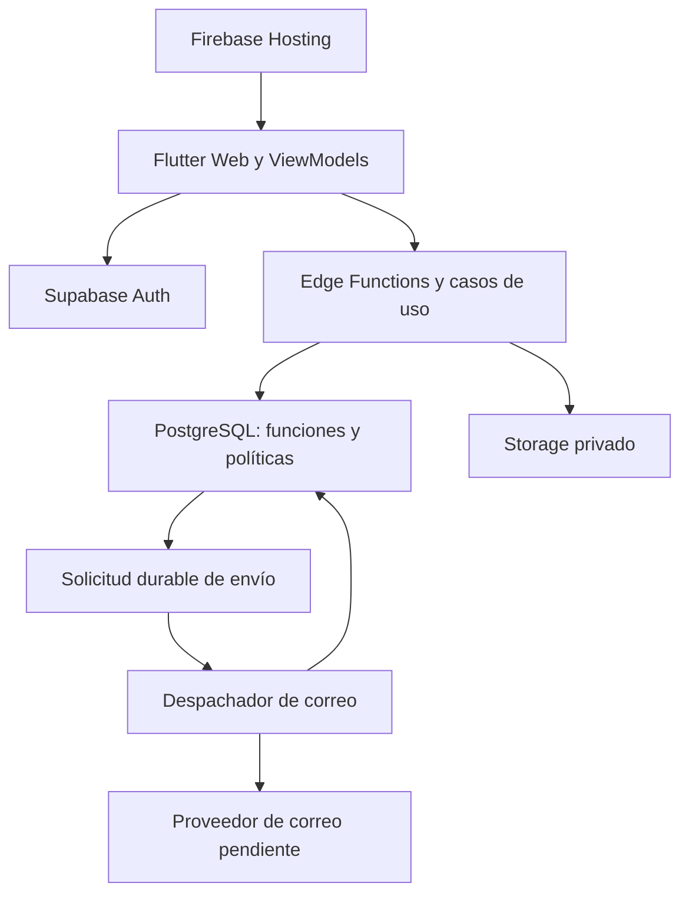
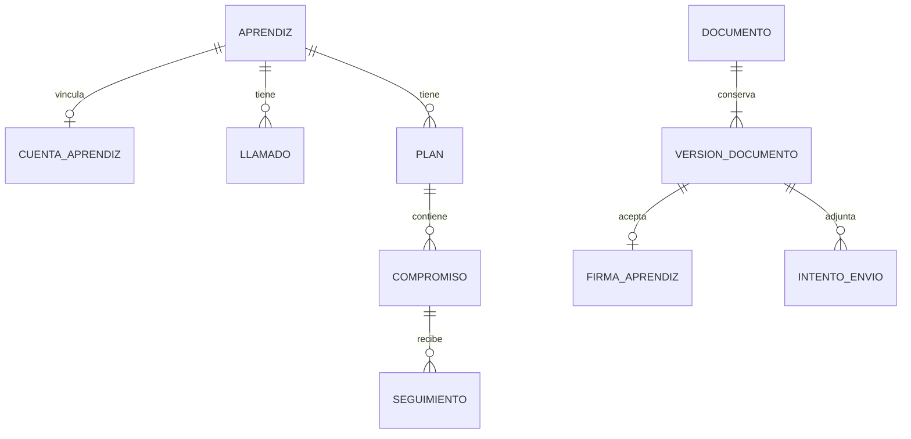

# TRAZA
## TRD — Technical Requirements Document

**Producto:** Sistema Integral de Gestión de Llamados de Atención y Seguimiento Académico  
**Nombre corto:** TRAZA  
**Versión del documento:** 1.0 
**Estado:** Aprobado
**Fecha de elaboración:** 28-10-2026  
**Fecha de consolidación:** 29-10-2026  
**Fecha de actualización:** 04-11-2026  
**Referencias:** PRD TRAZA v1.0 (21-10-2026); USER_FLOW TRAZA v1.0 (22-10-2026).  
**Plantilla utilizada:** `PLANTILLA_TRD(1).md`.

**Control de la consolidación.** Este documento integra los numerales 1 a 3 desarrollados en la conversación con los numerales 4 a 15 de `TRAZA_TRD_4_15_EN_REVISION.md`. Conserva los identificadores RT-001 a RT-022, RNFT-001 a RNFT-012, DT-001 a DT-016 y TEST-001 a TEST-021. La consolidación no constituye aprobación de las propuestas ni cierre de decisiones pendientes. La revisión cruzada documental se realizó el 04-11-2026; sus ajustes y dependencias se registran en este documento y en el informe de revisión.

**Interpretación de las decisiones.** El TRD v1.0 está aprobado como referencia técnica para el desarrollo de TRAZA. Las obligaciones funcionales derivan del PRD y del USER_FLOW; las resoluciones expresas de §14.1 determinan qué decisiones de diseño están resueltas y prevalecen sobre sus estados históricos de propuesta. La aprobación documental no aprueba por inferencia las propuestas aún pendientes ni acredita implementación, validación técnica o aceptación del producto. Los pendientes DT/DP y sus condiciones de resolución se mantienen identificados en §14 y deberán resolverse antes de implementar o aceptar los componentes afectados, según el hito indicado. Un pendiente no autoriza a inventar un comportamiento funcional. El numeral 4 concreta la base tecnológica de diseño de TRAZA: Flutter Web + Dart, Supabase Edge Functions con TypeScript y funciones SQL, Supabase, PostgreSQL y Firebase Hosting. Sus validaciones técnicas y condiciones operativas pendientes se conservan; no se trasladan decisiones de otros proyectos.

**Fuentes verificadas y ajustes de revisión.** PRD y USER_FLOW v1.0 fueron contrastados con el TRD. El 04-11-2026 se corrigieron las tablas del PRD, la identificación de versión del USER_FLOW, su flujo de correo, la fórmula de disponibilidad y las referencias de pruebas. Las reglas pendientes de producto y las validaciones técnicas continúan identificadas en §14. La cobertura documental no demuestra ejecución satisfactoria.

---

## 1. Introducción

### 1.1. Propósito del documento

Este Documento de Requisitos Técnicos (TRD) define las especificaciones técnicas necesarias para implementar y verificar el Producto Mínimo Viable (MVP) de TRAZA, de acuerdo con los requisitos funcionales, las reglas de negocio, los requisitos no funcionales y los criterios de aceptación establecidos en el PRD, y con los flujos de navegación e interacción descritos en el USER_FLOW.

Su propósito es traducir esas definiciones en decisiones y condiciones implementables sobre arquitectura, componentes, datos, seguridad, integridad documental, servicios externos, operación y pruebas. Cada especificación técnica deberá mantener una relación identificable con los requisitos y flujos que implementa, y establecer los medios para verificar su cumplimiento.

El TRD servirá como referencia para elaborar el PLAN, orientar el desarrollo asistido por inteligencia artificial mediante la metodología Spec Driven AI Development y evaluar la conformidad técnica del producto.

Las decisiones tecnológicas y los parámetros aún no aprobados deberán identificarse expresamente como propuestas o pendientes, junto con las condiciones necesarias para resolverlos antes de implementar los componentes afectados.

### 1.2. Alcance del documento

Este documento comprende la especificación técnica de la aplicación web TRAZA y de los servicios necesarios para implementar las nueve funcionalidades del MVP definidas en el PRD.

Su alcance incluye:

- **Arquitectura y componentes:** responsabilidades, relaciones y límites entre la interfaz de usuario, la lógica de aplicación, las reglas de dominio, la persistencia y los servicios de infraestructura.
- **Datos y persistencia:** entidades, relaciones, restricciones de integridad, almacenamiento de archivos, migraciones y conservación de información.
- **Identidad y autorización:** autenticación, autorregistro, recuperación de contraseña, sesiones y controles de acceso por rol, propiedad del registro y fichas de formación asociadas al instructor.
- **Operaciones y contratos:** entradas, salidas, validaciones, precondiciones, errores y controles de concurrencia y duplicación de las operaciones del sistema.
- **Gestión documental y firmas:** generación, almacenamiento, consulta, vinculación de la firma manuscrita con la versión exacta del documento, conservación del original y trazabilidad de las actuaciones y correcciones autorizadas.
- **Importación y comunicaciones:** procesamiento de archivos CSV y JSON, envío por correo electrónico del Formato de comunicación, registro de resultados y reintentos seguros.
- **Seguridad y operación:** protección de datos y secretos, auditoría, observabilidad, configuración de ambientes, despliegue, respaldo y recuperación.
- **Calidad y verificación:** pruebas funcionales y técnicas, seguridad, integridad, compatibilidad, accesibilidad y rendimiento, conforme a los criterios y parámetros aprobados.

El alcance funcional del producto se establece en el PRD. El TRD especifica los mecanismos técnicos para cumplirlo y deberá respetar las interacciones definidas en el USER_FLOW.

Las decisiones funcionales pendientes que condicionen el diseño técnico deberán conservarse identificadas como tales. Cualquier propuesta técnica que requiera modificar el alcance, los permisos o el comportamiento funcional deberá someterse al control de cambios y reflejarse en los documentos afectados antes de su implementación.

### 1.3. Audiencia objetivo

El documento está dirigido a los siguientes perfiles, cuyas responsabilidades podrán ser asumidas por una o varias personas según la organización del proyecto:

| Perfil | Uso del documento |
|---|---|
| Responsables del producto y validación funcional | Verificar que las especificaciones técnicas respeten el alcance, las reglas de negocio y los criterios de aceptación. |
| Arquitectura y liderazgo técnico | Definir y evaluar la arquitectura, las tecnologías, las dependencias y las decisiones técnicas. |
| Desarrollo | Implementar componentes, datos, contratos, validaciones y controles conforme a las especificaciones. |
| Pruebas y aseguramiento de calidad | Diseñar y ejecutar pruebas, comprobar la trazabilidad y reunir evidencias de cumplimiento. |
| Seguridad y privacidad | Evaluar la autorización, la protección de la información, la integridad documental y la auditoría. |
| Operación y despliegue | Configurar ambientes, supervisar el servicio y ejecutar procedimientos de despliegue, respaldo y recuperación. |

### 1.4. Referencias documentales

La elaboración y actualización del TRD se fundamentan en los siguientes documentos:

| Documento | Versión / fecha | Uso |
|---|---|---|
| PRD TRAZA | v1.0 / 21-10-2026. Estado: Aprobado; ajustes documentales 04-11-2026. | Define el alcance del MVP, los roles, los permisos, los requisitos funcionales, las reglas de negocio, los requisitos no funcionales y los criterios de aceptación. |
| USER_FLOW TRAZA | v1.0 / 22-10-2026. Estado: Aprobado; ajustes documentales 04-11-2026. | Describe las pantallas, la navegación, las interacciones, las validaciones visibles, los flujos alternativos, el manejo de errores y los escenarios de prueba. |

El PRD determina el alcance y el comportamiento funcional requerido; el USER_FLOW desarrolla su navegación e interacción; el TRD establece las especificaciones para su implementación técnica; y el PLAN organizará las actividades, dependencias y entregas necesarias para construir y verificar el producto.

Las discrepancias entre documentos deberán registrarse y resolverse con el responsable correspondiente antes de implementar el comportamiento afectado. Cuando su resolución modifique el alcance o el comportamiento funcional, deberá actualizarse primero el PRD y, posteriormente, los documentos relacionados.

Las referencias documentales y las relaciones de trazabilidad deberán mantenerse actualizadas cuando se aprueben nuevas versiones.

## 2. Alcance técnico de la solución

Este apartado define las capacidades técnicas necesarias para implementar el MVP de TRAZA, sus límites, restricciones, dependencias y principios de diseño. Se fundamenta en el PRD y el USER_FLOW, sin incorporar funcionalidades adicionales ni dar por aprobadas tecnologías o decisiones pendientes.

### 2.1. Capacidades técnicas requeridas

La solución deberá proporcionar las siguientes capacidades, mediante componentes y operaciones que permitan verificar su correspondencia con los requisitos funcionales:

| Capacidad técnica | Alcance requerido | Referencia funcional |
|---|---|---|
| **Autenticación y sesiones** | Permitir inicio y cierre de sesión, recuperación de contraseña y acceso mediante cuentas individuales. Validar la sesión en las operaciones protegidas. | RF-01 |
| **Autorregistro y vinculación de cuentas** | Permitir el autorregistro del aprendiz mediante correo electrónico, contraseña y número de identificación. Vincular la cuenta con el registro previamente importado cuando coincida la identificación, respetando las restricciones de unicidad del PRD. La importación no creará cuentas ni concederá acceso automáticamente. | RF-01 y RF-02 |
| **Importación de aprendices** | Procesar archivos CSV y JSON; validar estructura, campos obligatorios y duplicados; presentar la validación antes de confirmar; insertar registros válidos nuevos y generar el resultado de procesamiento con las razones de rechazo. Conservar la identificación como texto y exigir el número de ficha. | RF-02 |
| **Consulta y operaciones por alcance autorizado** | Restringir datos y operaciones según el rol, la propiedad del registro y las fichas previamente asociadas al instructor. Impedir el acceso del aprendiz a información de otros aprendices y a registros internos de seguimiento no autorizados. | RF-01 a RF-09, según la operación |
| **Gestión de llamados de atención** | Registrar, generar, conservar y consultar llamados asociados al aprendiz y al instructor responsable. Calcular su acumulación conforme a las reglas aprobadas, sin contabilizar las correcciones de un mismo llamado como actuaciones nuevas. | RF-03 y RF-09 |
| **Gestión de planes de mejoramiento** | Habilitar la generación manual del Plan 1 y del Plan 2 cuando se cumplan las condiciones correspondientes a dos y tres llamados acumulados. Conservar sus datos, compromisos y relaciones con las actuaciones de origen. | RF-04 |
| **Compromisos y seguimiento** | Registrar varios compromisos por plan y conservar las actuaciones de seguimiento, observaciones, evidencias y resultados asociados al compromiso, al plan y al instructor responsable, sin asignar estados formales ni determinar automáticamente incumplimientos. | RF-04, RF-05 y RF-09 |
| **Formato de comunicación al aprendiz** | Habilitar su generación manual cuando se cumpla la condición correspondiente a cuatro llamados acumulados. Conservar el documento y sus relaciones con el aprendiz y los antecedentes utilizados. | RF-06 |
| **Firma manuscrita y aceptación** | Mostrar el documento completo y permitir al aprendiz capturar, revisar y confirmar su firma desde una pantalla táctil. Vincularla con la versión exacta presentada y confirmar su registro únicamente después de comprobar su almacenamiento. Permitir al instructor registrar la observación por ausencia de firma conforme al PRD. | RF-08 |
| **Correo electrónico** | Permitir configurar el correo institucional de Coordinación Académica e iniciar automáticamente el envío del Formato de comunicación como adjunto después de su generación. Registrar intentos, resultados y fallos, y permitir reintentos sin generar otro documento. | RF-07 |
| **Historial e integridad documental** | Recuperar cronológicamente los documentos y las actuaciones autorizadas. Conservar originales, versiones, firmas, observaciones y registros de envío; vincular las correcciones y las anulaciones autorizadas sin sobrescribir ni eliminar físicamente los originales. | RF-09 |

Estas capacidades deberán contar con validación de datos, control de autorización, manejo de errores y confirmación de resultados. Las operaciones repetidas o interrumpidas no deberán producir duplicaciones ni presentar como completados resultados que no hayan sido confirmados.

Los contratos, las estructuras de datos, los mecanismos de almacenamiento y las pruebas se desarrollarán en los apartados correspondientes del TRD.

### 2.2. Límites y exclusiones técnicas

La implementación se limitará a las funcionalidades, los permisos y las reglas del MVP establecidos en el PRD y desarrollados en el USER_FLOW. La disponibilidad de una tecnología o servicio no autorizará capacidades adicionales.

Quedan fuera del alcance técnico del MVP:

- Funcionalidades de inteligencia artificial para consultar el Reglamento del SENA, analizar antecedentes o apoyar la elaboración de documentos.
- Firma biométrica mediante huella dactilar u otros mecanismos biométricos. La firma manuscrita capturada en pantalla táctil sí está incluida.
- Aplicación móvil nativa independiente. El acceso desde dispositivos móviles se realizará mediante la aplicación web.
- Integraciones con sistemas institucionales externos no aprobadas expresamente.
- Comunicaciones por WhatsApp, SMS u otros canales diferentes del correo electrónico previsto.
- Generación automática de planes de mejoramiento o del Formato de comunicación por alcanzar los umbrales de llamados. Su generación requerirá una decisión expresa del instructor.
- Estados formales de compromisos y determinación automática de su cumplimiento o incumplimiento.
- Determinación automática de faltas, calificaciones disciplinarias o sanciones.
- Comportamientos automáticos u opciones documentales adicionales para llamados posteriores al cuarto. Estos llamados se conservarán y podrán consultarse en el historial conforme a los permisos establecidos.
- Interfaces para administrar cuentas de instructores, roles, permisos o asociaciones entre instructores y fichas de formación.
- Autoguardado y borradores persistentes de formularios. No se garantiza recuperar información no guardada después de un cierre inesperado.

El envío automático del Formato de comunicación, una vez generado por el instructor, sí forma parte del MVP y deberá conservar la trazabilidad de sus intentos.

Las decisiones funcionales pendientes, incluidos los permisos de anulación y su efecto sobre el conteo y la disponibilidad documental, no deberán resolverse mediante supuestos técnicos. Toda ampliación requerirá una decisión documentada y la actualización de los artefactos afectados.

### 2.3. Restricciones técnicas y dependencias

El diseño deberá distinguir las condiciones confirmadas de las decisiones pendientes. Las propuestas tecnológicas y los parámetros sin aprobación no constituirán compromisos definitivos.

| Área | Condición confirmada | Definición pendiente |
|---|---|---|
| **Plataforma** | Aplicación web accesible desde equipos de escritorio y dispositivos móviles. | Base Flutter Web/Dart definida en §4; versiones y herramientas concretas pendientes. |
| **Navegadores y accesibilidad** | La interfaz deberá permitir ejecutar los flujos autorizados y presentar validaciones, errores y resultados comprensibles. | Navegadores, versiones, tamaños de pantalla, dispositivos y criterios específicos de accesibilidad para la matriz de pruebas. |
| **Pantallas táctiles** | La firma manuscrita se capturará mediante una pantalla táctil y se vinculará con la versión exacta del documento. | Dispositivos de referencia, mecanismo de captura y representación técnica de la firma. |
| **Importación** | Se admitirán CSV y JSON con los campos obligatorios del PRD. La identificación se conservará como texto. | Codificación, delimitadores, tamaño máximo, cantidad de registros y límites de procesamiento. |
| **Correo** | Se enviará el Formato de comunicación como adjunto al correo institucional configurado, conservando resultados y reintentos. | Proveedor, credenciales, límites, tiempos de espera y política técnica de reintentos. |
| **Almacenamiento** | Se conservarán datos, documentos, firmas, evidencias e historial con controles de acceso e integridad. | PostgreSQL y Supabase Storage definidos como base en §4; capacidad, formatos, límites, conservación y restauración pendientes. |
| **Autenticación** | Cuentas individuales, autorregistro contra registros importados y acceso restringido según el PRD. | Supabase Auth definido como base en §4; políticas y validación de sesiones pendientes. |
| **Red** | Las operaciones dependientes del servidor deberán confirmar su resultado. Las interrupciones se tratarán sin duplicar operaciones. | Condiciones de conectividad de referencia, tiempos de espera y mecanismos de consulta de resultados inciertos. |
| **Despliegue** | La configuración deberá permitir aplicar los controles de acceso y proteger la información y las credenciales. | Firebase Hosting y Supabase definidos como base en §4; ambientes, dominio, región, automatización y disponibilidad pendientes. |

La asociación instructor-ficha deberá configurarse previamente como parámetro operativo fuera de la interfaz funcional del MVP. Si no existe una asociación válida, el sistema denegará al instructor el acceso a los aprendices correspondientes.

Cada decisión pendiente deberá documentarse antes de implementar o validar el componente afectado. Las dependencias externas deberán evaluarse frente a las necesidades de seguridad, capacidad, disponibilidad y costo del producto.

### 2.4. Principios de diseño técnico

Los siguientes principios orientarán la arquitectura, la implementación y la verificación:

| Principio | Aplicación y verificación |
|---|---|
| **Mínimo privilegio** | Autorizar exclusivamente las operaciones y los datos previstos para cada rol y ámbito. Probar accesos permitidos y denegados, incluidos registros ajenos y fichas no asociadas. |
| **Seguridad por capas** | Distribuir los controles entre interfaz, servidor y persistencia según sus responsabilidades. Verificar que las solicitudes directas no permitan eludir las restricciones. |
| **Integridad documental** | Conservar los originales y vincular sus correcciones. Mantener cada firma asociada a la versión exacta firmada, sin trasladarla silenciosamente a otra versión. |
| **Trazabilidad** | Registrar responsable, fecha, referencia y resultado de las operaciones relevantes. Permitir reconstruir el historial autorizado de documentos, firmas, seguimientos y comunicaciones. |
| **Idempotencia** | Evitar duplicaciones ante solicitudes repetidas. Comprobar el resultado de operaciones inciertas antes de reintentarlas y conservar los intentos de envío de correo. |
| **Consistencia y concurrencia** | Preservar las relaciones entre datos ante fallos parciales y operaciones simultáneas. Evitar actuaciones incompletas, firmas sin documento y sobrescrituras inadvertidas. |
| **Modularidad** | Separar presentación, reglas de negocio, acceso a datos y servicios externos. Permitir probar las reglas sin depender de la navegación ni de un proveedor concreto. |
| **Aplicación de SOLID** | Aplicar los principios de responsabilidad única, abierto/cerrado, sustitución de Liskov, segregación de interfaces e inversión de dependencias en el diseño de clases, interfaces y componentes. Verificar que tengan responsabilidades delimitadas; que los puntos de extensión justificados permitan incorporar variantes sin modificar innecesariamente lógica estable; que las implementaciones respeten los contratos que sustituyen; que las interfaces no impongan operaciones innecesarias a sus consumidores; y que las reglas de negocio dependan de abstracciones frente a detalles de persistencia y servicios externos. Su aplicación deberá justificarse según las necesidades del sistema, evitando abstracciones sin propósito. |
| **Observabilidad con privacidad** | Registrar información suficiente para diagnosticar fallos y supervisar operaciones críticas, sin exponer contraseñas, secretos, imágenes de firmas ni contenido documental sensible en la telemetría. |
| **Ausencia de pérdida silenciosa de información** | Confirmar el guardado después de comprobar su persistencia, advertir sobre cambios sin guardar y comunicar errores o resultados inciertos. Este principio no implica autoguardado ni recuperación garantizada de datos no guardados. |
| **Trazabilidad de decisiones técnicas** | Relacionar componentes, contratos, datos y pruebas con los requisitos y flujos que implementan. Identificar propuestas y pendientes para evitar su incorporación como comportamientos aprobados por inferencia. |

El cumplimiento de estos principios deberá demostrarse mediante revisiones de diseño y código, pruebas y evidencias definidas en los apartados técnicos correspondientes.

## 3. Requisitos técnicos generales

Este apartado establece los requisitos técnicos necesarios para implementar y verificar el MVP de TRAZA, tomando como referencia el PRD v1.0 y el USER_FLOW v1.0.

Los requisitos describen comportamientos y condiciones verificables sin dar por aprobadas tecnologías, mecanismos o parámetros pendientes. Las decisiones de implementación se desarrollarán en los apartados de arquitectura, datos, seguridad, contratos, pruebas y operación.

### 3.1. Requisitos técnicos funcionales

Los requisitos identificados como **RT** expresan obligaciones técnicas derivadas de los requisitos funcionales y los flujos de interacción. Complementan sus criterios de aceptación sin sustituirlos.

La prioridad **Alta** se propone para los requisitos siguientes por su relación con capacidades obligatorias del MVP. Su secuencia de implementación se establecerá en el PLAN según las dependencias.

| ID | Requisito técnico | Origen (PRD/USER_FLOW) | Prioridad | Criterio verificable |
|---|---|---|---|---|
| RT-001 | Al iniciar sesión, validar las credenciales y la habilitación de la cuenta antes de permitir operaciones protegidas. | RF-01, CA-01.1 a CA-01.3; flujo 7.1. | Alta | Una cuenta habilitada con credenciales válidas accede; los demás casos se rechazan sin revelar información sensible. |
| RT-002 | Al cerrar sesión, finalizar el acceso autenticado e impedir que la navegación atrás permita consultar información protegida sin una sesión válida. | RF-01, CA-01.4; USER_FLOW §13. | Alta | Después del cierre, las vistas y operaciones protegidas requieren una nueva autenticación. |
| RT-003 | Durante el autorregistro, vincular la cuenta exclusivamente con un aprendiz previamente importado cuya identificación coincida, evitando vinculaciones duplicadas. | RF-01, CA-01.5 a CA-01.8; flujo 7.1. | Alta | Las identificaciones inexistentes o ya vinculadas impiden completar el registro; un registro exitoso conserva la asociación correcta. |
| RT-004 | Proporcionar recuperación de contraseña mediante el mecanismo de autenticación seleccionado, sin revelar credenciales. | RF-01, CA-01.9; UI-03. | Alta | El procedimiento permite restablecer el acceso conforme a sus validaciones, sin mostrar ni registrar contraseñas. |
| RT-005 | Autorizar cada consulta y modificación según sesión, rol, propiedad del registro y fichas asociadas al instructor, independientemente de la interfaz. | RF-01, CA-01.10 a CA-01.12; RNT-01. | Alta | Las solicitudes directas sobre datos no autorizados se rechazan sin exponer información ni ejecutar modificaciones parciales. |
| RT-006 | Antes de confirmar una importación CSV o JSON, validar estructura, campos obligatorios y duplicados, y presentar los resultados. | RF-02, CA-02.1 a CA-02.6; flujo 7.2. | Alta | Los errores se identifican con su causa y la incorporación requiere confirmación explícita. |
| RT-007 | Al confirmar la importación, incorporar registros válidos nuevos, conservar la identificación como texto y presentar el resultado, sin crear cuentas automáticamente. | RF-02, CA-02.4 a CA-02.10. | Alta | No se insertan identificaciones duplicadas; se conserva su representación y se informa qué registros se incorporaron o rechazaron. |
| RT-008 | Al guardar un llamado, validar sus campos obligatorios y conservar la actuación y el documento vinculados al aprendiz y al instructor responsable. | RF-03, CA-03.1 a CA-03.6; flujo 7.3. | Alta | El registro confirmado puede recuperarse mediante consulta autorizada con sus datos y asociaciones. |
| RT-009 | Calcular los llamados acumulados por aprendiz sin límite temporal y sin contar las correcciones del mismo llamado como llamados adicionales. | RF-03, CA-03.7 y CA-03.11; RNT-03; USER_FLOW §8.1. | Alta | El conteo incluye llamados separados en el tiempo y no aumenta por una corrección documental. |
| RT-010 | Validar las condiciones para ofrecer Plan 1, Plan 2 y Formato de comunicación, correspondientes a dos, tres y cuatro llamados acumulados, y exigir decisión expresa del instructor para generarlos. | RF-04, CA-04.1 a CA-04.3; RF-06, CA-06.1 y CA-06.2; USER_FLOW §8.2. | Alta | Alcanzar un umbral no crea documentos; las solicitudes de generación validan autorización y condiciones de negocio en el servidor. |
| RT-011 | Al generar un plan, conservar sus campos institucionales, compromisos y relaciones con el aprendiz y los antecedentes. | RF-04, CA-04.4 a CA-04.7; flujo 7.4. | Alta | Se recupera el documento completo con varios compromisos, fechas y responsables cuando corresponda. |
| RT-012 | Conservar cada actuación de seguimiento vinculada al compromiso, plan e instructor, sin sobrescribir antecedentes ni asignar estados formales al compromiso. | RF-05; USER_FLOW §7.5 y §8.4. | Alta | Las actuaciones se consultan cronológicamente; el aprendiz no accede al seguimiento interno y el sistema no decide incumplimientos. |
| RT-013 | Al generar el Formato de comunicación, conservar sus campos y antecedentes e iniciar inmediatamente el envío automático, sin confirmación adicional de envío. | RF-06; CA-07.3; flujo 7.6. | Alta | La generación inicia el flujo de envío; un fallo del correo no elimina ni obliga a regenerar el documento. |
| RT-014 | Permitir configurar una dirección institucional con formato admisible y conservar el destinatario utilizado en cada intento. | RF-07, CA-07.1, CA-07.2 y CA-07.11; UI-16. | Alta | Una dirección inválida no se utiliza; tras corregirla, el reintento emplea la vigente y conserva los destinatarios anteriores en el historial. |
| RT-015 | Enviar el Formato de comunicación como adjunto y registrar documento, destinatario, fecha, hora y resultado de cada intento. | RF-07, CA-07.4 a CA-07.10; flujo 7.7. | Alta | Los fallos son consultables y los reintentos reutilizan el documento. El éxito informado por el servicio no se presenta como confirmación de recepción o lectura. |
| RT-016 | Antes de firmar, mostrar el documento completo, explicar la acción y permitir capturar, borrar y repetir el trazo antes de la confirmación expresa. | RF-08, CA-08.1 a CA-08.5; flujo 7.8. | Alta | El aprendiz revisa el documento y puede rehacer el trazo; sin confirmación no se registra aceptación. |
| RT-017 | Al confirmar una firma, vincularla con el aprendiz, documento, versión exacta presentada, fecha y hora; confirmar el éxito después del almacenamiento. | RF-08, CA-08.6 a CA-08.11; USER_FLOW §9. | Alta | La firma recuperada corresponde a la versión visualizada; un fallo de almacenamiento no presenta el documento como firmado. |
| RT-018 | Permitir al instructor autorizado registrar una observación por ausencia de firma con texto, responsable, fecha, hora y referencia documental, bajo las condiciones del PRD. | RF-08, CA-08.12; UI-14; USER_FLOW §9.3. | Alta | La observación queda asociada al documento sin convertirla en aceptación ni habilitar al aprendiz una acción independiente de negativa. |
| RT-019 | Después de guardar, tramitar correcciones mediante nueva versión o documento correctivo vinculado, conservando el original y la firma que le corresponda. | RF-03, RF-04 y RF-09; USER_FLOW §9.4 y PF-32/PF-34. | Alta | Se consultan original y corrección con su relación; la firma original no se traslada como aceptación de la nueva versión. |
| RT-020 | Ante solicitudes repetidas o resultados inciertos, comprobar la operación previa antes de repetir sus efectos. | CA-03.9; CA-07.7; RNT-11; USER_FLOW §11.3. | Alta | Los reintentos no generan llamados, documentos ni actuaciones duplicados por una misma operación. |
| RT-021 | Exigir guardado explícito y advertir al abandonar formularios con cambios sin guardar, permitiendo regresar o descartarlos. | USER_FLOW §11.1 y §11.4; DP-03 y DP-04. | Alta | Cancelar antes de guardar no crea registros definitivos; los registros guardados se consultan desde el historial. |
| RT-022 | Proporcionar un historial autorizado que relacione actuaciones, documentos, versiones, firmas, observaciones y envíos. | RF-09; flujo 7.9. | Alta | Se reconstruye la secuencia documental y se consultan llamados posteriores al cuarto sin habilitar opciones adicionales no aprobadas. |

La implementación del tratamiento completo de anulaciones dependerá de la aprobación de sus permisos y efectos sobre el conteo y la disponibilidad documental. Estos comportamientos no se inferirán de RT-009 ni RT-019.

### 3.2. Requisitos no funcionales

Los requisitos **RNFT** concretan las condiciones de calidad del PRD. Sus evidencias deberán identificar ambiente, datos, procedimiento, resultado esperado y resultado obtenido.

**Base definida** indica una obligación derivada de los documentos de referencia. **Parámetro pendiente** identifica valores, mecanismos o condiciones de evaluación que requieren definición o aprobación.

| ID | Atributo | Requisito/umbral | Verificación | Estado |
|---|---|---|---|---|
| RNFT-001 | Rendimiento habitual | Propuesta inicial: respuesta máxima de 2 segundos para al menos el 95 % de las solicitudes habituales. Aprobar objetivo, concurrencia, volumen de datos y alcance de medición. Origen: RNF-01. | Pruebas de carga sobre autenticación, consultas, registro de llamados y seguimientos. | Objetivo y condiciones pendientes de aprobación. |
| RNFT-002 | Rendimiento de operaciones especiales | Definir tiempos objetivo para importación, generación documental, firmas y correo, distinguiendo procesamiento propio y servicios externos. Origen: RNF-01. | Medición por operación y dependencia con volúmenes documentados. | Parámetros pendientes. |
| RNFT-003 | Seguridad y autorización | Rechazar los accesos y modificaciones no autorizados contemplados en la matriz de pruebas. Origen: RNF-02. | Pruebas positivas y negativas por rol, propiedad y ficha, incluidas solicitudes directas. | Base definida; matriz detallada pendiente. |
| RNFT-004 | Privacidad y secretos | Impedir exposición de datos a usuarios no autorizados y de credenciales o secretos en cliente, repositorio y registros. Definir conservación y acceso. Origen: RNF-02. | Inspección de código, configuración, respuestas y registros; pruebas de acceso. | Base definida; políticas y periodos pendientes. |
| RNFT-005 | Integridad y auditoría | Conservar originales, relaciones y firmas por versión; registrar responsable, fecha, operación y registro afectado en los eventos exigidos. Origen: RNF-03. | Intentos de sobrescritura, comparación de versiones y reconstrucción de eventos. | Base definida; mecanismos y catálogo técnico pendientes. |
| RNFT-006 | Disponibilidad | Definir porcentaje objetivo, ventana de medición, dependencias supervisadas y tratamiento de mantenimientos. Origen: RNF-04. | Medición del servicio y pruebas de fallo de dependencias. | Parámetros pendientes. |
| RNFT-007 | Respaldo y recuperación | Disponer de respaldo y restauración verificables de datos y archivos relacionados. Definir frecuencia, retención, pérdida de datos tolerable —RPO— y tiempo de recuperación —RTO—. Origen: RNF-04. | Restauración documentada y comprobación de documentos, firmas y relaciones recuperadas. | Base definida; parámetros y procedimiento pendientes. |
| RNFT-008 | Compatibilidad | Completar los flujos aplicables en la matriz aprobada de navegadores, versiones, pantallas y dispositivos, incluida la firma táctil. Origen: RNF-05. | Ejecución de escenarios en cada combinación requerida. | Matriz pendiente. |
| RNFT-009 | Accesibilidad y usabilidad | Establecer criterios verificables para tareas principales, lectura documental, formularios, confirmaciones y mensajes. Origen: RNF-05 y USER_FLOW §12. | Inspección, herramientas y pruebas de tareas conforme a los criterios seleccionados. | Criterios, nivel y alcance pendientes. |
| RNFT-010 | Confiabilidad | En los escenarios de fallo definidos, evitar confirmaciones incorrectas, duplicaciones por reintento y pérdida documental por fallos del correo. Origen: RNF-06. | Simulación de interrupciones, fallos de almacenamiento y respuestas inciertas. | Base definida; política técnica de reintentos pendiente. |
| RNFT-011 | Mantenibilidad | Versionar código y configuración no sensible; documentar configuración, ejecución, pruebas y despliegue; verificar reglas críticas mediante pruebas reproducibles. Origen: RNF-07. | Revisión del repositorio y ejecución de instrucciones y pruebas documentadas. | Base definida; herramientas y alcance automatizado pendientes. |
| RNFT-012 | Observabilidad | Permitir diagnosticar fallos y seguir operaciones críticas sin registrar secretos ni contenido sensible innecesario. Definir eventos, correlación, métricas, retención y alertas. Origen: RNF-03, RNF-04 y RNF-06. | Provocar fallos y comprobar su identificación y seguimiento mediante registros protegidos. | Capacidad derivada; diseño y parámetros pendientes. |

Los requisitos con parámetros pendientes no podrán declararse verificados respecto de dichos parámetros. Las condiciones ya comprobables se evaluarán y registrarán por separado.

Los objetivos técnicos de esta sección deberán distinguirse de los indicadores de éxito del producto: una meta de adopción o digitalización no constituye, por sí misma, un umbral de aceptación técnica.

### 3.3. Restricciones y estándares técnicos

Cada estándar, convención o práctica deberá identificar su fuente, versión y estado. Las menciones incluidas en plantillas y ejemplos no constituirán decisiones tecnológicas aprobadas.

| Tema | Restricción o convención | Fuente / versión y estado |
|---|---|---|
| Referencia funcional | Respetar alcance, permisos, reglas y flujos de los documentos de referencia. | PRD TRAZA v1.0 y USER_FLOW TRAZA v1.0. |
| Identificadores | Utilizar identificadores estables RT y RNFT conforme al numeral 3.4. | Convención propuesta en este TRD v1.0. |
| Importación | Admitir CSV y JSON con `id`, `nombre_completo` y `numero_ficha`; conservar `id` como texto. | PRD v1.0, RF-02. Codificación, delimitadores y límites pendientes. |
| Planes de mejoramiento | Implementar los campos y la estructura institucional aplicables. | PRD v1.0, RF-04: GOR-F-084 V02. Copia institucional de referencia por validar antes de implementar la plantilla. |
| Formato de comunicación | Implementar los campos institucionales aplicables. | PRD v1.0, RF-06: GD-F-011. Versión y copia institucional de referencia por validar. |
| Llamado de atención | Utilizar el formato institucional definido para esta actuación. | PRD v1.0, RF-03. Código, versión y copia de referencia por precisar. |
| Privacidad | Aplicar controles y conservación conforme a políticas institucionales y disposiciones aplicables. | PRD v1.0, RNF-02 y RNT-10. Referencias específicas y versiones pendientes de identificación y validación. |
| Accesibilidad | Identificar estándar, versión, nivel y método de evaluación antes de afirmar cumplimiento. | PRD v1.0, RNF-05; USER_FLOW §12. Selección pendiente. |
| Contratos y codificación | Documentar nombres, tipos, obligatoriedad, representación de fechas, zonas horarias, errores y compatibilidad. | Convenciones pendientes de definición en los contratos y el modelo de datos. |
| Diseño y SOLID | Aplicar los principios del numeral 2.4 y justificar sus consecuencias en clases, interfaces, componentes y dependencias. | TRD v1.0, §2.4. Propuesta de aplicación concreta en §4, pendiente de aprobación. |
| Patrones de arquitectura y diseño | Seleccionar patrones según necesidades identificadas y documentar propósito, alcance, dependencias y verificación. | Propuestas documentadas en §4; ningún patrón específico queda aprobado por su inclusión en este apartado. |
| Código y dependencias | Versionar cambios y documentar dependencias; definir formato, análisis y revisión según el stack aprobado. | PRD v1.0, RNF-07. Herramientas y reglas específicas pendientes. |
| Protección del transporte | Definir mecanismos para proteger credenciales y datos durante la comunicación entre componentes. | Derivado de RNF-02. Protocolos, versiones y configuración pendientes de selección técnica. |

Las referencias y decisiones pendientes deberán resolverse antes de implementar o aceptar los componentes que dependan de ellas. No se afirmará cumplimiento de un estándar sin criterios identificados y evidencia de evaluación.

### 3.4. Especificación y verificabilidad de requisitos

**Identificación y estabilidad**

- `RT-NNN` identifica requisitos técnicos funcionales.
- `RNFT-NNN` identifica requisitos técnicos no funcionales.
- La numeración será consecutiva dentro de cada categoría.
- Los identificadores no se reutilizarán para requisitos diferentes.
- Los requisitos retirados conservarán su identificador, motivo y referencia de sustitución cuando corresponda.
- Las divisiones o sustituciones deberán mantener vínculos entre los requisitos originales y los nuevos.

**Contenido mínimo**

Cada requisito deberá identificar:

- Condición o evento de aplicación.
- Comportamiento o restricción exigida.
- Resultado observable.
- Fuente documental y versión.
- Prioridad y estado.
- Dependencias y decisiones pendientes.
- Criterios de aceptación y pruebas relacionadas.

Las tablas podrán contener una síntesis. Los detalles se desarrollarán en contratos, diseños o casos de prueba vinculados al identificador correspondiente.

**Prioridad**

| Prioridad | Significado |
|---|---|
| Alta | Necesario para una capacidad obligatoria del MVP o para proteger autorización, integridad o continuidad de una operación crítica. |
| Media | Puede implementarse después de otras capacidades sin impedir su desarrollo, pero debe cumplirse antes de aceptar la entrega a la que pertenece. |
| Baja | Menor urgencia dentro del alcance aprobado; su ejecución se planifica según dependencias y entrega comprometida. |

La prioridad no modifica el alcance ni permite omitir obligaciones. Tampoco equivale a aprobación.

**Estado y dependencias**

Los requisitos propuestos, aprobados, modificados o retirados deberán distinguirse mediante un registro de control. Los parámetros pendientes se identificarán separadamente, indicando la decisión necesaria y el componente afectado.

No se considerará aprobado un requisito técnico únicamente por estar redactado en el TRD. Su estado dependerá del proceso de revisión y aprobación del documento; las resoluciones expresas de diseño se registran en §14.1.

**Criterios verificables**

Los criterios deberán describir condiciones y resultados comprobables. Se evitarán adjetivos como «rápido», «seguro» o «intuitivo» sin una métrica, conducta o evidencia asociada.

Los valores numéricos deberán especificar unidad, operación medida, condiciones, población o muestra y método de medición. Los valores propuestos permanecerán identificados como pendientes hasta su aprobación.

Cuando una condición no pueda expresarse numéricamente, se utilizarán verificaciones observables, como denegar una solicitud no autorizada, conservar un original o impedir una duplicación.

**Relación con pruebas y evidencias**

Cada requisito deberá relacionarse con una o más pruebas o inspecciones. Una prueba podrá cubrir varios requisitos si distingue el resultado esperado para cada uno.

La evidencia registrará, como mínimo:

- Identificador del requisito y del caso de prueba.
- Versión del sistema y ambiente.
- Condiciones iniciales y datos utilizados.
- Resultado esperado y obtenido.
- Estado de ejecución y defectos encontrados.

La trazabilidad deberá permitir relacionar:

**PRD / USER_FLOW → requisito técnico → componente o contrato → prueba → evidencia.**

Las dependencias sin resolver deberán señalar qué implementación o verificación queda bloqueada. Las discrepancias se resolverán mediante el control de cambios, sin convertir interpretaciones técnicas en reglas funcionales aprobadas.

## 4. Arquitectura del sistema

### 4.1. Estilo y estructura arquitectónica

La propuesta arquitectónica de TRAZA se concreta en una **aplicación web modular por capas**, con **Flutter Web + Dart** para la interfaz y **Supabase** como plataforma administrada de backend. Las operaciones de servidor se implementarán mediante **Edge Functions con TypeScript** y **funciones SQL en PostgreSQL**; los archivos de la aplicación web se publicarán en **Firebase Hosting**.

Esta combinación constituye la base tecnológica propuesta para desarrollar el diseño del MVP. Su incorporación al TRD no acredita la implementación, la superación de las pruebas pendientes ni la contratación o configuración de servicios. Las versiones y parámetros operativos deberán fijarse antes de implementar los componentes afectados.

La organización lógica del código y la topología de despliegue se describen por separado: los módulos compartirán contratos y reglas, mientras su ejecución se distribuirá entre navegador, funciones de servidor, PostgreSQL y almacenamiento. La denominación anterior de «monolito modular» como unidad única de despliegue se sustituye por esta organización modular sobre servicios administrados y funciones serverless.

**Capas y responsabilidades**

| Capa | Responsabilidad | Implementación propuesta |
|---|---|---|
| Presentación | Pantallas, navegación, formularios, consulta documental, captura táctil y estados de interfaz. | Widgets de Flutter Web. |
| Aplicación en cliente | Coordinar tareas de interfaz, estados de carga/error y solicitudes a servicios. No decide permisos ni resultados persistentes de forma autoritativa. | ViewModels y casos de uso en Dart, cuando su complejidad lo justifique. |
| Aplicación en servidor | Verificar identidad y ámbito, validar solicitudes y coordinar documentos, archivos, correo y operaciones idempotentes. | Módulos TypeScript invocados mediante Supabase Edge Functions. |
| Dominio e integridad | Aplicar las reglas de acumulación, disponibilidad documental, versiones, aceptación e integridad. | Reglas de aplicación y funciones/restricciones PostgreSQL para las garantías que deben ser atómicas. |
| Infraestructura | Resolver identidad, acceso a datos, almacenamiento privado y servicios externos. | Supabase Auth, PostgreSQL, Supabase Storage y adaptadores de integración. |

La autoridad de cada regla se documentará una sola vez: las validaciones de Dart mejoran la interacción, pero la decisión definitiva reside en servidor y persistencia. No se mantendrán implementaciones divergentes de las reglas de negocio en ambos lenguajes.

Los módulos funcionales serán identidad y acceso; aprendices e importación; llamados; planes y seguimientos; documentos y firmas; comunicaciones; auditoría y operación. Su existencia no amplía los roles ni las funcionalidades del MVP.

**Patrones arquitectónicos y de diseño propuestos**

| Patrón o criterio | Aplicación en TRAZA | Verificación |
|---|---|---|
| Arquitectura modular por capas | Separar presentación, coordinación de aplicación, reglas e infraestructura en cliente y servidor. | Revisar límites y dependencias, evitando lógica transaccional en widgets. |
| MVVM en presentación | La View muestra datos y recoge acciones; el ViewModel expone estado y comandos de la pantalla y delega en contratos de aplicación/datos. No obliga a crear un ViewModel por cada widget. | Probar cambios de estado y acciones sin depender del renderizado ni de servicios reales. |
| Repository | Abstraer consultas y operaciones de persistencia mediante interfaces orientadas a casos de uso. | Sustituir implementaciones en pruebas sin permitir escrituras genéricas que omitan autorización o versionamiento. |
| Adapter | Encapsular las llamadas al cliente Supabase, Storage, generador documental y proveedor de correo. | Probar éxito, fallo e incertidumbre con implementaciones controladas. |
| Inyección de dependencias | Entregar a los consumidores las implementaciones de los contratos que requieren. | Evitar creación dispersa de clientes y permitir pruebas aisladas; biblioteca concreta pendiente. |
| Outbox transaccional | Conservar en PostgreSQL una solicitud durable de envío junto con la comunicación que la origina. | Recuperar la solicitud tras una caída sin regenerar la comunicación. |

MVC no se incorpora como patrón de presentación de esta propuesta: se propone explícitamente MVVM para Flutter. MVVM, Repository y Adapter no son tecnologías ni reemplazan los controles de autorización. La biblioteca de gestión de estado se seleccionará según estos contratos, sin introducir Riverpod, BLoC u otra dependencia por inferencia.

**Aplicación de SOLID**

- **Responsabilidad única:** separar visualización, generación documental, firma, persistencia y correo.
- **Abierto/cerrado:** encapsular variantes justificadas de plantilla o proveedor mediante contratos estables, sin construir extensiones innecesarias.
- **Sustitución de Liskov:** las implementaciones alternativas respetarán precondiciones, resultados y errores de sus interfaces.
- **Segregación de interfaces:** ofrecer contratos específicos de consulta, firma, documentos y comunicaciones, evitando interfaces que concedan capacidades innecesarias.
- **Inversión de dependencias:** las reglas de aplicación dependerán de abstracciones frente a servicios externos. La lógica transaccional específica de PostgreSQL quedará delimitada y documentada como dependencia técnica consciente.

Su cumplimiento se verificará mediante revisión de dependencias, pruebas de ViewModels/casos de uso y pruebas contractuales e integración; no se considerará demostrado únicamente por utilizar interfaces.

### 4.2. Componentes y responsabilidades

| Componente | Responsabilidad | Datos procesados | Dependencias | Requisitos |
|---|---|---|---|---|
| Cliente Flutter Web | Interfaz adaptable, documentos, formularios, historial y captura de firma. | Proyecciones autorizadas y trazos temporales. | ViewModels, repositorios y sesión. | RT-001 a RT-022 según flujo. |
| ViewModels y aplicación Dart | Exponer estados y comandos y coordinar solicitudes; gestionar confirmaciones y resultados inciertos en la interfaz. | Entradas de formularios y respuestas tipadas. | Contratos de casos de uso/repositorios. | RT-016, RT-020 y RT-021, entre otros. |
| Supabase Auth | Gestionar credenciales y sesiones; proporcionar identidad verificable. El vínculo con el aprendiz importado se controla en la aplicación de servidor. | Identidad, sesión y referencias de cuenta. | Configuración de Auth y datos de dominio. | RT-001 a RT-004. |
| Edge Functions | Entradas protegidas a casos de uso, autorización, coordinación de archivos, documentos e integraciones. | Solicitudes validadas e identidad verificada. | Auth, funciones SQL, Storage y adaptadores. | RT-005 a RT-020 según operación. |
| PostgreSQL y funciones SQL | Conservar relaciones, aplicar restricciones y ejecutar cambios atómicos de negocio, auditoría y registro idempotente. | Aprendices, fichas, actuaciones, versiones, firmas y operaciones. | Esquema, privilegios y políticas. | RT-003, RT-007 a RT-020, RT-022; RNFT-003 y RNFT-005. |
| Supabase Storage | Almacenar documentos, evidencias y firmas en contenedores privados. | Archivos y metadatos vinculados. | Políticas y autorización por recurso. | RT-013, RT-017 y RT-019; RNFT-004 y RNFT-005. |
| Servicio documental | Generar una representación reproducible desde datos y plantilla identificados. | Contenido congelado y versión documental. | Renderizador por seleccionar y Storage. | RT-008, RT-011, RT-013 y RT-019. |
| Despachador de comunicaciones | Consumir solicitudes durables, enviar el adjunto y conservar resultados e intentos. | Comunicación, destinatario y referencia de proveedor. | PostgreSQL, Edge Functions y proveedor de correo pendiente. | RT-013 a RT-015 y RT-020. |
| Auditoría y diagnóstico | Separar eventos de negocio de telemetría y correlacionar operaciones sin exposición innecesaria. | Actor, recurso, versión, operación y resultado. | PostgreSQL y mecanismos de supervisión. | RNFT-005 y RNFT-012. |
| Firebase Hosting | Servir los archivos compilados de Flutter Web mediante HTTPS y CDN. No ejecuta reglas de negocio ni determina permisos sobre documentos. | Artefactos públicos del frontend. | Compilación y configuración de despliegue. | RNFT-006 y RNFT-008, dentro de su alcance. |

### 4.3. Interacciones y comunicación entre componentes

Las comunicaciones entre navegador y servicios se realizarán por conexiones protegidas. Las operaciones de datos de la aplicación se canalizarán inicialmente por los contratos de Edge Functions; el acceso directo del cliente a tablas o archivos no se habilitará por defecto. Cualquier lectura directa posterior requerirá un contrato y políticas equivalentes probados. El frontend no recibirá credenciales privilegiadas.

**Autenticación y acceso.** Flutter inicia sesión mediante Supabase Auth y transmite la credencial de sesión según el contrato del servicio. Cada operación protegida verifica identidad, habilitación, rol y alcance. El autorregistro conserva la coincidencia con un aprendiz importado y no permite concederse rol Instructor. Si crear identidad y vincularla requiere pasos separados, se controlarán fallos parciales y reintentos antes de habilitar acceso documental.

**Consultas.** La Edge Function verifica autorización y obtiene una proyección permitida, paginada cuando corresponda. La consulta de documentos y archivos repite los controles por propietario, ficha y versión. No se envían seguimientos internos para ocultarlos únicamente en Flutter.

**Escrituras críticas.** La función de servidor valida la solicitud y llama a una función SQL que ejecuta conjuntamente los cambios relacionales que deban ser atómicos. Varias llamadas HTTP sucesivas no se considerarán una sola transacción. Se aplicarán claves idempotentes y comprobación de versión esperada.

**Documentos y firmas.** Se prepara y verifica el objeto privado y después se confirma su relación con la actuación, versión y evidencia. Storage no comparte una transacción única con PostgreSQL: deberán existir conciliación y limpieza controlada de objetos temporales. Solo se confirma éxito cuando el resultado completo está comprobado; la firma permanece vinculada a la versión exacta presentada.

**Comunicación.** La confirmación de la comunicación registra su solicitud de envío durable en la misma transacción relacional y activa inmediatamente el primer intento, sin confirmación adicional del instructor. El despachador usa el documento conservado y registra cada resultado. El mecanismo de ejecución/recuperación deberá soportar caídas y límites del entorno, y continúa pendiente de validación en DT-005. Una tarea en memoria o una ejecución en segundo plano sin registro durable no satisface esta condición.

### 4.4. Tecnologías y herramientas

| Elemento | Tecnología propuesta | Uso | Justificación / criterio | Estado |
|---|---|---|---|---|
| Frontend | Flutter Web + Dart. | Formularios, navegación por rol, documentos, historial y firma táctil. | Propuesta indicada por el responsable del producto; interfaz adaptable y separación de presentación/aplicación. | Base propuesta concretada; validación final pendiente, DT-002/007/015. |
| Backend | Supabase Edge Functions con TypeScript y funciones SQL de PostgreSQL. | Operaciones protegidas, coordinación y cambios transaccionales. | Separar ejecución de servicios externos de garantías atómicas de persistencia. | Base propuesta concretada; implementación y pruebas pendientes, DT-001/002/008. |
| BaaS | Supabase. | Base de datos administrada, identidad, archivos y funciones de servidor. | Concentrar infraestructura de backend manteniendo controles explícitos de dominio y seguridad. | Propuesto; configuración y condiciones operativas pendientes. |
| SGBD | PostgreSQL administrado por Supabase. | Relaciones, restricciones, versiones, auditoría y registro idempotente. | Modelo relacional y operaciones SQL transaccionales. | Motor propuesto concretado; versión y esquema pendientes, DT-003. |
| Identidad | Supabase Auth. | Inicio/cierre de sesión, autorregistro y recuperación. | Integración con backend y vínculo controlado al aprendiz importado. | Propuesto; políticas, sesiones y prueba real pendientes, DT-004. |
| Archivos | Supabase Storage con contenedores privados. | Documentos, firmas y evidencias. | Acceso por recurso y conservación de archivos vinculados. | Propuesto; políticas, límites y respaldo pendientes, DT-003/011. |
| Alojamiento del frontend | Firebase Hosting. | Publicación de archivos compilados de Flutter Web mediante HTTPS y CDN. | Separar entrega del cliente de los servicios de backend. | Propuesto; proyecto, ambientes y configuración pendientes, DT-010. |
| Correo | Proveedor externo por seleccionar, integrado desde servidor. | Envío del Formato de comunicación como adjunto. | Debe permitir registrar intentos y conciliar resultados inciertos. | Pendiente, DT-005. Supabase Auth no sustituye este flujo documental. |
| Documentos | Generación PDF propuesta; biblioteca y lugar de ejecución por validar. | Representación estable conforme a formatos institucionales. | Fidelidad, conservación y ejecución dentro de límites comprobados. | Pendiente, DT-006. |
| Pruebas y entrega | Herramientas compatibles con Dart/Flutter, TypeScript y PostgreSQL. | Pruebas de interfaz, API, SQL, autorización y despliegue. | Evidencia reproducible de los requisitos. | Herramientas y pipeline pendientes, DT-012. |

No se fijan versiones ni planes comerciales por inferencia. Se seleccionarán versiones compatibles y soportadas, se registrarán en archivos de dependencias y migraciones y se comprobarán las condiciones vigentes de los servicios antes de contratar o desplegar.

**Validación pendiente del frontend.** La prueba preliminar de Flutter realizada en laboratorio no acredita la firma táctil completa, accesibilidad integral ni integración Supabase. La incidencia táctil continúa abierta; esta propuesta no la presenta como resuelta. Deben ejecutarse pruebas con los dispositivos objetivo, lectores de pantalla, plantillas institucionales y servicios reales de prueba antes de aceptar el componente.

### 4.5. Justificación de decisiones arquitectónicas

**Flutter Web + Dart.** Se adopta como base propuesta por indicación del responsable del producto. Su aplicación se evaluará frente a formularios, lectura completa, firma táctil, estados de interfaz y compatibilidad. La posibilidad de compartir tecnología con plataformas nativas no amplía el alcance: el MVP seguirá siendo web. El beneficio esperado es una interfaz y lógica de presentación organizadas en Dart; el compromiso es verificar específicamente comportamiento de navegador, accesibilidad y documentos.

**MVVM, modularidad y SOLID.** Se propone MVVM para delimitar la vista y el estado/comandos de presentación, y Repository/Adapter para aislar infraestructura. Las dependencias deben aportar capacidad de prueba y sustitución, no complejidad sin propósito. La elección de gestión de estado e inyección concreta se documentará antes de implementar la estructura base.

**Supabase como backend administrado.** Auth, datos, archivos y funciones conforman la infraestructura propuesta. La lógica de servidor seguirá existiendo y se organizará en módulos y contratos; utilizar BaaS no concede permisos automáticamente ni elimina la necesidad de diseñar transacciones, auditoría y recuperación.

**PostgreSQL y funciones SQL.** Centralizan relaciones y garantías atómicas del dominio. Se delimitará qué regla requiere validación y persistencia conjunta, evitando mantener versiones contradictorias entre Dart, TypeScript y SQL. Se reconoce una dependencia técnica específica del motor, que se controlará con migraciones y pruebas.

**Firebase Hosting.** Se limita al alojamiento de Flutter Web. La autenticación y los datos de negocio se gestionarán en Supabase; no se incorpora una segunda base de datos o un segundo sistema de identidad de Firebase. Se revisarán navegación por URL, cabeceras y actualización de artefactos sin almacenar documentos privados en el hosting público.

**Correo y procesamiento documental.** Las Edge Functions serán el punto de coordinación propuesto. La generación de PDF y el despacho deberán probarse contra los límites y bibliotecas del entorno; no se presume compatibilidad con cualquier motor de renderizado ni ejecución ilimitada. Si un trabajo no cabe en esos límites, deberá registrarse y evaluar una alternativa concreta antes de incorporarla, sin añadir infraestructura por inferencia.

La selección de una familia tecnológica se distingue de su aceptación técnica. Las decisiones DT-001 a DT-004 y DT-010 se concretan con esta propuesta, pero conservan los pendientes de configuración, versiones, pruebas y aprobación que les correspondan. Se documentarán mediante ADR con fecha, estado, motivos, consecuencias y requisitos relacionados.

### 4.6. Límites de confianza y flujos de datos sensibles

**Navegador y hosting.** Flutter Web se ejecuta en un entorno no confiable. Ni el código compilado ni los controles de pantalla ocultan secretos o autorizan por sí mismos. Firebase Hosting entrega artefactos de la interfaz; los datos académicos, PDFs privados y evidencias no se publicarán en ese alojamiento.

**Identidad y permisos.** El servidor verifica la credencial de sesión y obtiene rol y ámbito desde fuentes protegidas. No acepta del cliente el autor, el rol, el conteo autorizado o la propiedad de un recurso como evidencia suficiente. Los controles se aplican también en descargas, historial, reportes de importación y consulta de operaciones inciertas.

**PostgreSQL.** Configurar privilegios mínimos y políticas RLS donde se expongan datos a identidades de usuario. El uso de funciones SQL requiere controlar quién puede ejecutarlas y validar sus entradas y alcance. Las funciones con privilegios elevados deben estar justificadas, restringidas y probadas; no se asumirá que RLS protege automáticamente una operación ejecutada con credenciales que la eludan.

**Edge Functions.** Las credenciales privilegiadas permanecen en servidor. Cuando se utilicen para operaciones internas, la función deberá ejecutar la autorización explícita del caso de uso y limitar los recursos afectados. Nunca se enviarán claves de servicio a Flutter.

**Storage.** Contenedores privados, acceso limitado al documento/versión y comprobación de permisos. Si se usan enlaces temporales, definir vigencia, alcance y tratamiento ante cierre o revocación de sesión; no asumir revocación instantánea de un enlace ya emitido.

**Archivos y correo.** La firma se protege como evidencia vinculada a su versión y no se incluye en telemetría. El proveedor de correo recibe solo el destinatario y el contenido autorizado para la comunicación, sin notas internas por defecto. La confirmación del servicio no equivale a recepción o lectura. Los reintentos conservan el mismo documento y no duplican la actuación.

Estos límites se verificarán con pruebas directas por recurso y rol, fallos parciales y escenarios de concurrencia. Las pruebas previas con un servidor local no sustituyen las verificaciones sobre Supabase, PostgreSQL y Storage.

## 5. Modelo de datos

### 5.1. Entidades del dominio

**Propuesta DT-003:** separar la identidad técnica, el registro importado del aprendiz, las actuaciones de negocio y sus versiones documentales. Los nombres siguientes son lógicos, no tablas físicas aprobadas.

| Entidad | Propósito |
|---|---|
| Cuenta | Referencia a la identidad autenticada, rol y habilitación. No duplica contraseñas de un proveedor. |
| Aprendiz | Identificación textual, nombre y ficha importada; puede existir sin cuenta. |
| Ficha / InstructorFicha | Identificar fichas y asociaciones operativas de responsabilidad, fuera de una interfaz administrativa del MVP. |
| Llamado | Identidad estable de la actuación; una corrección no crea otro llamado. |
| Plan | Plan 1 o 2, aprendiz, autor y antecedentes; sus compromisos se relacionan con el contenido documental. |
| Compromiso | Actividad, fecha y responsable del plan; sin atributo de estado formal de cumplimiento. |
| Seguimiento / Evidencia | Actuaciones internas y archivos asociados al compromiso; preservan antecedentes. |
| Comunicacion | Formato generado por decisión del instructor y asociado a sus antecedentes. |
| Documento / VersionDocumento | Identidad documental y versiones inmutables con contenido, plantilla y archivo exactos. |
| Firma | Aceptación del aprendiz vinculada exclusivamente a una versión. |
| ObservacionAusenciaFirma | Texto, instructor, documento/versión y fecha; no equivale a firma. |
| SolicitudEnvio / IntentoEnvio | Trabajo durable y sucesivos intentos sobre el mismo documento. |
| ConfiguracionCorreo | Conjunto limitado de direcciones institucionales disponibles, sin referencia a ficha; selección por comunicación e intento. |
| Importacion / ResultadoFila | Validación temporal, confirmación y reporte sin crear cuentas. |
| OperacionIdempotente | Identificador de operación, huella de entrada, resultado y referencia durable. |
| EventoAuditoria | Registro de actuaciones y resultados protegidos. |

Las relaciones polimórficas documento-actuación deben garantizarse mediante claves válidas o tablas de vínculo específicas; un par libre `tipo/id` no basta para integridad referencial. Las entidades técnicas no crean roles ni capacidades de administración adicionales.

### 5.2. Atributos y tipos de datos

El identificador interno será opaco y generado por servidor; el mecanismo concreto queda en DT-003. No se confundirá con `id` del archivo de importación, que es el documento de identidad textual. Los tipos son lógicos.

| Entidad | Atributo | Tipo/formato | Obligatorio | Validación | Sensibilidad | Fuente |
|---|---|---|---|---|---|---|
| Cuenta | cuenta_id, identidad_externa | Identificadores opacos | Sí | Unicidad del vínculo de identidad. | Personal | RF-01 |
| Cuenta | rol, habilitada | Enum de dos roles / booleano | Sí | Instructor o Aprendiz; asignación no controlada por el solicitante. | Acceso | RF-01 |
| Cuenta | aprendiz_id | Referencia | Para Aprendiz | Una cuenta de aprendiz por registro; sin autorregistro de instructores. | Personal | RT-003 |
| Aprendiz | documento_identidad (`id` importado) | Texto | Sí | Único; no convertir a número ni eliminar ceros. | Personal | RF-02 |
| Aprendiz | nombre_completo | Texto | Sí | No vacío; longitud pendiente. | Personal | RF-02 |
| Aprendiz | numero_ficha | Texto / referencia a Ficha | Sí | No vacío; formato y normalización por aprobar. | Académica | RF-02 |
| InstructorFicha | instructor_id, ficha_id | Referencias | Sí | Pareja única y cuenta Instructor. | Acceso | RT-005 |
| Llamado | llamado_id, aprendiz_id, autor_id | Identificador y referencias | Sí | Aprendiz y autor válidos; autorización por ficha. | Académica | RF-03 |
| Llamado | fecha_actuacion y datos institucionales | Fecha y campos tipados | Sí según formato | Catálogo de campos condicionado al formato institucional. | Académica | CA-03.1 |
| Plan | nivel, aprendiz_id, autor_id | Enum 1/2 y referencias | Sí | Validar condición de generación; no imponer una sola generación por nivel sin regla aprobada. | Académica | RF-04 |
| Compromiso | plan_version_id, actividad, fecha, responsable | Referencia, texto y fecha | Según formato | Debe pertenecer al contenido del plan correspondiente. | Académica | RF-04 |
| Seguimiento | compromiso_id, instructor_id, observacion, resultado, fecha_hora | Referencias, texto e instante | Según contrato | Conservar autor y antecedente; sin evaluación automática. | Interna restringida | RF-05 |
| Evidencia | seguimiento_id, archivo_id | Referencias | Sí | Misma actuación y alcance autorizado. | Interna restringida | RF-05 |
| Documento | documento_id, tipo, aprendiz_id | Identificador, enum y referencia | Sí | Llamado, plan o comunicación. | Académica | RF-03/04/06 |
| VersionDocumento | documento_id, numero_version, version_previa_id | Referencias y entero | Sí; previa opcional | Numeración única por documento; sin ciclos. | Académica | RT-019 |
| VersionDocumento | contenido, plantilla_version, archivo_id, resumen_integridad | Datos estructurados, referencia y huella | Sí al publicar | El archivo corresponde al contenido y plantilla congelados. Algoritmo por seleccionar. | Académica | RNFT-005 |
| Firma | version_id, aprendiz_id, archivo_id, firmado_en | Referencias e instante | Sí | Propietario y versión habilitada; persistencia confirmada. | Firma restringida | RF-08 |
| ObservacionAusenciaFirma | version_id, instructor_id, texto, creada_en | Referencias, texto e instante | Sí | Verificación funcional indicada en RF-08; no aceptación implícita. | Académica | RT-018 |
| Comunicacion | aprendiz_id, documento_id, autor_id | Referencias | Sí | Documento y antecedentes del mismo aprendiz. | Académica | RF-06 |
| IntentoEnvio | solicitud_id, version_id, destinatario, fecha_hora, resultado, referencia_proveedor | Referencias, dirección, instante y resultado técnico | Sí; referencia si existe | Guardar destinatario de cada intento; no sobrescribir. | Personal/técnica | RF-07 |
| Importacion | autor_id, huella_archivo, resumen, confirmada_en | Referencia, huella, contadores e instante | Según fase | Reporte coherente con resultados por fila. | Personal | RF-02 |
| OperacionIdempotente | clave, actor_id, tipo, huella_entrada, resultado | Texto y referencias | Sí | Clave única por actor y operación; misma clave no admite entrada distinta. | Técnica restringida | RT-020 |
| EventoAuditoria | actor, recurso, accion, fecha_hora, resultado, correlacion | Referencias, instante y códigos | Sí según evento | Actor humano o técnico explícito; no contenido sensible innecesario. | Restringida | RNFT-005 |

Instantes técnicos: se propone almacenamiento en UTC y representación con zona horaria explícita; las fechas del formato institucional se conservan como fechas, sin desplazarlas artificialmente por zona. La zona de presentación y la precisión se validarán en DT-013. No se normalizarán identificaciones silenciosamente; espacios, separadores, mayúsculas y caracteres admitidos requieren contrato aprobado.

### 5.3. Relaciones y cardinalidades

El diagrama es un extracto; no sustituye los vínculos descritos a continuación. Cada Instructor puede tener varias fichas y una ficha varios instructores mediante InstructorFicha. Cada aprendiz importado referencia una ficha en el alcance actual del archivo; los cambios de ficha y su efecto sobre acceso histórico requieren definición funcional antes de implementar traslados.

Llamados, planes y comunicaciones tienen documentos asociados. Planes y comunicaciones relacionan múltiples antecedentes mediante vínculos con clave propia, validados para el mismo aprendiz. Cada documento tiene una o más versiones finalizadas; cada versión tiene como máximo una aceptación del aprendiz titular bajo la propuesta de unicidad de DT-007. No se implementan otras firmas por inferencia.

Cada versión de plan conserva el conjunto de compromisos que muestra. Una corrección no debe reasignar seguimientos previos a compromisos diferentes; conservará referencias al compromiso original. El procedimiento para continuar el seguimiento tras cambios sustantivos en compromisos se validará dentro de DT-007.

Una comunicación genera una solicitud inicial de envío que admite varios intentos. Los intentos adicionales no crean nuevas comunicaciones. Las evidencias pertenecen a seguimientos y heredan su restricción interna; no se incorporan a la vista del aprendiz por navegar desde un plan.

### 5.4. Restricciones de integridad

Aplicar unicidad en identificación del aprendiz, vínculo cuenta-aprendiz, asociación instructor-ficha, número de versión por documento y claves idempotentes. Validar mediante referencias que firma, versión, documento y actuación pertenecen al mismo aprendiz.

Las versiones finalizadas no se sobrescriben. Una versión correctiva requiere antecedente, actor y vínculo; las anulaciones no eliminan físicamente el original ni sus archivos. El contador usa identidades de llamados, no filas de versiones, firmas o envíos. Su política respecto de anulados queda pendiente.

Usar transacciones o garantías equivalentes para negocio, metadatos y eventos obligatorios. Los archivos se preparan en una ubicación privada y se verifica su existencia antes de publicar la referencia. Si una escritura falla, el archivo temporal queda inaccesible para usuarios y sujeto a conciliación técnica; no se declara completada la actuación.

Las actualizaciones concurrentes usan versión esperada y un bloqueo o comprobación atómica. Si alguien corrigió el documento antes de confirmar la firma, no se firma automáticamente la versión nueva. El método concreto de aislamiento se selecciona con el motor de datos.

### 5.5. Persistencia y ciclo de vida de los datos

Antes de guardar, el formulario vive en memoria del cliente; no se persiste como borrador. Las fases técnicas de preparación de archivos, validación o despacho se crean únicamente como parte de una solicitud explícita y no proporcionan recuperación de borradores al usuario.

Después de guardar se conserva la identidad de la actuación y sus versiones. Consultas, correcciones, seguimientos y firmas se agregan conforme a sus permisos. La importación no actualiza automáticamente datos existentes ni cambia fichas: reporta duplicados.

No se ejecuta eliminación automática de originales, firmas, evidencias o auditoría hasta aprobar conservación y procedimiento institucional. La limpieza técnica de objetos temporales no referenciados tendrá plazo y salvaguardas separados; nunca eliminará objetos vinculados. La consulta histórica no implica acceso a registros internos de otro rol.

### 5.6. Alcance de datos y aislamiento por usuario

Centralizar una política de autorización por acción y recurso en el servidor. Cada repositorio de consulta recibe un ámbito derivado de la sesión, no un ámbito elegido libremente por el cliente. El instructor requiere asociación previa con la ficha del aprendiz; la autoría por sí sola no sustituye esa asociación. El aprendiz requiere coincidencia de su vínculo con el propietario del documento.

Aplicar el mismo filtro a listados, detalle, búsquedas, conteos, exportaciones autorizadas, enlaces de archivo, historial y consulta de operación. Los errores y reportes de importación no revelarán datos existentes de fichas ajenas. La importación admite solo filas de fichas asociadas al instructor, con comprobación al validar y confirmar. Los destinatarios no se vinculan a fichas: se seleccionan para cada comunicación.

## 6. Reglas de negocio y comportamiento técnico

### 6.1. Validaciones de datos

La interfaz ofrece validación temprana; el servidor repite todas las reglas obligatorias y la persistencia garantiza restricciones estructurales. Se rechazan atributos no permitidos para evitar asignación de rol, autor, firma o estado desde una entrada manipulada.

CSV/JSON: estructura procesable, campos obligatorios, tipos, valores no vacíos, duplicados dentro del archivo y frente a registros existentes. JSON no convertirá un identificador numérico a texto si ello pudiera haber eliminado ceros: el contrato propuesto exige cadena. El resultado de validación se vuelve a comprobar al confirmar porque puede haber importaciones concurrentes.

Documentos: campos institucionales, referencias coherentes, autorización y versión esperada. Firma: documento de tipo permitido, aprendiz titular, sesión válida, confirmación expresa, evidencia no vacía y versión presentada. Los límites de longitud, tamaño y formatos técnicos se aprobarán antes de aceptación.

### 6.2. Reglas de procesamiento

**Importación:** analizar archivo; rechazar estructura no procesable; clasificar filas válidas, inválidas y duplicadas; presentar revisión; al confirmar incorporar válidas nuevas y registrar resultado por fila. Se propone inserción consistente por fila con un resultado final de lote, admitiendo éxito parcial explícito. Un reintento recupera las filas ya procesadas sin duplicarlas. El reporte diferencia filas insertadas, rechazadas y pendientes si el procesamiento se interrumpió; no denomina completo a un lote inconcluso.

**Acumulación:** sumar identidades de llamados por aprendiz sin límite temporal. No reiniciar conteo por plan, firma, envío, periodo o corrección. Para anulaciones no aplicar exclusión ni inclusión definitiva hasta resolver DP-05.

**Generación:** en los casos aprobados, dos llamados ofrecen Plan 1; tres, Plan 2; cuatro, Formato de comunicación. Toda generación requiere decisión y validación en servidor. No exigir que se haya generado o firmado un plan anterior si no existe una regla funcional aprobada que lo ordene. Se conserva la disponibilidad de opciones no generadas al superar los umbrales 2/3/4. La cantidad de generaciones independientes por tipo permanece pendiente: no imponer unicidad por aprendiz/tipo ni habilitar repeticiones por inferencia; distinguir este pendiente de la idempotencia por intención.

**Comunicación:** la confirmación documental crea la solicitud durable e inicia el envío sin confirmación adicional. Se usa un adjunto ya conservado; la falta de destinatario se registra como envío no completado, sin perder el documento.

### 6.3. Gestión de estados y transiciones

No se agrega ciclo de vida operativo al llamado ni estados formales a compromisos. «Firmado», «con corrección» y «con anulación» representan evidencias o relaciones consultables, no etapas obligatorias para registrar un llamado.

Propuesta de estados técnicos de ejecución: recibida → en procesamiento → completada o fallida; un resultado incierto para el cliente se consulta antes de repetir. Son estados de una operación técnica, no estados disciplinarios ni compromisos de negocio.

Correo: pendiente de intento, en procesamiento, confirmado por servicio, fallido o resultado incierto. Solo una respuesta verificable del proveedor permite marcar confirmado por servicio. Un reintento crea un intento nuevo sobre la misma solicitud/documento y conserva el anterior. La política para recuperar trabajos «en procesamiento» tras una caída se define en DT-005.

Interfaz: carga, vacío, validación, error, éxito, resultado incierto y acceso denegado, según el USER_FLOW. Ningún estado técnico implica aceptación del aprendiz.

### 6.4. Correcciones, anulaciones y conservación de registros

Antes del guardado se permite editar o cancelar; no existe registro definitivo. Después, toda corrección crea versión o documento correctivo, con responsable, fecha, antecedente y motivo cuando corresponda. No incrementa la identidad ni conteo de llamados.

Si la versión está firmada se conservan contenido y evidencia. La versión nueva no hereda aceptación y exige tratamiento explícito conforme al flujo aprobado. Las consultas deben distinguir original, corrección y firma de cada versión.

Anulación: conservar original, motivo obligatorio, responsable, fecha y referencia; no habilitar la acción al Instructor ni a un rol nuevo por inferencia. DP-05 bloquea su implementación completa hasta definir quién autoriza y su efecto en conteo y documentos ya generados. Las pruebas dependientes se registrarán como bloqueadas.

### 6.5. Manejo de errores y excepciones

| Código propuesto | Situación | Respuesta funcional |
|---|---|---|
| AUTH_REQUIRED / SESSION_EXPIRED | Falta de sesión o expiración. | Solicitar autenticación sin ejecutar la operación. |
| ACCESS_DENIED | Operación o recurso fuera del ámbito. | Denegar sin revelar datos protegidos. |
| VALIDATION_FAILED | Campos o estructura inválidos. | Identificar campos/filas seguros y causa corregible. |
| IDENTIFICATION_NOT_IMPORTED / ALREADY_LINKED | Autorregistro no válido. | Impedir duplicación o vínculo sin registro. |
| DUPLICATE_RECORD | Registro ya existente. | Reportar sin nueva inserción ni exposición ajena. |
| VERSION_CONFLICT | Documento cambió desde su presentación. | Exigir recarga y revisión; no trasladar firma. |
| GENERATION_NOT_AVAILABLE | Condición documental no satisfecha. | No generar; devolver causa autorizada. |
| PERSISTENCE_FAILED | Escritura definitivamente fallida. | Informar fallo; no confirmar actuación. |
| OPERATION_PENDING | Resultado aún no determinado. | Consultar operación antes de repetir. |
| IDEMPOTENCY_CONFLICT | Misma clave con entrada diferente. | Rechazar y pedir operación nueva tras revisión. |
| MAIL_NOT_CONFIGURED / MAIL_FAILED / MAIL_UNKNOWN | Sin destinatario, fallo o incertidumbre. | Conservar documento e intentos y mostrar resultado real. |
| INTERNAL_ERROR | Fallo no previsto. | Mensaje seguro con referencia de diagnóstico, sin trazas internas. |

Los códigos son parte del contrato propuesto y deberán versionarse. El detalle de base de datos, secretos y trazas no se entrega al cliente. No se convierte toda excepción en «falló»: primero se comprueba si la escritura pudo haber concluido.

### 6.6. Idempotencia y operaciones de resultado incierto

El cliente genera una clave opaca por intención de guardar/generar/firmar y la reutiliza si desconoce el resultado. El servidor la vincula a actor, caso de uso y huella de la entrada validada. Una misma clave y entrada devuelve el resultado previamente confirmado; una entrada distinta produce conflicto. La clave no reemplaza sesión ni autorización.

Registrar la clave y el resultado en la transacción de negocio. Resolver solicitudes simultáneas mediante unicidad y control de concurrencia; no mediante una comprobación previa aislada. El usuario puede consultar una operación solo si conserva autorización sobre el recurso.

El despacho de correo tendrá su propia solicitud durable y exclusión de procesamiento simultáneo. Si el proveedor admite clave idempotente o consulta por referencia, utilizar esas capacidades tras seleccionarlo. Si se perdió la respuesta después de que el proveedor pudo aceptar el mensaje, registrar resultado incierto y conciliar antes de reenviar. No prometer exactamente una entrega externa: sin soporte del proveedor puede persistir riesgo de correo duplicado, que no debe duplicar la actuación documental.

DT-005 y DT-008 definirán conciliación, retención de claves, recuperación de trabajos y condiciones de reintento. No reintentar automáticamente errores de validación o autorización.

### 6.7. Formularios sin guardar y pérdida de conexión

No hay autoguardado ni borradores persistentes. Mantener temporalmente entradas en memoria mientras la vista siga abierta; al salir con cambios advertir y permitir volver o descartar. No escribir formularios sensibles en almacenamiento persistente del navegador por conveniencia.

Si se pierde conexión antes de enviar, informar y conservar temporalmente lo que siga en memoria. Si ocurre después de enviar, conservar la clave de operación mientras sea posible y consultar resultado. Ante expiración solicitar autenticación y volver a validar permisos; no reenviar automáticamente la firma ni aplicar datos a otra versión. Si se cierra inesperadamente el navegador, no prometer recuperación de información no guardada. Los documentos ya guardados se recuperan por historial.

## 7. Interfaces e integración

### 7.1. Interfaces entre componentes

Contratos internos propuestos: `IdentitySession`, `ResourceAuthorization`, `LearnerRepository`, `ActuationRepository`, `DocumentStore`, `DocumentRenderer`, `SignatureStore`, `MailGateway`, `AuditWriter` y `OperationRegistry`. Sus nombres son ilustrativos; cada uno expone capacidades delimitadas y resultados tipados.

Los casos de uso son el punto de entrada a modificaciones. Los controladores no llaman directamente a escritura documental sin autorización. Las tareas de correo usan identidad técnica limitada, acceden solo al documento requerido y no ejecutan generación de planes. La inyección de dependencias se configura en infraestructura; dominio no crea clientes de proveedor.

### 7.2. Contratos de entrada y salida

Propuesta de sobre común: respuesta con `operation_id`, `correlation_id`, `result` y, cuando proceda, `error.code`, `error.fields` y mensaje seguro. El actor se deriva de sesión. Las operaciones de escritura reciben clave idempotente y versión esperada cuando corresponda.

| Operación | Entrada | Salida | Errores principales | Efectos persistentes | Autorización |
|---|---|---|---|---|---|
| RegistrarAprendiz | Identificación, correo y contraseña por canal de identidad. | Cuenta vinculada o resultado seguro. | No importado, ya vinculado, validación. | Vínculo cuenta-aprendiz y evento. | No autenticado; solo autorregistro Aprendiz. |
| ValidarImportacion | Archivo y datos de formato. | Token temporal de validación, filas y resumen autorizado. | Archivo inválido, límite, acceso. | Metadatos técnicos temporales, no aprendices. | Instructor; solo filas de fichas asociadas.  |
| ConfirmarImportacion | Token, huella y clave de operación. | Resumen durable y reporte por fila. | Token obsoleto, duplicado, error parcial. | Aprendices válidos y reporte; sin cuentas. | Instructor autorizado. |
| ConsultarAprendices | Filtros y cursor de página. | Lista filtrada y siguiente cursor. | Sesión, autorización. | Ninguno de negocio. | Instructor, fichas asociadas. |
| RegistrarLlamado | Aprendiz, campos institucionales, clave. | Actuación y versión confirmadas. | Validación, acceso, persistencia. | Llamado, documento y evento. | Instructor por ficha. |
| ConsultarDisponibilidad | Aprendiz. | Conteo y opciones justificadas. | Acceso o regla pendiente. | Ninguno. | Instructor autorizado. |
| GenerarPlan | Aprendiz, nivel, antecedentes, campos y compromisos. | Plan y versión. | Condición no satisfecha, validación. | Plan, compromisos y documento. | Instructor por ficha. |
| RegistrarSeguimiento | Compromiso, observación, resultados y evidencias. | Actuación confirmada. | Acceso, validación, archivo. | Seguimiento y referencias. | Instructor; no Aprendiz. |
| GenerarComunicacion | Aprendiz, antecedentes, campos y destinatario seleccionado. | Documento y resultado conocido del inicio de envío. | Condición, persistencia; correo separado. | Comunicación, versión y solicitud de envío. | Instructor por ficha. |
| ConfigurarCorreo | Dirección institucional y versión esperada del registro; sin ficha. | Configuración vigente. | Dirección inválida, acceso, conflicto. | Configuración y evento. | Instructor según permiso de configuración del PRD; sin vinculación a ficha. |
| ReintentarEnvio | Solicitud fallida, destinatario seleccionado para el intento y clave. | Referencia al nuevo intento o resultado incierto. | Reintento no permitido, correo, acceso. | Intento sobre el mismo documento. | Instructor autorizado. |
| ConsultarDocumento | Documento y versión opcional. | Proyección autorizada y acceso privado al archivo. | Acceso, no disponible. | Ninguno de negocio. | Instructor por ficha / Aprendiz titular. |
| ConfirmarFirma | Versión presentada, evidencia, confirmación y clave. | Firma durable o conflicto. | Versión, acceso, almacenamiento. | Evidencia, firma y evento. | Aprendiz titular y documento habilitado. |
| RegistrarAusenciaFirma | Versión, texto y verificación funcional. | Observación vinculada. | Acceso, validación. | Observación y evento; no firma. | Instructor autorizado. |
| CorregirDocumento | Documento, versión esperada, contenido y motivo aplicable. | Nueva versión vinculada. | Conflicto, acceso, validación. | Corrección; conserva original. | Instructor según permisos del PRD. |
| ConsultarHistorial | Aprendiz, filtros y cursor. | Registros permitidos y relaciones. | Acceso, consulta. | Ninguno de negocio. | Según rol y propietario. |
| ConsultarOperacion | Identificador opaco. | Resultado conocido o en procesamiento. | Acceso, no disponible. | Ninguno de negocio. | Actor y recurso autorizados. |

No se publica contrato de anulación ejecutable mientras DP-05 siga abierto. Los contratos no autorizan exportaciones masivas ni reportes no incluidos en el MVP.

### 7.3. Servicios y API

Las operaciones anteriores son nombres lógicos, no endpoints aprobados. Tras DT-002 se publicará el contrato de API con método/ruta o función, versión, esquemas, límites y códigos. Si se adopta HTTP/JSON, la propuesta distingue 401 para falta de autenticación, 403/404 según política de ocultación, 409 para conflictos, 422 para validación, 429 para límites y 5xx para fallos del servicio. Esta correspondencia se aprobará con el diseño de seguridad.

Las listas se paginan y usan orden estable; los tamaños y filtros se fijarán tras medir datos y compatibilidad. Toda descarga vuelve a validar permisos. Las fechas de intercambio incluyen zona para instantes y formato independiente para fechas civiles. Se documentan campos omitidos, nulos y desconocidos; el servidor rechaza cambios en campos no editables. No se publican secretos en ejemplos de contratos.

### 7.4. Integraciones externas

El correo es la integración funcional externa necesaria para la comunicación. Identidad y almacenamiento podrán ser servicios de infraestructura seleccionados, sin integrar sistemas institucionales por inferencia.

El adaptador de correo recibe versión exacta del adjunto conservado, destinatario seleccionado para el intento, referencia de intento y configuración del remitente. El contenido mínimo y asunto se aprobarán con el formato; no incluir datos internos de seguimiento ni adjuntos adicionales automáticamente. Guardar referencia del proveedor si existe y el resultado real de cada intento. No solicitar acuse de lectura ni introducir rastreadores como requisito del MVP.

### 7.5. Manejo de fallos de comunicación

Separar rechazo definitivo, indisponibilidad transitoria y resultado desconocido. Los límites y tiempos de espera quedan pendientes; su valor deberá ser coherente con el proveedor y la experiencia de usuario.

Si falla lectura o escritura, consultar el registro de operación y ofrecer recuperación segura. Si falla correo, mantener comunicación y archivo; no devolver «documento no generado» cuando sí existe. Un reintento explícito después de corregir destinatario usa la dirección seleccionada por el instructor para el intento y conserva la previa en su intento. Los errores transitorios solo admiten automatización bajo política aprobada y con conciliación de incertidumbre.

### 7.6. Seguridad de integraciones y archivos

Validar extensión, estructura y contenido admitido; no confiar solo en el nombre o MIME del navegador. Establecer límites de tamaño, filas, profundidad JSON y tiempo de procesamiento antes de producción. Proponer UTF-8 como codificación de intercambio y un contrato CSV explícito; su aceptación definitiva queda en DT-013.

Tratar nombres y textos importados como datos; escapar contenido al mostrarlo o renderizarlo. No ejecutar fórmulas ni interpretar scripts. Si un reporte se exporta como hoja en el futuro, evaluar neutralización de fórmulas antes de añadir esa función.

Archivos privados con nombres internos no predecibles y metadatos verificables; impedir ejecución de contenido cargado. Para evidencias, aprobar lista de tipos y controles de inspección según infraestructura. Proteger cargas de firmas y no permitir referencias a archivos de otro aprendiz. Los escáneres o bibliotecas concretos no se consideran contratados.

## 8. Seguridad y control de acceso

### 8.1. Autenticación

La identidad del usuario se valida en cada operación protegida. Credenciales gestionadas por el mecanismo seleccionado; no almacenar ni registrar contraseñas en texto legible ni desarrollar criptografía propia. El correo y contraseña del autorregistro no conceden rol Instructor: la provisión de instructores se define como operación controlada fuera de la interfaz del MVP.

La creación de identidad y el vínculo con Aprendiz pueden involucrar servicios distintos. Si se crea la identidad pero falla el vínculo, no se habilita acceso documental; registrar la operación para recuperación idempotente o compensación controlada, sin dejar dos cuentas vinculadas al mismo aprendiz. Probar ese fallo parcial con TEST-002.

El autorregistro solo requiere la coincidencia con la identificación importada, conforme al alcance aprobado; no se añade un requisito funcional de biometría, segundo factor o validación institucional adicional. Documentar el riesgo de que conocer una identificación permita reclamar una cuenta y validar su aceptación con el responsable del producto; cualquier endurecimiento que cambie el flujo exige cambio funcional.

Se proponen límites de intentos y protección de recuperación frente a abuso; valores pendientes de DT-004. Los mensajes de inicio/recuperación evitan exponer credenciales; el autorregistro mantiene los mensajes funcionales exigidos por el PRD.

### 8.2. Autorización y permisos

| Recurso/acción | Instructor | Aprendiz |
|---|---|---|
| Consultar aprendices | Solo fichas asociadas. | No lista de terceros; datos propios necesarios. |
| Importar | Solo filas de fichas asociadas; validar ámbito al revisar y confirmar (DC-01 resuelta). | No. |
| Registrar llamados y generar planes/comunicación | Sí, con ámbito y condiciones. | No. |
| Consultar documentos e historial | Dentro de fichas asociadas. | Solo documentos y actuaciones visibles propios. |
| Consultar/registrar seguimiento interno | Sí, autorizado. | No. |
| Firmar llamados/planes como aprendiz | No. | Propios y habilitados, con versión exacta. |
| Registrar observación por ausencia | Sí, bajo condiciones del PRD. | No. |
| Configurar correo y consultar/reintentar envíos | Sí, bajo ámbito aprobado. | No. |
| Corregir documento | Según permiso y ámbito; nueva versión. | No. |
| Anular | Sin permiso ejecutable hasta resolver DP-05. | No se concede. |
| Administrar roles/cuentas de instructores/asociaciones | Sin interfaz en MVP. | No. |

La autorización no exige una interfaz de administración adicional. Las tareas operativas con privilegios tendrán acceso limitado, responsable y registro; no constituyen un tercer rol de usuario funcional. No confiar en identificadores secretos como mecanismo de permiso.

### 8.3. Protección de datos

Separar datos de identidad, académicos, seguimiento interno, firmas y secretos. Minimizar campos y accesos por caso de uso. Se propone transporte cifrado para todas las operaciones y archivos y protección del almacenamiento y respaldos con capacidades de la infraestructura; configuración concreta pendiente.

Las respuestas se construyen con proyecciones por rol, sin enviar un objeto completo para ocultar campos solo con CSS. No almacenar documentos sensibles en cachés públicas. Revisar cabeceras, almacenamiento del cliente y enlaces temporales; evitar información sensible en URLs, asuntos de correo y analítica.

Las políticas institucionales, plazos, región y obligaciones aplicables requieren validación antes de tratamiento productivo. No se declara cumplimiento jurídico específico sin esa identificación. Los datos de pruebas serán sintéticos o adecuadamente anonimizados.

### 8.4. Integridad y trazabilidad de operaciones

Cada evento obligatorio registra identidad del actor o servicio, acción, recurso, versión, instante, resultado y correlación de operación. La fecha de servidor es la referencia de la actuación técnica; una fecha institucional diligenciada se conserva aparte.

La escritura ordinaria no puede alterar eventos previos. Los accesos operativos excepcionales se controlan y registran; no se declara inviolabilidad absoluta frente a administradores de infraestructura. Una huella de integridad ayuda a detectar diferencias, pero no es una firma digital certificada ni reemplaza la evidencia de aceptación manuscrita.

### 8.5. Gestión de sesiones y credenciales

DT-004/DP-07 deben fijar duración, inactividad, renovación, expiración, invalidación y recuperación. No establecer minutos por inferencia. Elegir almacenamiento de sesión según el modelo de amenazas: si se usan cookies, proteger su acceso y solicitudes de cambio; si se usan tokens, limitar exposición y renovación. Definir protección CSRF/CORS y revocación según el mecanismo, no copiar controles incompatibles entre sí.

Al cerrar sesión invalidar la sesión conforme a la capacidad del proveedor, limpiar estado sensible de la aplicación y evitar reutilizar vistas protegidas. No se promete borrar copias descargadas por el usuario ni invalidar mágicamente credenciales ajenas al control de TRAZA; las limitaciones se evaluarán al seleccionar identidad.

### 8.6. Autorización de acciones excepcionales

Las correcciones requieren autorización actual, versión esperada y conservación de contenido. Los permisos no deben quedar implícitos en endpoints genéricos de edición o borrado. No existe eliminación física de originales como acción ordinaria.

La anulación permanecerá sin ruta ejecutable o denegada mientras no se resuelvan autoridad y efecto funcional. Tampoco se permitirá anular mediante acceso directo al almacenamiento. Cualquier procedimiento operativo excepcional aprobado documentará responsable, motivo, alcance, evidencia y validación posterior, sin crear permisos funcionales por inferencia.

## 9. Requisitos de calidad y confiabilidad

### 9.1. Rendimiento y capacidad

RNFT-001 conserva la propuesta de máximo 2 segundos para el 95 % de solicitudes habituales, pendiente de aprobación; no se utiliza como SLA ya acordado. DT-009 debe fijar concurrencia, volumen de datos, mezcla de operaciones, ambiente, duración y punto de medición. Medir percentiles, errores y número de solicitudes, separando experiencia total de cliente, tiempo de servidor y dependencias cuando corresponda.

Importación, generación documental, firma y correo tendrán objetivos propios RNFT-002. Para correo medir desde confirmación documental hasta primer intento y hasta respuesta del proveedor; no confundir aceptación con lectura. Preparar consultas filtradas y paginadas e índices sobre claves y relaciones relevantes, validados con mediciones. No mantener un contador mutable sin reconciliación contra llamados fuente. No declarar capacidad por volumen no probado.

### 9.2. Disponibilidad y recuperación

Identificar como dependencias críticas identidad, backend, datos, archivos y correo, con supervisión independiente. Una caída de correo no invalida documentos ni bloquea consultas ya posibles. La indisponibilidad de identidad sí puede impedir nuevos accesos y debe comunicarse.

DT-010 fija objetivo de disponibilidad y ventana; DT-011 fija respaldos, RPO, RTO, responsables y retención. Mientras estén pendientes, la aceptación de continuidad queda bloqueada, no todo el diseño. El responsable operativo deberá nombrarse antes del despliegue productivo. Las pruebas restauran datos y archivos coherentes y verifican documentos firmados, no solo el arranque de la aplicación.

### 9.3. Mantenibilidad y modularidad

Organizar código por módulos funcionales y responsabilidades del numeral 4, evitando dependencias cíclicas. Revisar SOLID mediante casos concretos: pruebas de contratos para sustitución, interfaces segregadas y ausencia de reglas de negocio en adaptadores de correo o pantallas.

Mantener control de versiones para código, esquema, plantillas y configuración no secreta. Documentar preparación, ejecución, pruebas, despliegue, restauración y decisiones. Registrar dependencias y sus versiones al seleccionar el stack; comprobar vulnerabilidades y licencias aplicables sin imponer herramientas no elegidas.

Una revisión de código comprueba permisos, transacciones, archivos, idempotencia, datos sensibles y pruebas afectadas. La cobertura numérica mínima y los controles automáticos quedan en DT-012; un porcentaje alto no sustituye los casos de fallo críticos.

### 9.4. Usabilidad y accesibilidad técnica

Propuesta de criterios a validar con DP-06: etiquetas asociadas a campos, navegación por teclado en controles convencionales, foco visible, errores vinculados al campo, estados anunciables, contraste medible y documento legible en tamaños soportados. La firma manuscrita mantiene su interacción táctil; el tratamiento accesible de ese gesto y alternativas institucionales requiere una definición específica, sin inventar otro mecanismo de aceptación.

No afirmar conformidad con una versión o nivel de estándar aún no seleccionado. Las pruebas comprobarán lectura completa antes de firma, posibilidad de rehacer el trazo, confirmación explícita, mensajes de guardado y advertencias por cambios. Las herramientas automáticas se complementan con revisión manual y tareas de Instructor/Aprendiz.

### 9.5. Compatibilidad y portabilidad

DT-015/DP-06 aprobarán una matriz con navegador y versión, sistema operativo, tamaño, dispositivo táctil y flujos obligatorios. Evaluar escritorio y móviles de referencia, orientación, visualización de documentos y captura táctil. No declarar soporte universal ni exigir aplicación instalada para firmar.

La portabilidad se favorece con adaptadores, exportación operativa controlada del esquema/archivos y configuración externa. No equivale a cero esfuerzo de migración: los servicios de identidad, enlaces y tareas pueden requerir adaptación y pruebas.

### 9.6. Observabilidad y diagnóstico

Separar auditoría de negocio, diagnóstico técnico y métricas. La correlación sigue una operación entre cliente, servidor, archivos y correo sin usar la identificación personal como clave pública.

| Señal propuesta | Medición o evento | Uso |
|---|---|---|
| Operaciones | Conteos por tipo y resultado; latencia y percentiles. | Detectar errores y degradación. |
| Importación | Filas procesadas/incorporadas/rechazadas, tiempo y lote inconcluso. | Verificar reporte y capacidad sin volcar contenido. |
| Documentos/firmas | Fallos de renderizado, archivo o vínculo; conflictos de versión. | Diagnosticar integridad y concurrencia. |
| Correo | Tiempo al primer intento, fallos, solicitudes pendientes e inciertas. | Evitar trabajos perdidos y confirmaciones incorrectas. |
| Seguridad | Intentos denegados y eventos de autenticación relevantes. | Investigar abuso sin registrar contraseñas. |
| Recuperación | Último respaldo verificable y resultado de restauraciones. | Supervisar continuidad. |

Umbrales, retención, destinatarios y tiempos de respuesta a alertas se fijarán en DT-016, sin suponer personal de atención permanente. No publicar logs al Aprendiz ni incluir datos de documentos en mensajes de diagnóstico.

## 10. Persistencia, auditoría y gestión de documentos

### 10.1. Estrategia de almacenamiento

Proponer metadatos y relaciones en base relacional y objetos privados para documentos, firmas y evidencias. El almacenamiento distingue temporales técnicos, objetos vinculados finalizados y respaldos. Cada objeto tiene identificador, tipo, tamaño, ubicación interna y resumen de integridad bajo mecanismo por aprobar.

Al publicar una actuación: preparar representación; almacenar y verificar archivo privado; confirmar datos, referencias, evento y clave de operación en transacción; solo entonces devolver éxito. Si falla la transacción, el objeto no publicado queda inaccesible y se concilia. Si la escritura queda confirmada y se pierde la respuesta, la operación consultable recupera el resultado. El proceso técnico no equivale a un borrador funcional.

Descargas y vistas verifican permiso por documento y versión. Se prohíben objetos públicos por defecto y rutas elegidas libremente por el cliente. Las evidencias internas tienen una política distinta de las vistas documentales del Aprendiz.

### 10.2. Registro de actuaciones y eventos relevantes

Catálogo propuesto: confirmación de importación y resumen; vinculación de cuenta; creación de llamado; generación de plan/comunicación; registro de seguimiento y evidencia; corrección; firma confirmada o intento fallido relevante; observación por ausencia de firma; cambio de configuración de correo; inicio y resultado de envío; rechazo de acceso relevante y recuperación técnica. Añadir anulación solo al aprobar su procedimiento.

Campos mínimos: identificador de evento, actor humano/técnico, acción, recurso, versión si aplica, fecha/hora de servidor, resultado, operación y correlación. Los motivos funcionales se guardan en la actuación correspondiente, no se copian íntegros a logs. Los eventos de cambios confirmados se coordinan con su transacción; los fallos se registran sin afirmar que hubo actuación persistida.

El acceso al historial funcional no concede acceso total a la bitácora técnica. El catálogo definitivo, retención y acceso operativo quedan en DT-016/DP-08.

### 10.3. Versionamiento y conservación de documentos

Cada documento tiene identidad estable y versiones finalizadas inmutables. La versión contiene datos congelados, plantilla identificada y representación conservada; consultar un original no lo regenera con datos actuales del aprendiz o con la última plantilla.

Una corrección conserva versión previa, autor, instante y motivo aplicable. El contenido firmado sigue disponible con su firma. Una referencia «versión vigente» sirve para navegación, sin eliminar anteriores ni mover su aceptación. La actualización de nombre o plantilla futura no altera documentos emitidos.

Al firmar se vincula la evidencia al contenido exacto. Si se requiere un PDF con firma visible, producir una representación derivada identificada que referencie original y firma; no sobrescribir los bytes del original. La presentación y el formato final se validarán en DT-006/007. No se afirma que la firma manuscrita sea una firma criptográfica certificada.

### 10.4. Copias de seguridad y recuperación de datos

El respaldo debe incluir esquema, datos, archivos referenciados, plantillas necesarias, relaciones de firma, auditoría y solicitudes/intentos de correo. Documentar la recuperación de configuración y secretos mediante su mecanismo separado; no incrustarlos en un respaldo de datos sin controles.

DT-011 fijará frecuencia, conservación, cifrado, ubicación, acceso, responsables y RPO/RTO. Seleccionar un punto coherente entre metadatos y objetos; un respaldo de base de datos sin archivos no cumple el alcance documental.

Restaurar en entorno aislado, comprobar referencias y huellas, ejecutar consultas y firma histórica y registrar tiempos. Desactivar el despacho de correo durante restauración/pruebas para no reenviar comunicaciones reales; al recuperar producción conciliar lo que el proveedor ya aceptó antes de activar trabajos pendientes. Conservar evidencia de restauración y pérdidas conocidas.

### 10.5. Exportación y generación de documentos

La generación parte de datos validados y persistidos/snapshot coherente y de una plantilla versionada. La propuesta de formato final es PDF (DT-006), pendiente de aprobación y de las copias institucionales. No se inventan campos ni se declara fidelidad sin comparar la representación con los formatos fuente.

Verificar campos, saltos de página, legibilidad, caracteres, fechas, espacios de firma y asociación al aprendiz. Conservar representación y metadatos antes de confirmar éxito. Los nombres de descarga no serán el mecanismo de identificación ni autorización.

La consulta/descarga documental se limita a los permisos del MVP. No se añade exportación masiva, analítica ni reportes adicionales por conveniencia técnica. Una descarga de documento propio no incluye seguimientos internos ni archivos de otro aprendiz.

### 10.6. Captura y persistencia de firmas

El flujo muestra la versión completa e identifica la acción de aceptación. Capturar trazo temporal en dispositivo táctil; permitir borrar y repetir antes de confirmar. El formato de evidencia, tamaño máximo y tratamiento del trazo vacío se validan en DT-007.

Al confirmar, el servidor verifica sesión, propietario, tipo de documento y versión presentada. La persistencia coordina evidencia y referencia de aceptación sin afirmar éxito prematuramente. Se propone una sola aceptación por aprendiz y versión con reintento idempotente; no se añade firma del Instructor ni de Coordinación sin requisito.

Si la versión cambia mientras se captura, devolver conflicto, no reutilizar el trazo en otra versión y solicitar nueva revisión. Si expira sesión, no registrar la firma sin nueva autenticación y revalidación. Si se desconoce el resultado, consultar operación antes de repetir. Un error definitivo deja el documento sin la aceptación que falló, conservando cualquier aceptación previamente confirmada.

Las nuevas versiones requieren tratamiento de aceptación explícito. Una observación por ausencia no sustituye firma y puede consultarse según el PRD. No se agrega botón de rechazo para el Aprendiz.

### 10.7. Evidencias y plazos de conservación

Las evidencias de seguimiento se vinculan a su actuación y quedan restringidas al Instructor autorizado; los archivos de firma quedan protegidos por el documento/versión. Definir tipos, límites, acceso operativo y procedimiento de extracción autorizada antes de producción.

DP-08 y DT-011 deben fijar conservación y tratamiento de originales, firmas, seguimientos, intentos, auditoría, temporales y respaldos. No se proponen años de retención ni borrado legal automático. Cualquier eliminación autorizada futura debe evaluar vínculos y política institucional, sin borrar evidencia por una anulación ordinaria. Hasta resolver conservación no habilitar depuración productiva de registros de negocio.

## 11. Configuración y despliegue

### 11.1. Entornos de ejecución

| Entorno propuesto | Propósito | Datos y acceso |
|---|---|---|
| Desarrollo | Construcción y pruebas locales. | Datos sintéticos; credenciales sin acceso productivo. |
| Pruebas/integración | Ejecución repetible y verificación de adaptadores. | Datos controlados y proveedores simulados o de prueba. |
| Validación | Revisión funcional y técnica previa a publicación. | Datos sintéticos o anonimizados; acceso del equipo autorizado. |
| Producción | Operación institucional. | Datos reales bajo permisos y políticas aprobados. |

La separación lógica/física y su costo se aprueban en DT-010. Cada entorno tiene identidad, configuración, almacenamiento, datos y secretos separados; no se emplea el correo real para pruebas ordinarias. No se crea un portal administrativo adicional para operar ambientes.

### 11.2. Configuración de la aplicación

Parámetros: dirección institucional destinataria, identidad del remitente, endpoints de servicios, límites de archivos/filas, paginación, tiempos de espera, política de reintentos, sesiones, nivel de logs y referencias de plantillas. Los valores no aprobados no se codifican como acuerdos funcionales.

El Instructor selecciona el correo para cada comunicación dentro del conjunto de direcciones disponibles, sin vinculación a fichas. La configuración conserva auditoría; cada intento congela el destinatario seleccionado para él. Los demás parámetros son operativos, modificables solo por personal autorizado fuera de la interfaz MVP. Los umbrales 2/3/4 no se convierten en reglas editables por usuario sin cambio funcional aprobado.

### 11.3. Gestión de variables y secretos

Separar valores públicos de secretos. Credenciales de base de datos, servicios privilegiados y correo solo residen en ejecución del servidor o gestor elegido, nunca en el bundle web, repositorio, capturas ni ejemplos públicos. Documentar nombres de variables sin valores reales.

Asignar acceso por entorno y función, controlar rotación y revocación y registrar cambios sin copiar el secreto. Elegir mecanismo de inyección y recuperación en DT-010. Los archivos de configuración de ejemplo no permiten conectar accidentalmente a producción.

### 11.4. Instalación y despliegue

Procedimiento propuesto: verificar versión y decisiones bloqueantes; instalar dependencias fijadas; ejecutar análisis y pruebas; construir artefacto reproducible; respaldar según impacto; aplicar migraciones validadas; configurar servicios y secretos; publicar; verificar salud y casos mínimos autorizados; habilitar tareas; observar resultados y registrar versión.

Los chequeos posteriores cubren login, aislamiento, consulta documental y estado de tareas sin generar actuaciones reales de prueba. El plan de reversión distingue código, esquema y objetos; volver a un binario anterior no revierte automáticamente datos ni firmas ya emitidos. Si una reversión destructiva compromete integridad se detiene publicación y se aplica corrección hacia adelante o restauración autorizada, con evidencia de impacto.

La autorización productiva y las personas responsables se fijan antes de desplegar. La elaboración del TRD no constituye autorización para publicar la aplicación.

### 11.5. Migraciones y evolución del sistema

Versionar esquema, restricciones, índices, plantillas y cambios de configuración necesarios. Probar sobre datos sintéticos representativos y sobre restauración controlada cuando corresponda. Aplicar restricciones a datos existentes solo después de validar compatibilidad.

Favorecer cambios compatibles por etapas: agregar estructura, migrar y verificar, cambiar consumidores y retirar lo obsoleto cuando no afecte originales ni versiones históricas. Registrar respaldo y plan de recuperación por migración de riesgo. No recalcular documentos firmados con plantillas nuevas ni convertir correcciones en nuevos llamados durante una migración.

### 11.6. Automatización de calidad y entrega

Propuesta de pipeline independiente de proveedor: validación de formato/tipos → análisis de secretos/dependencias → unitarias → integración y migraciones → pruebas críticas de navegador y seguridad → construcción → publicación en validación → evaluación → autorización productiva y comprobaciones posteriores.

DT-012 determina herramientas, obligatoriedad, costo y responsables. Mientras la automatización no esté aprobada, ejecutar pasos manuales reproducibles con evidencia; no suprimir las verificaciones por no tener CI/CD. No introducir objetivos porcentuales de cobertura sin decisión. Un paso bloqueante fallido impide liberar el componente afectado.

## 12. Estrategia de pruebas y verificación técnica

### 12.1. Pruebas unitarias

Verificar validaciones puras, identidad textual y duplicados, conteo por llamado, disponibilidad en casos 1/2/3/4 y conservación de posteriores sin opciones nuevas, vínculos de versión, política de autorización, huellas de operación y clasificación de resultados de correo. Usar reloj y adaptadores controlados.

No añadir pruebas que supongan efecto de anulaciones o disponibilidad retroactiva aún no aprobados. Separar estados técnicos de operaciones de los compromisos, que no tienen estados formales. Probar resultados y contratos, evitando pruebas que solo repitan la estructura interna del código.

### 12.2. Pruebas de integración

Ejecutar con motor, identidad, archivos y renderizador seleccionados: unicidad en registros concurrentes; rollback; escritura de objetos sin metadatos; transacción confirmada sin respuesta; firma simultánea con corrección; solicitud durable después de caída; consulta autorizada de operación y descarga.

Las pruebas de correo simulan aceptación, rechazo, timeout antes/después de aceptación y consulta de referencia. Validar adaptador real en entorno de prueba controlado antes de producción. Una simulación satisfactoria no demuestra entrega real ni lectura.

### 12.3. Pruebas funcionales y de reglas de negocio

Recorrer UI-01 a UI-17 y flujos 7.1 a 7.9 según permisos. Cubrir autorregistro importado/no importado/duplicado; importación válida/inválida/parcial; acceso por ficha y titular; llamados y conteo sin generación automática; planes con varios compromisos; seguimiento interno sin estados; formato generado por decisión y envío automático; firma previa lectura y confirmación; observación por ausencia; correcciones conservando original; historial, cancelación y resultado incierto.

Las PF del USER_FLOW se usan como fuente y se relacionan con TEST; no se renumeran ni se declaran ejecutadas por redactar esta estrategia. PF-33 y otros escenarios de anulación estarán bloqueados hasta DP-05. Los llamados posteriores al cuarto se prueban para conservación y consulta, sin nuevos documentos automáticos.

### 12.4. Pruebas de seguridad y calidad

Probar solicitudes directas con recurso ajeno, cambios de rol en entrada, accesos a notas internas mediante plan, URLs de archivos reutilizadas, consultas de operación ajena y sesión cerrada. Probar entradas malformadas, límites, control de errores, archivos y ausencia de secretos en cliente/logs.

Medir RNFT-001/002 cuando se aprueben cargas y objetivos; probar RNFT-007 mediante restauración completa; compatibilidad/accesibilidad con matriz aprobada. Las pruebas deben documentar si un resultado no puede evaluarse por un parámetro pendiente. No sustituir evaluación de seguridad por un único escaneo automático.

### 12.5. Criterios de verificación y aceptación técnica

Aceptar un requisito solo con evidencia reproducible que cumpla sus criterios y referencias, sin bloqueos abiertos sobre ese comportamiento. Los resultados posibles son no ejecutada, satisfactoria, fallida o bloqueada. Una prueba no ejecutada no está aprobada.

Una liberación no debe tener fallos abiertos que permitan acceso ajeno, pérdida/sobrescritura de originales, firma de versión equivocada, éxito falso o duplicación de actuación por reintento. La clasificación de otros defectos y su aceptación excepcional se documentan con responsable e impacto; no se inventa un umbral de defectos permitidos.

El TRD puede revisarse con pendientes explícitos, pero ello no acredita que el sistema esté listo para producción. Los componentes afectados por decisiones obligatorias siguen sin aceptación.

### 12.6. Matriz de pruebas y cobertura

Esta matriz define escenarios principales; cada fila se descompone en casos positivos y negativos con pasos, datos y evidencia cuando se prepare la ejecución. La columna Evidencia indica qué deberá producirse, no que ya exista.

| ID de prueba | Requisito relacionado | Precondiciones/datos | Resultado esperado | Evidencia prevista | Estado |
|---|---|---|---|---|---|
| TEST-001 | RT-001/002/004; RNFT-003 | Cuenta habilitada/no habilitada, credenciales, recuperación y cierre. | Login válido; rechazo seguro; recuperación sin revelar contraseña; cierre efectivo. | Respuestas y recorrido UI-01/03/04. | No ejecutada. |
| TEST-002 | RT-003 | Identificación importada, inexistente y ya vinculada; registro simultáneo. | Un solo vínculo válido; sin cuentas duplicadas. | Registros y respuestas autorizadas. | No ejecutada. |
| TEST-003 | RT-005; RNFT-003/004 | Dos aprendices y dos ámbitos de instructor; solicitudes directas. | Denegar recurso ajeno y seguimiento interno. | Matriz de acceso y respuestas. | No ejecutada. |
| TEST-004 | RT-006/007 | CSV/JSON válidos, malformados, incompletos y duplicados. | Prevalidación y confirmación verifican ficha autorizada por fila; rechazos seguros; identificación textual; reporte sin cuentas. | Archivos sintéticos y reporte por fila. | No ejecutada. |
| TEST-005 | RT-008/009 | Llamados espaciados y correcciones del mismo llamado. | Persistencia y asociaciones; conteo sin límite temporal ni aumento por corrección. | Consultas y documentos recuperados. | No ejecutada. |
| TEST-006 | RT-010/011/013 | Conteos 1, 2, 3, 4 y 5; opciones previas no generadas; generación seleccionada o cancelada. | Opciones correspondientes sin generación automática; documentos solo tras decisión. | API, historial y archivos. | No ejecutada. |
| TEST-007 | RT-011/012 | Plan con varios compromisos y seguimientos. | Antecedentes conservados; sin estados formales; acceso interno restringido. | Historial autorizado y prueba negativa de Aprendiz. | No ejecutada. |
| TEST-008 | RT-014/015; RNFT-010 | Correo válido, ausente, fallido y corregido. | Selección sin ficha antes de generar; adjunto correcto, intento automático, destinatario congelado por intento y reintento del mismo documento con selección revisada. | Intentos y respuesta de adaptador. | No ejecutada. |
| TEST-009 | RT-016/017 | Documento propio, trazo repetido, confirmación y fallo de archivo. | Firma solo tras confirmación/persistencia y sobre versión exacta. | Vínculo, archivo y respuesta. | No ejecutada. |
| TEST-010 | RT-017/019; RNFT-005 | Corrección concurrente con firma y documento ya firmado. | Conflicto controlado; original y firma conservados; sin aceptación trasladada. | Comparación de versiones y eventos. | No ejecutada. |
| TEST-011 | RT-018 | Instructor informa ausencia de firma. | Observación con datos obligatorios; no aceptación ni botón de negativa para Aprendiz. | Registro y consulta autorizada. | No ejecutada. |
| TEST-012 | RT-020; RNFT-010 | Caída antes/después de commit y solicitudes concurrentes con misma clave. | Una sola actuación y resultado consultable; entrada distinta rechazada. | Registros idempotentes y conteos. | No ejecutada. |
| TEST-013 | RT-021 | Formulario cambiado, cancelación, abandono y cierre inesperado. | Advertencia y opción de volver/descartar; no borrador persistente ni promesa de recuperación. | Recorrido de navegador. | No ejecutada. |
| TEST-014 | RT-022 | Historial con versiones, firmas, envíos y quinto llamado. | Secuencia autorizada; historial vacío distinto de error; quinto conservado sin opciones nuevas. | Capturas controladas y respuestas. | No ejecutada. |
| TEST-015 | RNFT-001/002 | Carga, objetivos y volúmenes aprobados. | Métricas dentro de umbrales aprobados, sin fallos de integridad. | Informe de rendimiento. | Bloqueada: DT-009. |
| TEST-016 | RNFT-006/007 | Respaldos completos y objetivos de continuidad. | Restauración coherente y medición de RPO/RTO; sin reenvíos de prueba. | Informe de restauración y disponibilidad. | Bloqueada: DT-010/011. |
| TEST-017 | RNFT-008/009 | Matriz de dispositivos y criterios aprobados. | Flujos completos y firma táctil evaluados; accesibilidad según criterios. | Matriz y evaluación manual/automática. | Bloqueada: DT-015. |
| TEST-018 | RNFT-011; §2.4 SOLID | Repositorio y stack seleccionados. | Dependencias, contratos, documentación y revisión reproducibles. | Informe de diseño, análisis y pruebas contractuales. | No ejecutada. |
| TEST-019 | RNFT-004/005/012 | Errores provocados y eventos críticos. | Correlación y auditoría suficientes sin datos sensibles en telemetría. | Logs depurados y eventos protegidos. | No ejecutada. |
| TEST-020 | DP-05; RT-009/019, alcance condicionado | Permiso y efecto de anulación aprobados. | Anulación trazable, original conservado y conteo según decisión. | Procedimiento, historial y pruebas de permiso. | Bloqueada: DP-05. |
| TEST-021 | RT-013/015/020; RNFT-010 | Caída tras generar, tarea reclamada, respuesta de correo perdida. | Solicitud durable recuperable; conciliación de incertidumbre sin duplicar documento. | Outbox, intentos y simulación del proveedor. | No ejecutada. |

## 13. Trazabilidad de requisitos

### 13.1. Relación entre PRD, USER_FLOW y TRD

El PRD define comportamiento y aceptación; el USER_FLOW detalla navegación y alternativas; RT/RNFT expresan obligaciones técnicas; arquitectura, datos y contratos describen la propuesta de implementación; TEST define su comprobación. Se conserva el identificador original de cada fuente sin inventar equivalencia entre una pantalla y una ruta de backend.

La trazabilidad es una relación de cobertura, no evidencia de funcionamiento. Un requisito con sección y prueba asignadas puede seguir sin ejecutar o bloqueado. Los cambios funcionales se resuelven primero en documentos fuente y después en TRD, PLAN y pruebas.

### 13.2. Matriz de trazabilidad de requisitos

| PRD (RF/MVP/RNF/regla) | USER_FLOW (pantalla/flujo/decisión) | TRD (RT/datos/arquitectura/seguridad) | Prueba | Estado |
|---|---|---|---|---|
| RF-01 / MVP-01 | UI-01–04; §7.1/13 | RT-001–005; §7.2/8.1/8.2/8.5 | TEST-001–003 | Especificado; DT-004 pendiente. |
| RF-02 / MVP-02 | UI-05–07; §7.2 | RT-006/007; §5/6.1/6.2/7.6 | TEST-003/004 | Especificado; DT-013/014 pendientes. |
| RF-03 / MVP-03 | UI-08–10; §7.3/8.1 | RT-008–010/019/020; §5/6/10.3 | TEST-005/006/010/012 | Especificado; límites de DP-05 y DT-014. |
| RF-04 / MVP-04 | UI-11/12; §7.4/8.2 | RT-010/011/019; §5/6.2/10.5 | TEST-006/007/010 | Especificado; plantillas y versiones por validar. |
| RF-05 / MVP-05 | UI-12; §7.5/8.4 | RT-012; §5.1/5.6/8.2 | TEST-003/007 | Especificado; no estados de compromiso. |
| RF-06 / MVP-06 | UI-15; §7.6 | RT-013; §4.3/6.2/10.5 | TEST-006/008/021 | Especificado; DT-005/006 pendientes. |
| RF-07 / MVP-07 | UI-16/17; §7.7/8.5 | RT-014/015/020; §6.6/7.4/11.2 | TEST-008/012/021 | Especificado; DT-005/014 pendientes. |
| RF-08 / MVP-08 | UI-10/12–14; §7.8/9 | RT-016–018; §5.4/10.6 | TEST-009–011 | Especificado; DT-007 pendiente. |
| RF-09 / MVP-09 | UI-08 y detalles; §7.9 | RT-019/022; §5/8.4/10 | TEST-010/014/019/020 | Especificado; anulación bloqueada. |
| RNF-01 | §10/12 y flujos de operaciones | RNFT-001/002; §9.1 | TEST-015 | Objetivos pendientes. |
| RNF-02 | §4/6.1/13 | RNFT-003/004; §4.6/8 | TEST-001/003/019 | Pruebas diseñadas; parámetros pendientes. |
| RNF-03 | §9/15; PF-32/34 | RNFT-005; §5.4/10.2/10.3 | TEST-009/010/019 | Pruebas diseñadas; mecanismos pendientes. |
| RNF-04 | Errores e interrupciones, §11 | RNFT-006/007; §9.2/10.4 | TEST-016 | Objetivos pendientes. |
| RNF-05 | §12 | RNFT-008/009; §9.4/9.5 | TEST-017 | Matriz y criterios pendientes. |
| RNF-06 / RNT-09/11 | §7.7/10/11 | RNFT-010; §6.5/6.6/7.5 | TEST-008/012/021 | Política y proveedor pendientes. |
| RNF-07 | §14–16 | RNFT-011; §9.3/11.6 | TEST-018 | Herramientas y alcance pendientes. |
| RNF-03/04/06 | Errores y trazabilidad | RNFT-012; §9.6/10.2 | TEST-019 | Catálogo y alertas pendientes. |

### 13.3. Relación entre requisitos técnicos y pruebas

Cobertura de diseño: RT-001 a RT-022 tienen al menos una referencia TEST en §12.6. RNFT-001 a RNFT-012 también tienen método de verificación y referencia TEST. Esto no declara cobertura de ejecución ni porcentaje de código cubierto.

Antes de aceptar cada entrega, desglosar escenarios parametrizados y criterios de aceptación específicos del PRD; comprobar casos positivos, denegaciones y fallos pertinentes. Registrar cualquier requisito sin escenario, evidencia o parámetro necesario como brecha abierta, sin ocultarlo bajo un estado general «completo».

Los principios de §2.4 se comprueban de manera transversal: SOLID/modularidad en TEST-018, mínimo privilegio en TEST-003, integridad/concurrencia en TEST-010/012, idempotencia en TEST-012/021 y observabilidad en TEST-019.

**Correspondencia de escenarios de navegación y pruebas técnicas**

| PF del USER_FLOW | TEST del TRD relacionado | Precisión requerida |
|---|---|---|
| PF-01, PF-02 | TEST-001 | Cuenta habilitada/no habilitada y credenciales. |
| PF-03, PF-04 | TEST-002 | Agregar identificación/cuenta ya vinculada y concurrencia. |
| PF-05, PF-06 | TEST-003 | Incluir ficha ajena y ausencia total de asociación. Vinculado a RF-01 en USER_FLOW §15. |
| PF-07, PF-08 | TEST-004 | CSV y JSON, prevalidación, éxito parcial, duplicados y ausencia de creación de cuentas. |
| PF-09, PF-10, PF-11 | TEST-005; TEST-010 para versión/firma concurrentes | Corrección guardada sin firma y conteo continuo. |
| PF-12, PF-13 | TEST-006 | Umbrales y cancelación; probar opciones omitidas conservadas al superar el umbral; generaciones repetidas pendientes DT-014. |
| PF-14 | TEST-006/007 | Formato institucional, varios compromisos y asociaciones. |
| PF-15, PF-38 | TEST-007 | Actuaciones acumuladas sin estados formales. |
| PF-16 | TEST-003/007 | Probar también solicitudes directas y archivos internos. |
| PF-17, PF-18 | TEST-009 | Firma táctil, rehacer trazo, confirmación, almacenamiento y versión exacta. |
| PF-19 | TEST-010 | Intentos de alterar o eliminar la versión firmada. |
| PF-20 | TEST-011 | Condición de aprendiz informado, datos mínimos y ausencia distinta de aceptación. |
| PF-21 | TEST-006/008/021 | Generación manual, conservación y primer intento automático. |
| PF-22, PF-23, PF-24 | TEST-008/021 | Adjuntar documento exacto, no afirmar lectura, conservar intentos y usar dirección seleccionada para el intento. |
| PF-25 | TEST-012/021; TEST-009 para fallo de firma | Distinguir fallo de incertidumbre y consultar antes de repetir. |
| PF-26, PF-36 | TEST-013 | Regresar o descartar, sin borrador persistente. PF-26 vinculado en USER_FLOW §15. |
| PF-27 | TEST-001/003 | Cierre, navegación atrás y solicitud directa. |
| PF-28 | TEST-014, ampliar expresamente | Historial vacío distinto de error; vinculado a RF-09 en USER_FLOW §15. |
| PF-29 | TEST-003 | Rutas y recursos protegidos, sin exposición de datos. |
| PF-30 | TEST-014 | Quinto y posteriores se conservan; sin nuevas opciones inferidas. |
| PF-31 | TEST-013 | Cancelar antes de guardar no crea llamado ni documento. |
| PF-32 | TEST-005/010 | Conservar original y vínculo; no aumentar conteo. |
| PF-33 | TEST-020 | Bloqueada por DP-05 hasta definir autorización y efecto. |
| PF-34 | TEST-010 | Firma permanece en original; nueva aceptación explícita según decisión aplicable. |
| PF-35 | TEST-012/020 | Corrección incierta verificable; variante de anulación bloqueada por DP-05. |
| PF-37 | TEST-014 | Consulta por historial sin depender del formulario original. |
| PF-39 | TEST-012 | Reintento de intención ya confirmada y control de entrada diferente. |

**Registro de criterios de aceptación del PRD y cobertura de diseño**

Cada fila es una obligación verificable; los TEST indicados son familias que deben ejecutarse con variantes del criterio identificado. Registrar resultados por CA, no solo por familia. Ninguna fila se declara satisfecha por estar incluida aquí. Los PF citados aportan recorridos de origen, sin reemplazar las variantes de API, concurrencia o fallo. Para anulaciones aplicar DP-05; para firma/formatos y reglas funcionales abiertas aplicar §14.

| CA | Comportamiento y resultado esperado del PRD | RT relacionados | PF de origen | Familias TEST | Estado |
|---|---|---|---|---|---|
| CA-01.1 | Inicio de sesión exitoso: Dado que el usuario tiene una cuenta habilitada y credenciales válidas, cuando las ingresa, el sistema debe permitirle iniciar sesión y habilitar las funcionalidades correspondientes a su rol. | RT-001–005 | PF-01–06/27/29 | TEST-001/002/003 | No ejecutada; aplicar dependencias de §14. |
| CA-01.2 | Credenciales inválidas: Cuando se ingresen credenciales incorrectas, el sistema debe rechazar el acceso e informar que no fue posible iniciar sesión, sin exponer información sensible. | RT-001–005 | PF-01–06/27/29 | TEST-001/002/003 | No ejecutada; aplicar dependencias de §14. |
| CA-01.3 | Cuenta no habilitada: El sistema debe impedir el acceso cuando la cuenta no esté habilitada para iniciar sesión. | RT-001–005 | PF-01–06/27/29 | TEST-001/002/003 | No ejecutada; aplicar dependencias de §14. |
| CA-01.4 | Cierre de sesión: Cuando el usuario cierre sesión, el sistema debe finalizarla e impedir el acceso posterior a funcionalidades protegidas sin una nueva autenticación. | RT-001–005 | PF-01–06/27/29 | TEST-001/002/003 | No ejecutada; aplicar dependencias de §14. |
| CA-01.5 | Autorregistro: El sistema debe permitir que un aprendiz cree su cuenta ingresando número de identificación, correo electrónico y contraseña. | RT-001–005 | PF-01–06/27/29 | TEST-001/002/003 | No ejecutada; aplicar dependencias de §14. |
| CA-01.6 | Vinculación con registro importado: El autorregistro solo podrá completarse cuando el número de identificación ingresado coincida con el de un registro de aprendiz previamente importado. | RT-001–005 | PF-01–06/27/29 | TEST-001/002/003 | No ejecutada; aplicar dependencias de §14. |
| CA-01.7 | Identificación no encontrada: Si el número de identificación no corresponde a un registro importado, el sistema debe impedir la creación de la cuenta e informar que no se encontró un registro que permita realizar la vinculación. | RT-001–005 | PF-01–06/27/29 | TEST-001/002/003 | No ejecutada; aplicar dependencias de §14. |
| CA-01.8 | Cuenta o identificación ya vinculada: Si el número de identificación o la cuenta ya están vinculados a una cuenta existente, el sistema debe impedir la creación de una cuenta duplicada e informar el resultado. | RT-001–005 | PF-01–06/27/29 | TEST-001/002/003 | No ejecutada; aplicar dependencias de §14. |
| CA-01.9 | Recuperación de contraseña: El sistema debe ofrecer el mecanismo de recuperación de contraseña disponible para las cuentas y comunicar el resultado sin revelar credenciales. | RT-001–005 | PF-01–06/27/29 | TEST-001/002/003 | No ejecutada; aplicar dependencias de §14. |
| CA-01.10 | Permisos por rol: El sistema debe restringir las operaciones y los datos de acuerdo con el rol autenticado. El aprendiz no podrá registrar ni gestionar actuaciones académicas ni acceder a información de otros aprendices. | RT-001–005 | PF-01–06/27/29 | TEST-001/002/003 | No ejecutada; aplicar dependencias de §14. |
| CA-01.11 | Autorización por ámbito de responsabilidad: El instructor solo podrá consultar o gestionar información de aprendices cuyas fichas estén previamente asociadas a su responsabilidad. Si la asociación no existe, el acceso deberá denegarse. | RT-001–005 | PF-01–06/27/29 | TEST-001/002/003 | No ejecutada; aplicar dependencias de §14. |
| CA-01.12 | Aplicación de controles: Las restricciones de autorización deberán aplicarse a las operaciones y a los datos, independientemente de la interfaz o del dispositivo utilizado. | RT-001–005 | PF-01–06/27/29 | TEST-001/002/003 | No ejecutada; aplicar dependencias de §14. |
| CA-02.1 | Formatos admitidos: El sistema debe permitir importar archivos CSV o JSON. | RT-005/006/007 | PF-07/08 | TEST-003/004 | No ejecutada; aplicar dependencias de §14. |
| CA-02.2 | Campos obligatorios: Cada registro debe contener `id`, `nombre_completo` y `numero_ficha`. El sistema debe validar la presencia y estructura de estos campos antes de procesar la importación. | RT-005/006/007 | PF-07/08 | TEST-003/004 | No ejecutada; aplicar dependencias de §14. |
| CA-02.3 | Validación de estructura y registros: El sistema debe identificar archivos con estructura inválida y registros incompletos, inválidos o duplicados, e informar los errores encontrados. | RT-005/006/007 | PF-07/08 | TEST-003/004 | No ejecutada; aplicar dependencias de §14. |
| CA-02.4 | Identificación única: El campo `id` debe corresponder al número del documento de identidad del aprendiz y almacenarse como texto, conservando ceros iniciales. Decisión confirmada 04-11-2026 (DC-07): retirar exclusivamente espacios comunes U+0020 al inicio y al final antes de validar (P-06 confirmada 06-11-2026); admitir únicamente dígitos ASCII del `0` al `9` y rechazar valores vacíos, espacios internos, letras, puntos, guiones y cualquier otro carácter. No convertir a número ni eliminar silenciosamente caracteres inválidos. Informar el error en su fila de importación. Esta regla no aprueba caracteres ni normalización de `numero_ficha`. | RT-005/006/007 | PF-07/08 | TEST-003/004 | No ejecutada; aplicar dependencias de §14. |
| CA-02.5 | Prevención de duplicados: Si el número de identificación ya existe en TRAZA, no insertar un segundo registro y conservar internamente la causa exacta EXISTENTE con acceso restringido. Con ficha de entrada autorizada, mostrar el número de fila y «Identificación ya registrada» solo si se acredita permiso vigente sobre el aprendiz existente; en los demás casos de duplicidad mostrar el número de fila y «No fue posible incorporar esta fila», sin revelar nombre, ficha, identificador interno ni motivo de duplicidad. Aplicar P-08 en validación, confirmación y consultas posteriores. Los duplicados dentro del archivo se resuelven por P-04: comparar filas válidas autorizadas por identificación normalizada; si nombre y ficha coinciden según contrato, primera candidata y siguientes duplicadas; si difieren, rechazar todas las filas en conflicto e indicar sus números. Una fila inválida o no autorizada no bloquea otra válida autorizada; las demás identificaciones continúan. | RT-005/006/007 | PF-07/08 | TEST-003/004 | No ejecutada; aplicar dependencias de §14. |
| CA-02.6 | Resultado de importación: Antes de confirmar la incorporación, permitir revisar el resultado de validación. Al finalizar, presentar resumen de registros procesados, incorporados y rechazados, conservando internamente la causa exacta y mostrando por fila solo el detalle autorizado vigente conforme a P-08. Ficha inexistente o no autorizada: mostrar «No se pudo validar la ficha para esta fila» sin distinguir ambas ni buscar duplicados globales. Duplicado accesible: «Identificación ya registrada»; duplicado ajeno o permiso no acreditado: «No fue posible incorporar esta fila». Aplicar idéntica protección en pantalla, confirmación, consultas posteriores, descargas, contadores y caché; recalcular con permisos actuales sin desglose de duplicados restringidos. | RT-005/006/007 | PF-07/08 | TEST-003/004 | No ejecutada; aplicar dependencias de §14. |
| CA-02.7 | Inserción de registros válidos: El sistema debe incorporar únicamente registros válidos nuevos cuya ficha esté previamente asociada al instructor, sin crear cuentas. Revalidar el ámbito al confirmar; rechazar por fila las fichas no autorizadas sin revelar información de registros ajenos. | RT-005/006/007 | PF-07/08 | TEST-003/004 | No ejecutada; aplicar dependencias de §14. |
| CA-02.8 | Consulta de aprendices: El instructor debe poder consultar los datos básicos de los aprendices importados únicamente cuando sus fichas estén asociadas a su ámbito de responsabilidad. | RT-005/006/007 | PF-07/08 | TEST-003/004 | No ejecutada; aplicar dependencias de §14. |
| CA-02.9 | Control por ficha: El sistema debe utilizar `numero_ficha` para determinar el ámbito de acceso del instructor. La relación instructor-ficha debe estar configurada previamente; si no existe, el sistema debe denegar el acceso. | RT-005/006/007 | PF-07/08 | TEST-003/004 | No ejecutada; aplicar dependencias de §14. |
| CA-02.10 | Separación entre importación y acceso: La importación de un aprendiz no debe crear una cuenta, habilitar una sesión ni conceder por sí misma acceso a los documentos. | RT-005/006/007 | PF-07/08 | TEST-003/004 | No ejecutada; aplicar dependencias de §14. |
| CA-02.11 | Reporte de errores: Los errores de estructura y de datos deben presentarse de manera comprensible para que el responsable pueda corregir el archivo y volver a intentarlo. | RT-005/006/007 | PF-07/08 | TEST-003/004 | No ejecutada; aplicar dependencias de §14. |
| CA-03.1 | Diligenciamiento: El sistema debe permitir al instructor diligenciar los campos definidos en el formato institucional vigente del llamado de atención, incluidos los datos de identificación del aprendiz, fecha, grupo, número de orden, lugar, motivo y demás campos aplicables. | RT-008/009/019/020/022 | PF-09/10/11/19/25/30/32/34/39 | TEST-005/010/012/014 | No ejecutada; aplicar dependencias de §14. |
| CA-03.2 | Asociación y responsable: Cada llamado debe quedar asociado al aprendiz correspondiente y al instructor que registra la actuación. | RT-008/009/019/020/022 | PF-09/10/11/19/25/30/32/34/39 | TEST-005/010/012/014 | No ejecutada; aplicar dependencias de §14. |
| CA-03.3 | Validación: Antes de guardar, el sistema debe validar la presencia y el formato de los campos obligatorios definidos para el documento. | RT-008/009/019/020/022 | PF-09/10/11/19/25/30/32/34/39 | TEST-005/010/012/014 | No ejecutada; aplicar dependencias de §14. |
| CA-03.4 | Registro y conservación: Cuando el instructor complete los datos requeridos y confirme el registro, el sistema debe guardar la actuación y conservar su relación con el aprendiz. | RT-008/009/019/020/022 | PF-09/10/11/19/25/30/32/34/39 | TEST-005/010/012/014 | No ejecutada; aplicar dependencias de §14. |
| CA-03.5 | Consulta por instructor: El instructor debe poder consultar los llamados y sus documentos únicamente de los aprendices cuyas fichas estén asociadas a su responsabilidad. | RT-008/009/019/020/022 | PF-09/10/11/19/25/30/32/34/39 | TEST-005/010/012/014 | No ejecutada; aplicar dependencias de §14. |
| CA-03.6 | Consulta por aprendiz: El aprendiz autenticado debe poder consultar exclusivamente sus propios llamados y visualizar el documento completo. | RT-008/009/019/020/022 | PF-09/10/11/19/25/30/32/34/39 | TEST-005/010/012/014 | No ejecutada; aplicar dependencias de §14. |
| CA-03.7 | Conteo acumulado: El sistema debe contabilizar los llamados registrados para cada aprendiz, sin importar el tiempo transcurrido entre ellos, para determinar la disponibilidad de las opciones documentales definidas en el punto 5. | RT-008/009/019/020/022 | PF-09/10/11/19/25/30/32/34/39 | TEST-005/010/012/014 | No ejecutada; aplicar dependencias de §14. |
| CA-03.8 | Sin ciclo de vida: El registro del llamado no debe requerir transiciones entre estados operativos. El conteo acumulado y la disponibilidad de opciones documentales no constituyen estados del llamado. | RT-008/009/019/020/022 | PF-09/10/11/19/25/30/32/34/39 | TEST-005/010/012/014 | No ejecutada; aplicar dependencias de §14. |
| CA-03.9 | Prevención de duplicados por reintento: Si una operación de registro se reintenta debido a un problema de comunicación, el sistema debe evitar que el mismo envío de la operación cree llamados duplicados. | RT-008/009/019/020/022 | PF-09/10/11/19/25/30/32/34/39 | TEST-005/010/012/014 | No ejecutada; aplicar dependencias de §14. |
| CA-03.10 | Relación documental: El llamado debe conservar su relación con el aprendiz y con los documentos posteriores que se generen a partir de los antecedentes correspondientes. | RT-008/009/019/020/022 | PF-09/10/11/19/25/30/32/34/39 | TEST-005/010/012/014 | No ejecutada; aplicar dependencias de §14. |
| CA-03.11 | Corrección antes de la firma: Antes de que el aprendiz firme, el instructor autorizado debe poder corregir el llamado. El sistema debe registrar la corrección en el historial y no contabilizarla como un nuevo llamado. Antes de guardar, podrá editarse o cancelarse el formulario. Después de guardar, la corrección creará una nueva versión o documento correctivo vinculado, conservando el original y su historial; no creará una nueva actuación ni incrementará el conteo de llamados. | RT-008/009/019/020/022 | PF-09/10/11/19/25/30/32/34/39 | TEST-005/010/012/014 | No ejecutada; aplicar dependencias de §14. |
| CA-03.12 | Bloqueo de la versión firmada: Una vez firmada una versión, esta no podrá editarse ni sobrescribirse. Cualquier corrección posterior deberá producir una nueva versión o documento vinculado al original, preservando el contenido y la firma originales. | RT-008/009/019/020/022 | PF-09/10/11/19/25/30/32/34/39 | TEST-005/010/012/014 | No ejecutada; aplicar dependencias de §14. |
| CA-03.13 | Versión presentada para firma: La firma deberá vincularse a la versión exacta del llamado que el aprendiz visualizó antes de firmar. | RT-008/009/019/020/022 | PF-09/10/11/19/25/30/32/34/39 | TEST-005/010/012/014 | No ejecutada; aplicar dependencias de §14. |
| CA-04.1 | Disponibilidad del Plan de mejoramiento 1: Desde dos llamados acumulados, ofrecer generar el Plan 1 si aún no se ha generado; conservar esta opción cuando el conteo alcance tres o más. La política de generaciones independientes adicionales permanece pendiente. | RT-010/011/019 | PF-12/13/14/32/34 | TEST-006/007/010 | No ejecutada; aplicar dependencias de §14. |
| CA-04.2 | Disponibilidad del Plan de mejoramiento 2: Desde tres llamados acumulados, ofrecer generar el Plan 2 si aún no se ha generado; conservar esta opción al superar el umbral, junto con Plan 1 si sigue pendiente. La política de generaciones independientes adicionales permanece pendiente. | RT-010/011/019 | PF-12/13/14/32/34 | TEST-006/007/010 | No ejecutada; aplicar dependencias de §14. |
| CA-04.3 | Generación manual: El sistema no debe generar automáticamente ninguno de los planes por alcanzar el número de llamados correspondiente. La generación requiere la decisión expresa del instructor. | RT-010/011/019 | PF-12/13/14/32/34 | TEST-006/007/010 | No ejecutada; aplicar dependencias de §14. |
| CA-04.4 | Formato institucional: El sistema debe permitir diligenciar los campos aplicables del formato GOR-F-084 V02, incluidos los datos de reunión, agenda, objetivos, desarrollo y demás información prevista. | RT-010/011/019 | PF-12/13/14/32/34 | TEST-006/007/010 | No ejecutada; aplicar dependencias de §14. |
| CA-04.5 | Varios compromisos: El instructor debe poder registrar varios compromisos o actividades dentro de un mismo plan, con sus fechas, responsables y demás datos previstos en el formato. | RT-010/011/019 | PF-12/13/14/32/34 | TEST-006/007/010 | No ejecutada; aplicar dependencias de §14. |
| CA-04.6 | Conservación y asociación: Una vez generado, el plan debe conservarse y quedar asociado al aprendiz y a los llamados o actuaciones que lo originaron. | RT-010/011/019 | PF-12/13/14/32/34 | TEST-006/007/010 | No ejecutada; aplicar dependencias de §14. |
| CA-04.7 | Consulta: El instructor debe poder consultar los planes generados y el aprendiz debe poder consultar sus propios planes conforme a los permisos establecidos. | RT-010/011/019 | PF-12/13/14/32/34 | TEST-006/007/010 | No ejecutada; aplicar dependencias de §14. |
| CA-04.8 | No implica aceptación: La generación o consulta del plan no debe interpretarse como aceptación del aprendiz. La aceptación formal requiere la firma correspondiente. | RT-010/011/019 | PF-12/13/14/32/34 | TEST-006/007/010 | No ejecutada; aplicar dependencias de §14. |
| CA-04.9 | Corrección antes de la firma: Un plan generado pero aún no firmado podrá corregirse por el instructor autorizado. El sistema deberá conservar la trazabilidad de las correcciones y mantener la relación con el documento correspondiente. Antes de guardar, podrá editarse o cancelarse el formulario. Después de guardar, la corrección creará una nueva versión o documento correctivo vinculado, conservando el original y su historial; no creará una nueva actuación ni incrementará el conteo de llamados. | RT-010/011/019 | PF-12/13/14/32/34 | TEST-006/007/010 | No ejecutada; aplicar dependencias de §14. |
| CA-04.10 | Corrección después de la firma: Una vez firmado un plan, no podrá modificarse ni sobrescribirse. La corrección deberá generar una nueva versión o documento vinculado al original y preservar el contenido y la firma originales. | RT-010/011/019 | PF-12/13/14/32/34 | TEST-006/007/010 | No ejecutada; aplicar dependencias de §14. |
| CA-04.11 | Versión presentada para firma: La firma del aprendiz deberá vincularse a la versión exacta del plan que se le presentó para su aceptación. | RT-010/011/019 | PF-12/13/14/32/34 | TEST-006/007/010 | No ejecutada; aplicar dependencias de §14. |
| CA-04.12 | Ausencia de firma: Si el instructor comprueba que el aprendiz fue informado del plan y no encuentra la firma, podrá registrar la observación definida en RF-08. | RT-010/011/019 | PF-12/13/14/32/34 | TEST-006/007/010 | No ejecutada; aplicar dependencias de §14. |
| CA-05.1 | Consulta de compromisos: El sistema debe permitir al instructor consultar los compromisos registrados en cada plan. | RT-005/012/019 | PF-15/16/32/38 | TEST-003/007/010 | No ejecutada; aplicar dependencias de §14. |
| CA-05.2 | Registro de seguimiento: El instructor debe poder registrar observaciones, evidencias y resultados de las verificaciones realizadas sobre cada compromiso. | RT-005/012/019 | PF-15/16/32/38 | TEST-003/007/010 | No ejecutada; aplicar dependencias de §14. |
| CA-05.3 | Asociación del registro: Cada registro de seguimiento debe quedar asociado al plan, al compromiso correspondiente y al instructor que lo registra. | RT-005/012/019 | PF-15/16/32/38 | TEST-003/007/010 | No ejecutada; aplicar dependencias de §14. |
| CA-05.4 | Historial cronológico: El sistema debe conservar los registros de seguimiento y permitir reconstruir cronológicamente las actuaciones realizadas. | RT-005/012/019 | PF-15/16/32/38 | TEST-003/007/010 | No ejecutada; aplicar dependencias de §14. |
| CA-05.5 | Conservación de antecedentes: Un nuevo registro de seguimiento no debe eliminar ni sobrescribir los registros anteriores. | RT-005/012/019 | PF-15/16/32/38 | TEST-003/007/010 | No ejecutada; aplicar dependencias de §14. |
| CA-05.6 | Consulta restringida: Los registros internos de seguimiento serán consultables por el instructor autorizado. El aprendiz podrá consultar sus documentos propios, pero el MVP no le concede acceso a las observaciones y evidencias internas de seguimiento. | RT-005/012/019 | PF-15/16/32/38 | TEST-003/007/010 | No ejecutada; aplicar dependencias de §14. |
| CA-05.7 | Valoración del instructor: El sistema debe facilitar el registro y la consulta, pero no debe determinar automáticamente si un compromiso constituye incumplimiento ni sustituir la valoración del instructor. | RT-005/012/019 | PF-15/16/32/38 | TEST-003/007/010 | No ejecutada; aplicar dependencias de §14. |
| CA-05.8 | Correcciones autorizadas: Las correcciones o anulaciones autorizadas deben conservar la actuación original y la trazabilidad de la modificación. | RT-005/012/019 | PF-15/16/32/38 | TEST-003/007/010 | No ejecutada; aplicar dependencias de §14. |
| CA-06.1 | Disponibilidad: Desde cuatro llamados acumulados, ofrecer generar el Formato de comunicación si aún no se ha generado; conservar la opción al superar cuatro. La política de generaciones independientes adicionales permanece pendiente. | RT-010/013 | PF-12/13/21 | TEST-006/008/021 | No ejecutada; aplicar dependencias de §14. |
| CA-06.2 | Generación manual: El formato no debe generarse automáticamente al alcanzar el cuarto llamado. Su generación requiere la decisión expresa del instructor. | RT-010/013 | PF-12/13/21 | TEST-006/008/021 | No ejecutada; aplicar dependencias de §14. |
| CA-06.3 | Formato institucional: El sistema debe permitir completar los campos establecidos en el formato GD-F-011, utilizando la información disponible y los antecedentes que correspondan. | RT-010/013 | PF-12/13/21 | TEST-006/008/021 | No ejecutada; aplicar dependencias de §14. |
| CA-06.4 | Motivos y normas: El formato debe permitir registrar los motivos de la comunicación y las normas presuntamente infringidas del Reglamento del Aprendiz del SENA cuando corresponda según el formato institucional. El sistema no debe determinar automáticamente la existencia de una falta ni su calificación definitiva. | RT-010/013 | PF-12/13/21 | TEST-006/008/021 | No ejecutada; aplicar dependencias de §14. |
| CA-06.5 | Asociación con antecedentes: El documento generado debe quedar asociado al aprendiz y a los llamados y actuaciones que originaron su generación. | RT-010/013 | PF-12/13/21 | TEST-006/008/021 | No ejecutada; aplicar dependencias de §14. |
| CA-06.6 | Conservación: El sistema debe conservar el documento generado para su consulta y trazabilidad posterior. | RT-010/013 | PF-12/13/21 | TEST-006/008/021 | No ejecutada; aplicar dependencias de §14. |
| CA-06.7 | Inicio del envío: Una vez generado el Formato de comunicación, el sistema debe iniciar inmediatamente su envío automático al correo institucional de Coordinación Académica seleccionado por el instructor para esa comunicación, conforme a RF-07. | RT-010/013 | PF-12/13/21 | TEST-006/008/021 | No ejecutada; aplicar dependencias de §14. |
| CA-06.8 | Fallo de envío: La falta de destinatario válido o la indisponibilidad del servicio de correo no deberá impedir que el documento generado se conserve. El fallo se registrará y se atenderá conforme a RF-07. | RT-010/013 | PF-12/13/21 | TEST-006/008/021 | No ejecutada; aplicar dependencias de §14. |
| CA-07.1 | Configuración del destinatario: El instructor debe poder registrar y actualizar las direcciones institucionales disponibles conforme a los permisos del MVP, sin asociarlas a fichas, y seleccionar una de ellas para cada comunicación antes de confirmar su generación y envío automático. El catálogo contiene el conjunto limitado de correos disponibles; no se fija una cantidad por inferencia. | RT-014/015/020 | PF-21/22/23/24/25 | TEST-008/012/021 | No ejecutada; aplicar dependencias de §14. |
| CA-07.2 | Validación de dirección: El sistema debe validar que la dirección tenga un formato admisible antes de utilizarla como destinatario. | RT-014/015/020 | PF-21/22/23/24/25 | TEST-008/012/021 | No ejecutada; aplicar dependencias de §14. |
| CA-07.3 | Envío automático inmediato: Después de generar y conservar la comunicación, iniciar automáticamente el envío a la dirección seleccionada por el instructor para esa comunicación, sin una segunda confirmación. Si falta selección válida, conservar el documento y registrar envío no completado. | RT-014/015/020 | PF-21/22/23/24/25 | TEST-008/012/021 | No ejecutada; aplicar dependencias de §14. |
| CA-07.4 | Mecanismo de entrega: El mensaje debe incluir el Formato de comunicación generado como archivo adjunto. Este es el mecanismo de entrega documental definido para el MVP. | RT-014/015/020 | PF-21/22/23/24/25 | TEST-008/012/021 | No ejecutada; aplicar dependencias de §14. |
| CA-07.5 | Registro del intento: El sistema debe conservar el documento relacionado con el envío, el destinatario, la fecha y hora del intento y el resultado informado por el servicio de correo. | RT-014/015/020 | PF-21/22/23/24/25 | TEST-008/012/021 | No ejecutada; aplicar dependencias de §14. |
| CA-07.6 | Notificación del fallo: Si el envío no puede completarse, el sistema debe registrar el error e informar al instructor. | RT-014/015/020 | PF-21/22/23/24/25 | TEST-008/012/021 | No ejecutada; aplicar dependencias de §14. |
| CA-07.7 | Reintento sin duplicación: El sistema debe permitir reintentar un envío fallido utilizando el mismo documento, sin duplicar el llamado, generar de nuevo el Formato de comunicación ni crear otra actuación documental por causa del reintento. Cada intento debe quedar registrado por separado. | RT-014/015/020 | PF-21/22/23/24/25 | TEST-008/012/021 | No ejecutada; aplicar dependencias de §14. |
| CA-07.8 | Consulta de resultados: El instructor debe poder consultar los intentos de envío y los resultados disponibles. | RT-014/015/020 | PF-21/22/23/24/25 | TEST-008/012/021 | No ejecutada; aplicar dependencias de §14. |
| CA-07.9 | Alcance de la confirmación: El sistema debe distinguir entre el resultado satisfactorio informado por el servicio de correo y la confirmación de recepción o lectura del mensaje. No debe afirmar que el mensaje fue recibido o leído si no dispone de evidencia para ello. | RT-014/015/020 | PF-21/22/23/24/25 | TEST-008/012/021 | No ejecutada; aplicar dependencias de §14. |
| CA-07.10 | Destinatario no configurado o servicio no disponible: Si no existe una dirección válida o el servicio de correo no está disponible, el sistema debe conservar el documento, registrar el envío como no completado e informar al instructor. Una vez corregida la configuración o restablecido el servicio, el instructor podrá reintentar el envío del mismo documento, conservando los intentos anteriores y sin duplicar la actuación. | RT-014/015/020 | PF-21/22/23/24/25 | TEST-008/012/021 | No ejecutada; aplicar dependencias de §14. |
| CA-07.11 | Reintento tras cambio de destinatario: Después de un fallo, permitir al instructor revisar, cambiar o conservar su selección de destinatario antes de reintentar. Usar la dirección seleccionada para ese intento, conservar los destinatarios anteriores y reutilizar el mismo documento. Un cambio del catálogo no redirige por sí solo un intento ya registrado. | RT-014/015/020 | PF-21/22/23/24/25 | TEST-008/012/021 | No ejecutada; aplicar dependencias de §14. |
| CA-08.1 | Visualización previa: Antes de firmar, el sistema debe mostrar al aprendiz el documento completo que se propone aceptar. | RT-005/016/017/018/019 | PF-17/18/19/20/34 | TEST-003/009/010/011 | No ejecutada; aplicar dependencias de §14. |
| CA-08.2 | Información sobre la acción: El sistema debe presentar una indicación explícita sobre el significado de la acción de firmar. | RT-005/016/017/018/019 | PF-17/18/19/20/34 | TEST-003/009/010/011 | No ejecutada; aplicar dependencias de §14. |
| CA-08.3 | Captura de firma: El sistema debe permitir capturar una firma manuscrita mediante la pantalla táctil del dispositivo. | RT-005/016/017/018/019 | PF-17/18/19/20/34 | TEST-003/009/010/011 | No ejecutada; aplicar dependencias de §14. |
| CA-08.4 | Repetición del trazo: Antes de confirmar el registro, el aprendiz debe poder borrar la firma capturada y realizarla nuevamente. | RT-005/016/017/018/019 | PF-17/18/19/20/34 | TEST-003/009/010/011 | No ejecutada; aplicar dependencias de §14. |
| CA-08.5 | Confirmación expresa: El sistema debe solicitar confirmación expresa antes de registrar la firma como evidencia de aceptación. | RT-005/016/017/018/019 | PF-17/18/19/20/34 | TEST-003/009/010/011 | No ejecutada; aplicar dependencias de §14. |
| CA-08.6 | Asociación con documento y versión: La firma debe quedar vinculada al aprendiz, al documento firmado y a la versión exacta que se mostró para su aceptación. | RT-005/016/017/018/019 | PF-17/18/19/20/34 | TEST-003/009/010/011 | No ejecutada; aplicar dependencias de §14. |
| CA-08.7 | Registro temporal: El sistema debe conservar la fecha y hora de la firma y las evidencias técnicas definidas para permitir la verificación posterior de la actuación. | RT-005/016/017/018/019 | PF-17/18/19/20/34 | TEST-003/009/010/011 | No ejecutada; aplicar dependencias de §14. |
| CA-08.8 | Almacenamiento confirmado: El sistema solo debe informar que la firma se registró correctamente después de confirmar que la evidencia se almacenó satisfactoriamente. | RT-005/016/017/018/019 | PF-17/18/19/20/34 | TEST-003/009/010/011 | No ejecutada; aplicar dependencias de §14. |
| CA-08.9 | Fallo de almacenamiento: Si la firma no puede guardarse, el sistema debe informar que la operación no se completó y no presentar el documento como firmado. | RT-005/016/017/018/019 | PF-17/18/19/20/34 | TEST-003/009/010/011 | No ejecutada; aplicar dependencias de §14. |
| CA-08.10 | Consulta posterior: El aprendiz debe poder consultar posteriormente el documento firmado desde su cuenta, sin modificarlo ni eliminarlo. | RT-005/016/017/018/019 | PF-17/18/19/20/34 | TEST-003/009/010/011 | No ejecutada; aplicar dependencias de §14. |
| CA-08.11 | Aplicación a documentos: El mecanismo debe aplicarse tanto a los llamados de atención como a los planes de mejoramiento incluidos en el MVP. | RT-005/016/017/018/019 | PF-17/18/19/20/34 | TEST-003/009/010/011 | No ejecutada; aplicar dependencias de §14. |
| CA-08.12 | Observación por ausencia de firma: El sistema no debe ofrecer al aprendiz una opción para registrar su negativa. Cuando el instructor compruebe que el aprendiz fue informado del documento y no encuentre la firma, podrá registrar una observación asociada al documento. | RT-005/016/017/018/019 | PF-17/18/19/20/34 | TEST-003/009/010/011 | No ejecutada; aplicar dependencias de §14. |
| CA-08.13 | Datos mínimos de la observación: La observación debe conservar el texto registrado, la identificación del instructor, la fecha y hora y la referencia al documento. | RT-005/016/017/018/019 | PF-17/18/19/20/34 | TEST-003/009/010/011 | No ejecutada; aplicar dependencias de §14. |
| CA-08.14 | Ausencia de aceptación: La falta de firma no debe interpretarse como aceptación del documento. | RT-005/016/017/018/019 | PF-17/18/19/20/34 | TEST-003/009/010/011 | No ejecutada; aplicar dependencias de §14. |
| CA-08.15 | Integridad documental: Una vez firmado, el documento no podrá modificarse ni eliminarse silenciosamente. Las correcciones autorizadas deberán conservar la evidencia original y su historial. | RT-005/016/017/018/019 | PF-17/18/19/20/34 | TEST-003/009/010/011 | No ejecutada; aplicar dependencias de §14. |
| CA-08.16 | No suplantación: El instructor no podrá registrar una firma en nombre del aprendiz ni alterar una firma previamente almacenada. | RT-005/016/017/018/019 | PF-17/18/19/20/34 | TEST-003/009/010/011 | No ejecutada; aplicar dependencias de §14. |
| CA-09.1 | Historial de llamados: El sistema debe permitir consultar los llamados de atención registrados para un aprendiz y su secuencia cronológica. | RT-005/019/022 | PF-28/30/32/33/34/37 | TEST-003/010/014/019/020 | No ejecutada; aplicar dependencias de §14. |
| CA-09.2 | Historial de planes: El sistema debe permitir consultar los planes de mejoramiento, sus compromisos y los registros de seguimiento relacionados. | RT-005/019/022 | PF-28/30/32/33/34/37 | TEST-003/010/014/019/020 | No ejecutada; aplicar dependencias de §14. |
| CA-09.3 | Historial de comunicaciones: El sistema debe permitir consultar el Formato de comunicación generado y las actuaciones que dieron origen a su generación. | RT-005/019/022 | PF-28/30/32/33/34/37 | TEST-003/010/014/019/020 | No ejecutada; aplicar dependencias de §14. |
| CA-09.4 | Evidencias asociadas: El historial debe permitir identificar las firmas, observaciones por ausencia de firma y evidencias de envío disponibles asociadas a cada actuación. | RT-005/019/022 | PF-28/30/32/33/34/37 | TEST-003/010/014/019/020 | No ejecutada; aplicar dependencias de §14. |
| CA-09.5 | Consulta del instructor: El instructor debe poder consultar únicamente las actuaciones e historiales que esté autorizado a gestionar según la asociación entre su responsabilidad y la ficha del aprendiz. | RT-005/019/022 | PF-28/30/32/33/34/37 | TEST-003/010/014/019/020 | No ejecutada; aplicar dependencias de §14. |
| CA-09.6 | Consulta del aprendiz: El aprendiz autenticado debe poder consultar exclusivamente sus propios llamados y documentos relacionados autorizados. | RT-005/019/022 | PF-28/30/32/33/34/37 | TEST-003/010/014/019/020 | No ejecutada; aplicar dependencias de §14. |
| CA-09.7 | Conservación del historial: Las correcciones y anulaciones autorizadas deben registrarse sin eliminar silenciosamente la evidencia original ni los antecedentes necesarios para reconstruir la actuación. | RT-005/019/022 | PF-28/30/32/33/34/37 | TEST-003/010/014/019/020 | No ejecutada; aplicar dependencias de §14. |
| CA-09.8 | Identificación de actuaciones: El historial debe permitir identificar la actuación, el documento relacionado y el responsable de las operaciones registradas, según la información disponible para cada evento. | RT-005/019/022 | PF-28/30/32/33/34/37 | TEST-003/010/014/019/020 | No ejecutada; aplicar dependencias de §14. |
| CA-09.9 | Consulta de solo lectura: La consulta del historial por parte del aprendiz debe ser de solo lectura y no permitirle modificar registros ni documentos. | RT-005/019/022 | PF-28/30/32/33/34/37 | TEST-003/010/014/019/020 | No ejecutada; aplicar dependencias de §14. |
| CA-09.10 | Llamados posteriores al cuarto: El sistema debe permitir consultar los llamados acumulados posteriores al cuarto, sin habilitar automáticamente opciones documentales adicionales mientras las reglas correspondientes permanezcan pendientes de definición y aprobación. | RT-005/019/022 | PF-28/30/32/33/34/37 | TEST-003/010/014/019/020 | No ejecutada; aplicar dependencias de §14. |

### 13.4. Trazabilidad de decisiones y cambios

Registrar por cambio: identificador, fecha, solicitante, fuente, descripción, motivo, estado, responsable de decisión, RT/RNFT afectados, contratos/datos, pruebas, riesgos y versión de incorporación. Las decisiones técnicas se documentan con DT/ADR y referencias cruzadas.

Si cambia alcance o comportamiento, actualizar primero PRD y USER_FLOW según corresponda; no corregirlos de hecho con un endpoint o esquema. Un ajuste técnico sin efecto funcional mantiene esas fuentes y actualiza TRD, pruebas y PLAN afectados. Mantener historial de propuestas rechazadas o aplazadas para no reintroducirlas por error.

## 14. Decisiones técnicas pendientes

### 14.1. Decisiones por definir

Los roles de responsabilidad que siguen son propuestas de asignación; las personas y fechas deben acordarse. «Antes de» identifica un hito bloqueante, no una fecha inventada. La tabla conserva el registro inicial; las resoluciones expresas del 04-11-2026, a continuación, actualizan únicamente las decisiones indicadas.

| ID | Decisión técnica | Opciones / recomendación | Impacto/riesgo | Responsable propuesto | Fecha / hito | Estado |
|---|---|---|---|---|---|---|
| DT-001 | Arquitectura y patrones. | Arquitectura modular por capas sobre Supabase; MVVM en Flutter, Repository/Adapter y outbox propuestos en §4.1. | Acoplamiento, autorización y distribución de transacciones. | Responsable técnico + producto. | Antes de estructura base. | Propuesta concretada; validación y aprobación pendientes. |
| DT-002 | Stack y versiones. | Base propuesta: Flutter Web/Dart y Edge Functions/TypeScript con SQL; fijar versiones compatibles y verificar los escenarios del frontend. | Soporte, mantenibilidad, seguridad e incidencia táctil abierta. | Responsable técnico. | Antes de implementación y aceptación de componentes afectados. | Base propuesta concretada; versiones y aceptación pendientes. |
| DT-003 | Motor, esquema y archivos. | PostgreSQL y Supabase Storage privado propuestos; validar versión, esquema, políticas, vínculos y coordinación de archivos/transacciones. | Integridad y acceso. | Responsable técnico/datos. | Antes de migración inicial. | Productos propuestos concretados; diseño y validación pendientes. |
| DT-004 | Identidad y sesiones. | Supabase Auth propuesto; definir vínculo con aprendiz, provisión operativa, almacenamiento de sesión y políticas. | Autorregistro indebido y acceso residual. | Técnico/seguridad + producto. | Antes de RF-01. | Servicio propuesto concretado; políticas y pruebas pendientes. |
| DT-005 | Correo, outbox e incertidumbre. | Adaptador y solicitud durable; evaluar idempotencia/consulta de proveedor y recuperación de trabajos. | Envío perdido o repetido. | Técnico/operación. | Antes de RF-07. | Pendiente. |
| DT-006 | Plantillas y representación. | PDF propuesto; identificar copias institucionales, renderizado y firma visible derivada. | Documento incompleto o no reproducible. | Producto + técnico. | Antes de generación documental. | Pendiente. |
| DT-007 | Evidencia y concurrencia de firma/versiones. | Formato de trazo, unicidad por versión, versión esperada y tratamiento de compromisos corregidos. | Firma equivocada y seguimiento reasignado. | Producto + técnico/seguridad. | Antes de firma y correcciones. | Pendiente. |
| DT-008 | Claves y transacciones idempotentes. | Clave por intención y huella; decidir retención, bloqueo y consulta. | Duplicación y conflictos. | Responsable técnico. | Antes de escrituras críticas. | Propuesta pendiente. |
| DT-009 | Rendimiento y capacidad. | Aprobar o sustituir propuesta 2 s/95 %; definir carga y objetivos especiales. | Capacidad no demostrada. | Producto + técnico. | Antes de aceptación de rendimiento. | Pendiente. |
| DT-010 | Alojamiento, entornos y disponibilidad. | Firebase Hosting para Flutter Web y Supabase para backend, como propuesta; definir proyectos, planes, región, aislamiento, costo y objetivos. | Exposición o indisponibilidad. | Producto + operación. | Antes de despliegue productivo. | Proveedores propuestos concretados; configuración y aceptación pendientes. |
| DT-011 | Respaldo y conservación. | Definir RPO/RTO, frecuencia, plazos, acceso y restauración de datos/objetos. | Pérdida de evidencia. | Producto/institución + operación. | Antes de aceptación de continuidad. | Pendiente. |
| DT-012 | Pruebas, revisión y entrega. | Herramientas, cobertura de casos críticos, pipeline y autorización. | Cambios sin evidencia. | Técnico/calidad. | Antes de primera entrega verificable. | Pendiente. |
| DT-013 | Contratos de datos y archivos. | Tipos, fechas/zonas, normalización, CSV/JSON, límites y códigos. | Alteración de identificaciones e incompatibilidad. | Técnico + producto para reglas. | Antes de importación/API física. | Pendiente. |
| DT-014 | Ambigüedades de alcance funcional detectadas. | Importación restringida, selección de correo sin ficha y opciones omitidas resueltas; pendientes cambios de ficha y generaciones múltiples. | Permisos o reglas inferidos. | Responsable del producto. | Antes del comportamiento afectado. | Requiere definición funcional. |
| DT-015 | Compatibilidad y accesibilidad. | Aprobar matriz de dispositivos y estándar/nivel aplicable. | Flujos o firma inutilizables. | Producto + diseño/calidad. | Antes de aceptación de interfaz. | Pendiente. |
| DT-016 | Auditoría y observabilidad. | Eventos, acceso, retención, métricas y alertas. | Datos sensibles expuestos o diagnóstico insuficiente. | Técnico/seguridad + operación. | Antes de aceptación operativa. | Pendiente. |

La selección de productos, servicios y versiones requiere verificar sus capacidades y condiciones vigentes al evaluar alternativas. Este documento no ha realizado una comparación de proveedores ni fija precios o especificaciones comerciales.

**Resoluciones de diseño del 04-11-2026 y dependencias por entrega**

Por solicitud del responsable de resolver las decisiones de implementación, se adopta la base tecnológica de §4 como selección para el diseño: Flutter Web/Dart, Supabase Edge Functions/TypeScript y SQL, Supabase Auth/Storage, PostgreSQL y Firebase Hosting. Se adopta arquitectura modular por capas, MVVM en presentación, Repository/Adapter, inyección de dependencias y outbox transaccional. Las expresiones «propuesto» de §4 se conservan como antecedente de elaboración y se entienden actualizadas por este registro para estos elementos. La selección no acredita aceptación técnica ni fija versiones o contratación.

| Decisión | Resolución de diseño | Permanece por comprobar o decidir |
|---|---|---|
| DT-001 | Arquitectura y patrones de §4 seleccionados para implementación. | Verificación de dependencias y SOLID mediante TEST-018. |
| DT-002/003/004/010 | Familias tecnológicas seleccionadas según §4. | Versiones, esquema físico, políticas de sesión, región, planes y despliegue. |
| DT-007 | Control optimista de versión; una aceptación por aprendiz/versión; ante conflicto revisar nuevamente y no trasladar el trazo. | Formato/límites de evidencia, validación táctil y continuidad del seguimiento de compromisos corregidos. |
| DT-008 | Clave por actor, operación e intención; huella de entrada; unicidad y resultado coordinados con la transacción de negocio. Consulta antes de repetir. | Periodo de conservación de claves y recuperación tras cierre del navegador; pruebas de concurrencia y fallos. |
| DT-005 | Documento conservado y outbox en transacción relacional; primer despacho automático; incertidumbre se concilia antes de reenviar. | Proveedor y ejecución durable dentro de límites comprobados; no prometer entrega externa exactamente una vez. |
| DT-012 | Verificación por CA y PF/TEST de §13.3; casos negativos, concurrencia y fallos para escrituras críticas. | Herramientas y automatización concretas. Se admiten procedimientos manuales reproducibles mientras se configura el pipeline. |
| DT-013 | Identificación y ficha como texto; JSON exige cadena; CSV/JSON en UTF-8; instantes técnicos UTC y presentación con zona explícita. | Normalización, delimitador CSV, límites y zona institucional de presentación. No eliminar ceros ni transformar documentos de identidad. |

Este registro prevalece sobre el estado inicial de la tabla anterior de DT-001 a DT-016 únicamente para las resoluciones expresas anteriores. Las decisiones parcialmente resueltas conservan sus dependencias abiertas; el informe complementario `DECISIONES_POR_ENTREGA_TRAZA.md` presenta recomendaciones funcionales que requieren validación del responsable y no son reglas implementables hasta confirmarlas.

**Decisiones funcionales confirmadas el 04-11-2026.** La importación admite únicamente aprendices de fichas previamente asociadas al instructor; se verifica el permiso por fila tanto al validar como al confirmar. Las filas no autorizadas se rechazan sin exponer datos de ámbitos ajenos y se conserva el procesamiento de filas válidas autorizadas.

Los correos destinatarios pertenecen a un conjunto limitado de direcciones institucionales disponibles, sin asociación a fichas. El instructor selecciona una dirección para la comunicación al preparar su envío. Para conservar el envío automático aprobado, la selección se presenta antes de confirmar la generación; tras generar y conservar el documento, el sistema inicia el envío sin una segunda confirmación. Si falta una selección válida, conserva el documento, registra envío no completado y permite seleccionar un destinatario y reintentar. Cada intento conserva una copia de la dirección efectivamente utilizada; no se deduce un destinatario a partir de la ficha ni de cambios posteriores del catálogo.

Las opciones documentales no generadas permanecen disponibles después de superar su umbral: Plan 1 desde dos llamados, Plan 2 desde tres y comunicación desde cuatro. La generación sigue siendo manual y potestativa. Con tres llamados pueden coexistir Plan 1 y Plan 2 pendientes; con cuatro o más se conservan las opciones pendientes de los tres tipos. Esto no crea tipos documentales nuevos para el quinto llamado. La cantidad de documentos independientes permitidos del mismo tipo sigue pendiente; no se aprueba una restricción de uno por aprendiz. Las correcciones mantienen versiones y trazabilidad.

### 14.2. Supuestos técnicos sujetos a validación

| ID | Supuesto temporal | Cómo validarlo | Dependencia |
|---|---|---|---|
| ST-01 | Se dispone de conectividad para operaciones con servidor; no hay sincronización offline. | Acordar condiciones de uso y probar interrupciones. | UI, firma y sesiones. |
| ST-02 | Los formatos institucionales pueden representarse conservando campos y estructura. | Obtener copias vigentes y validar ejemplos renderizados. | DT-006 y RF-03/04/06. |
| ST-03 | Existe un responsable operativo para cuentas Instructor y asociaciones de fichas. | Nombrarlo y documentar procedimiento fuera de la interfaz. | Inicio de operación y autorización. |
| ST-04 | La infraestructura puede conservar objetos privados y respaldarlos coherentemente. | Prueba de concepto de almacenamiento/restauración. | Datos, firma y continuidad. |
| ST-05 | El servicio de correo permitirá envío institucional con adjuntos dentro de límites aceptables. | Validar configuración y envío de prueba tras seleccionarlo. | RF-07. |

Los supuestos no agregan requisitos de producto y no sustituyen decisiones aprobadas. Si fallan, registrar impacto y revisar arquitectura o fuentes según corresponda.

### 14.3. Riesgos y alternativas técnicas

Las valoraciones son estimaciones iniciales cualitativas, sujetas a evaluación con el equipo; no resultados medidos.

| Riesgo | Probabilidad / impacto estimados | Mitigación y alternativa | Riesgo residual |
|---|---|---|---|
| Reclamo de cuenta con identificación conocida. | Media / Alto. | Prevenir duplicados y abuso; revisar aceptación institucional del flujo. Cualquier verificación adicional requiere cambio aprobado. | La coincidencia documental por sí sola no prueba control de identidad. |
| Acceso cruzado por fallo de filtro o archivo público. | Media / Alto. | Política centralizada, archivos privados y pruebas directas por recurso. | Accesos operativos privilegiados requieren supervisión. |
| Firma de versión distinta o sobrescritura. | Media / Alto. | Versiones inmutables, versión esperada y prueba concurrente. | Errores de operación o migración exigen recuperación. |
| Datos y objetos inconsistentes tras fallo. | Media / Alto. | Preparación privada, verificación, transacción y conciliación. | Se requiere tarea de conciliación y respaldo coherente. |
| Correo aceptado con respuesta perdida. | Media / Medio-alto. | Referencia de proveedor, consulta e idempotencia cuando exista. | Puede haber envío externo repetido sin duplicar actuación. |
| Generación/documento incompatible con formato oficial. | Media / Alto. | Validar copias, contenido y presentación antes de aceptar. | Cambios institucionales requieren versiones y migración no destructiva. |
| Uso de móvil incompatible o inaccesible. | Media / Alto. | Matriz aprobada y pruebas táctiles/manuales tempranas. | No se garantiza soporte fuera de la matriz. |
| Ausencia de responsables y objetivos de continuidad. | Media / Alto. | Cerrar DT-010/011 y ejecutar restauración. | Dependencia de proveedores y disponibilidad operativa. |
| Sobrearquitectura o stack elegido sin evidencia. | Media / Medio. | Arquitectura modular por capas propuesta, dependencias mínimas y evaluación del equipo. | Revisión necesaria al crecer la carga. |

### 14.4. Decisiones funcionales pendientes que afectan el diseño técnico

Se conservan los IDs de origen del USER_FLOW. DP-01, DP-03, DP-04 y el comportamiento explícito de DP-10 no se reabren: compromisos sin estados, sin borradores/autoguardado, advertencia al salir y consulta antes de reintentar se aplican como reglas del MVP.

| ID de origen | Decisión funcional pendiente | Documento responsable | Impacto técnico | ¿Bloquea? | Estado |
|---|---|---|---|---|---|
| DP-02 | Flujo independiente de negativa expresa a firmar. | PRD / USER_FLOW §17. | Nuevos permisos, evidencia y UI. | No al MVP actual; sí a incorporar esa capacidad. | Pendiente; no implementar. |
| DP-05 | Autoridad para anular y efecto en conteo/disponibilidad, incluida relación con documentos ya generados. | PRD / USER_FLOW §17. | Permisos, proyección de conteo, antecedentes y pruebas. | Parcial: anulación y reglas dependientes. | Pendiente. |
| DP-06 | Dispositivos, pantallas, navegadores y accesibilidad. | PRD RNF-05 / USER_FLOW §12/17. | Diseño y matriz de calidad. | Aceptación de compatibilidad/accesibilidad. | Pendiente. |
| DP-07 | Expiración, inactividad y recuperación de sesión. | PRD RNF-02 / USER_FLOW §17. | Identidad, firma e interrupciones. | Implementación final de sesiones y su aceptación. | Pendiente. |
| DP-08 | Plazos y políticas de conservación. | PRD RNF-02/03/04 / USER_FLOW §17. | Archivos, auditoría y respaldos. | Retención definitiva y depuración productiva. | Pendiente. |
| DP-09 | Nuevas actuaciones documentales posteriores al cuarto. | PRD / USER_FLOW §17. | Reglas y navegación futuras. | No: se conservan/consultan llamados; no se agregan opciones. | Fuera del MVP mientras no se apruebe. |
| PRD §8.2 | Disponibilidad, cargas, tiempos, respaldo y RPO/RTO. | PRD. | Dimensionamiento y aceptación de calidad. | Parámetros de pruebas afectados. | Pendiente; DT-009/010/011. |
| Hallazgo H-TRD-01 / DT-014 | Importación solo en fichas asociadas, validada por fila sin exposición ajena. | PRD / USER_FLOW. | Validar ámbito antes de incorporar. | No queda decisión funcional abierta sobre este alcance. | Resuelto 04-11-2026; pruebas pendientes. |
| Hallazgo H-TRD-02 / DT-014 | Correos sin ficha; selección del Instructor por comunicación e intento. | PRD / USER_FLOW. | Catálogo y destinatario conservado por intento. | Implementación y concurrencia del catálogo por detallar. | Regla funcional resuelta 04-11-2026. |
| Hallazgo H-TRD-03 / DT-014 | Acceso histórico y conteo si cambia ficha o responsabilidad. | Responsable del producto; aclarar PRD/USER_FLOW. | Política de acceso y conservación de asociaciones históricas. | Gestión de cambios de ficha, no importación inicial sin traslados. | Por aclarar. |
| Hallazgo H-TRD-04 / DT-014 | Opciones omitidas permanecen disponibles al superar su umbral. Cantidad de generaciones independientes por tipo aún pendiente. | PRD / USER_FLOW. | Disponibilidad acumulativa; no inferir unicidad por aprendiz/tipo. | Solo escenarios de generación repetida. | Resuelto parcialmente 04-11-2026. |

Los hallazgos H-TRD no son decisiones funcionales nuevas ni equivalen a una contradicción confirmada: identifican escenarios que deben aclararse para evitar una implementación por inferencia. No se requiere reabrir todo el alcance para resolverlos.

## 15. Glosario técnico

### 15.1. Términos y definiciones

| Término | Definición en TRAZA |
|---|---|
| Actuación | Registro de negocio con identidad propia, autor, fecha y relación con un aprendiz o compromiso. |
| Llamado | Actuación que participa en el conteo acumulado; sus correcciones no son llamados adicionales. |
| Documento | Identidad lógica de una representación institucional vinculada a una actuación. |
| Versión documental | Contenido finalizado e identificado que se conserva sin sobrescritura. |
| Firma manuscrita | Trazo capturado y confirmado por el aprendiz como aceptación, vinculado a una versión exacta. |
| Observación por ausencia de firma | Registro del Instructor bajo las condiciones del PRD; no equivale a aceptación ni a negativa registrada por el Aprendiz. |
| Ámbito autorizado | Conjunto de recursos y acciones permitidos por rol, propiedad y asociación instructor-ficha. |
| Idempotencia | Conservación de un único efecto de negocio ante reenvíos de la misma operación identificada. |
| Resultado incierto | El solicitante no puede determinar si la operación concluyó; requiere consulta o conciliación antes de repetir efectos. |
| Outbox transaccional | Solicitud durable de trabajo externo registrada junto con la actuación que lo origina. |
| Conciliación | Verificación entre registros y servicios para resolver operaciones u objetos en situación inconsistente o incierta. |
| Repositorio | Interfaz que delimita acceso a datos y persistencia sin exponer detalles al dominio. |
| Adaptador | Implementación que traduce un contrato de aplicación a un servicio o tecnología concreta. |
| Huella de integridad | Resumen calculado para detectar cambios de contenido; no acredita por sí solo identidad ni aceptación. |
| Proyección por rol | Respuesta construida con los campos y relaciones autorizados para el solicitante. |
| Estado técnico | Situación de ejecución o almacenamiento; no implica estado disciplinario ni estado formal de un compromiso. |
| Confirmado por servicio de correo | El proveedor informó aceptación según su contrato; no prueba lectura ni recepción efectiva. |

### 15.2. Acrónimos y abreviaturas

| Acrónimo | Significado |
|---|---|
| PRD | Product Requirements Document; requisitos del producto. |
| TRD | Technical Requirements Document; requisitos técnicos. |
| USER_FLOW | Documento de navegación e interacción. |
| MVP | Producto Mínimo Viable. |
| RF / RNF | Requisito funcional / no funcional del PRD. |
| RT / RNFT | Requisito técnico funcional / no funcional del TRD. |
| DT | Decisión técnica pendiente o propuesta controlada. |
| DP | Decisión funcional identificada en el USER_FLOW. |
| ADR | Architecture Decision Record; registro de decisión arquitectónica. |
| API | Application Programming Interface. |
| RPO | Recovery Point Objective; pérdida temporal máxima de datos tolerable. |
| RTO | Recovery Time Objective; tiempo objetivo para restablecer el servicio. |
| SOLID | Responsabilidad única, abierto/cerrado, sustitución de Liskov, segregación de interfaces e inversión de dependencias. |
| MVC | Model–View–Controller; patrón de separación de modelo, vista y controlador. |
| MVVM | Model–View–ViewModel; patrón propuesto para separar la vista de su estado y comandos de presentación en Flutter. |
| CSV / JSON | Formatos de intercambio admitidos para importación. |
| PDF | Formato de representación documental propuesto, pendiente de aprobación. |
| UTC | Referencia temporal propuesta para instantes de almacenamiento. |
| CI/CD | Integración y entrega/despliegue continuos; herramientas y autorizaciones por seleccionar. |
| CSRF / CORS | Controles relacionados con solicitudes entre sitios y orígenes; aplicación según diseño de sesión/API. |

## Control de cambios del TRD

| Versión | Fecha | Cambio | Responsable |
|---|---|---|---|
| 1.0 — propuesta parcial para revisión | 29-10-2026 | Desarrollo de los numerales 4 a 15 en `TRAZA_TRD_4_15_EN_REVISION.md`, como continuación de los numerales 1 a 3 elaborados en conversación. | Borrador elaborado con asistencia de IA; revisión a cargo del responsable del producto. |
| 1.0 — consolidada para revisión | 29-10-2026 | Integración de los numerales 1 a 15 y control de cambios en un único documento. Se conserva la versión 1.0 por permanecer en elaboración/revisión, sin versión técnica aprobada previa. Se mantienen los identificadores, SOLID, propuestas y decisiones pendientes; se actualizan cabecera, notas de alcance y referencias editoriales. | Consolidación elaborada con asistencia de IA; revisión y aprobación a cargo de Luis Fernando Corredor Mora. |
| 1.0 — numeral 4 actualizado | 30-10-2026 | Reestructuración de §4 con la base propuesta por el responsable: Flutter Web + Dart, Supabase Edge Functions/TypeScript y funciones SQL, Supabase, PostgreSQL y Firebase Hosting. Se explicitan MVVM como propuesta, responsabilidades, límites de confianza y validaciones pendientes. Se sincronizan cabecera, DT-001/002/003/004/010 y la referencia arquitectónica del riesgo de sobrearquitectura y el glosario MVVM, sin cerrar su aceptación técnica ni modificar reglas funcionales. | Ajuste elaborado con asistencia de IA; revisión y aprobación a cargo del responsable del producto. |
| 1.0 — aprobada; coherencia editorial | 04-11-2026 | Confirmación del estado Aprobado como referencia técnica; subtítulo sin indicación de revisión y aclaración del alcance de la aprobación frente a las resoluciones de §14.1. Se conservan los pendientes, sus condiciones de resolución y las validaciones técnicas sin acreditar su cierre. | Ajuste solicitado por Luis Fernando Corredor Mora, responsable del producto. |

Estas filas identifican hitos de elaboración de la misma versión 1.0; no constituyen versiones aprobadas distintas. La consolidación inicial no aprobó esas decisiones; la selección de diseño del 04-11-2026 se registra en §14.1. La aprobación documental de v1.0 ya está registrada. Permanecen pendientes las validaciones técnicas, los parámetros y la aceptación del producto que correspondan; no se consideran resueltos por esa aprobación. Los responsables de implementación aún no asignados se registrarán cuando corresponda; Luis Fernando Corredor Mora asume inicialmente la habilitación de instructores y asignación de fichas (DC-08).

**Actualización 04-11-2026:** ajustes H-RC-02 a H-RC-08, enlaces PF/TEST y registro de todos los CA del PRD; selección de base de diseño y resolución parcial de DT, con dependencias explícitas. No constituye aceptación técnica del producto.

**Decisiones de producto 04-11-2026:** importación solo por ficha asociada; destinatario seleccionado sin relación con ficha; conservación de opciones documentales omitidas al superar el umbral. Generaciones independientes repetidas siguen pendientes.

## Registro complementario confirmado — 04-11-2026 (DC-07/DC-08)

**Fuente:** instrucción expresa de Luis Fernando Corredor Mora en la revisión de E0. Se conserva la versión documental existente; este registro actualiza únicamente las decisiones indicadas y no aprueba las propuestas físicas del nuevo anexo.

- **DC-07, confirmada:** identificación del aprendiz como texto, con ceros iniciales; retirar espacios exteriores antes de validar; exigir uno o más dígitos ASCII 0–9. Rechazar vacío, espacios internos, letras, puntos, guiones y otros caracteres; no convertir a número ni limpiar caracteres inválidos silenciosamente. Error localizado por fila. ` 00123456 ` se acepta como `00123456`; `0012 3456`, `1.234.567` y solo espacios se rechazan. Aplicar la misma regla al dato de identificación utilizado en autorregistro. El conjunto exacto de espacios exteriores se precisa como propuesta P-06 del anexo, sin ampliarlo silenciosamente.
- **DC-08, confirmada:** Luis Fernando Corredor Mora asume inicialmente la habilitación de instructores y asignación de fichas. No se crea rol administrador ni interfaz administrativa del MVP. El mecanismo técnico y sus controles son propuestas para revisión.
- **Ficha pendiente:** no se han aprobado caracteres ni normalización de numero_ficha. P-01 del anexo propone una política explícita; no se aplica automáticamente DC-07 a ese campo ni se bloquean relaciones independientes.
- **Alcance autorizado:** especificación física inicial de identidad, fichas e importación, autorización, auditoría, idempotencia, procedimiento operativo y casos de prueba. Entregar para revisión antes de convertir en migración; sin ejecutar cambios ni crear recursos Supabase.
- **Pendientes conservados:** generaciones independientes repetidas, acceso histórico ante traslados/cambios de responsabilidad, autoridad y efectos de anulaciones y continuidad del seguimiento de compromisos corregidos. No se resuelven mediante restricciones implícitas.
- **Formatos:** se identificaron ejemplos diligenciados GOR-F-084 V02 y GD-F-011; no está confirmada su incorporación a Docs ni su vigencia institucional. Se requieren copias/instrucciones validadas para fidelidad documental, sin bloquear el núcleo independiente. No se inventan campos definitivos.

**Entregable vigente:** [TRAZA_E0_ESPECIFICACION_FISICA_INICIAL.md](TRAZA_E0_ESPECIFICACION_FISICA_INICIAL.md), v0.4 para revisión técnica, 06-11-2026; decisiones funcionales actualizadas en el registro final de esta fecha. FI-01–39 previstos, no ejecutados. Primera migración: [propuesta v0.1](TRAZA_E0_PRIMERA_MIGRACION_PROPUESTA.md), sin SQL.

Actualiza DT-003/004/013 y la provisión operativa ST-03 solo en lo confirmado. §5 conserva su carácter lógico; la propuesta física se desarrolla en el anexo y no constituye tablas físicas aprobadas. También se corrigieron la referencia a la tabla anterior de §14.1, el alcance ya resuelto de importación en §8.2 y la aclaración final de aprobación documental.

## Decisiones confirmadas y secuencia E0 — 06-11-2026

**Fuente:** aprobación expresa de Luis Fernando Corredor Mora. Este registro actualiza los pendientes históricos de 04/05-11-2026 solo en lo resuelto aquí; no cambia generaciones repetidas, traslados/acceso histórico, anulaciones ni continuidad de seguimiento de compromisos corregidos. DC-07/DC-08 permanecen confirmadas.

- **P-08 aprobada:** impedir duplicación y conservar causa exacta interna restringida. Ficha inexistente/no autorizada: número de fila y «No se pudo validar la ficha para esta fila», sin distinguir ambas ni buscar duplicados globales. Ficha autorizada y permiso vigente verificable sobre aprendiz existente: número y «Identificación ya registrada». Otros casos de duplicidad: número y «No fue posible incorporar esta fila», sin datos ajenos ni motivo de duplicidad. Aplicar en validación, confirmación, nuevas consultas, descarga, contadores y caché con permisos actuales. La ficha de entrada no acredita acceso al existente. Mensaje genérico reduce exposición, no elimina toda inferencia. Sin canal de revisión inventado; DC-08 no autoriza consultar otras fichas. PRD CA-02.5/6 ajustados; CA-02.7 conservado.
- **P-01/P-06 confirmadas:** identificación y ficha textuales de uno o más dígitos ASCII 0–9, con ceros preservados; retirar exclusivamente U+0020 exterior, rechazar vacío, espacios internos, tabs y otros caracteres. Misma normalización en catálogo y búsqueda de ficha en importación; también en identificación de autorregistro.
- **P-04 aprobada con ajuste:** agrupar filas válidas autorizadas por id normalizado; coincidencia de nombre y ficha según contrato: primera candidata y siguientes duplicadas internas. Diferencia de nombre o ficha: rechazar todas las filas del grupo conflictivo e indicar números de fila para corregir. Filas inválidas/ajenas se tratan aparte, no bloquean válidas ni exponen datos a través de agrupación. Otras identificaciones continúan. Distinto de P-08 frente a datos ya persistidos. La comparación concreta de nombre sigue como precisión técnica propuesta en §6.1 del anexo, no se deduce su aprobación.
- **P-05:** depuración productiva condicionada a política institucional; plazo pendiente. Desarrollo con datos sintéticos y plazos de ensayo explícitos, sin convertirlos en política productiva.
- **Primera migración:** alcance/secuencia confirmados, base técnica privada PostgreSQL; identidad, fichas, asociaciones e importación en incremento posterior. Diseño de objetos y permisos todavía para revisión; no se autoriza generar/ejecutar SQL ni crear recursos.

Referencias vigentes: [especificación física v0.4](TRAZA_E0_ESPECIFICACION_FISICA_INICIAL.md), para revisión técnica, FI-01–39 previstos; [primera migración propuesta v0.1](TRAZA_E0_PRIMERA_MIGRACION_PROPUESTA.md), M1-01–12 previstos. P-02/03/07, precisión de comparación de nombre, plazo productivo de P-05 y validaciones técnicas permanecen pendientes. No hay pruebas funcionales ejecutadas ni H0 cerrado.
