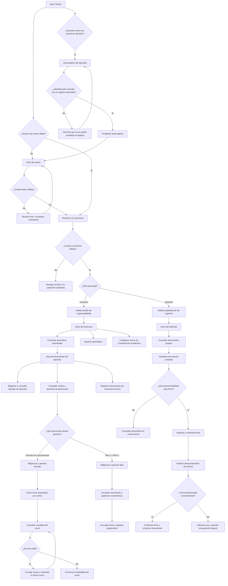
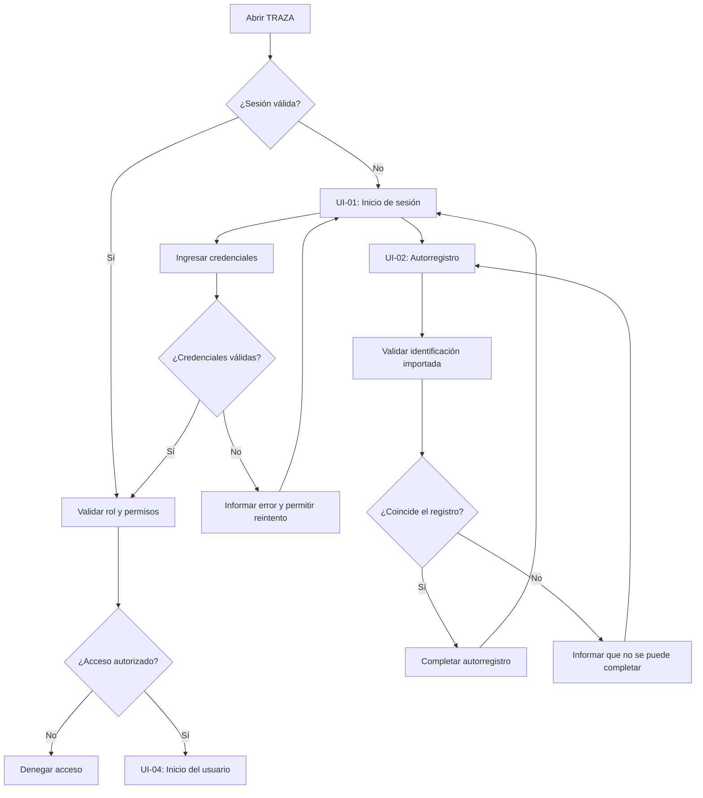
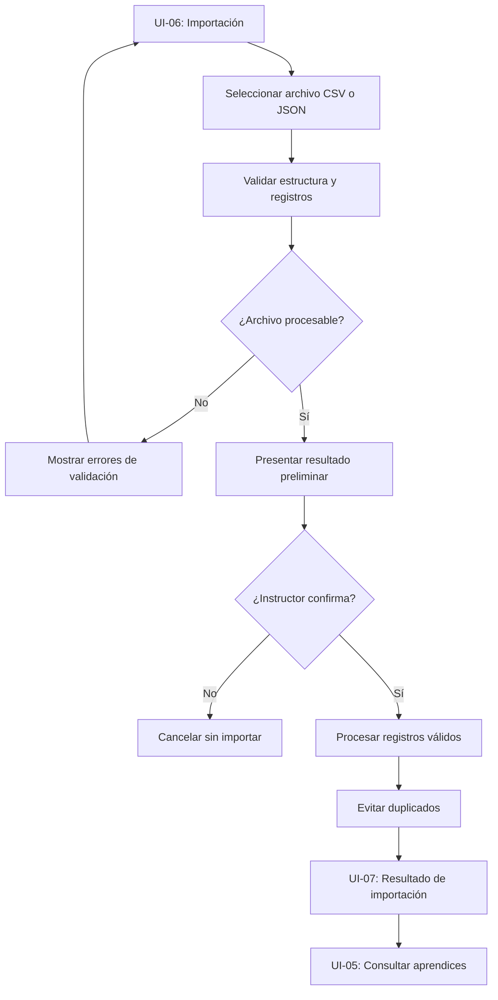
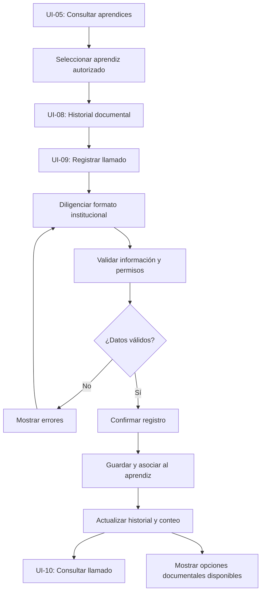
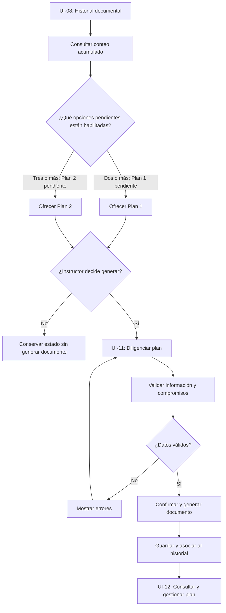
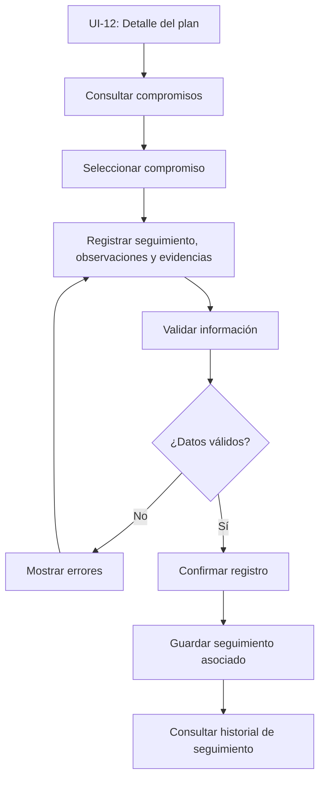
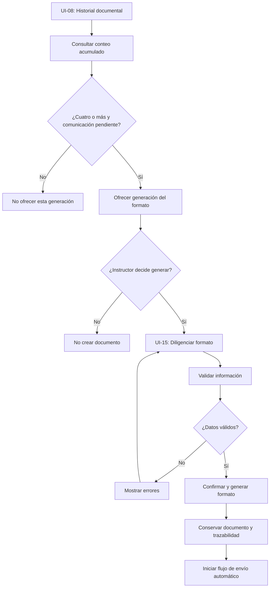
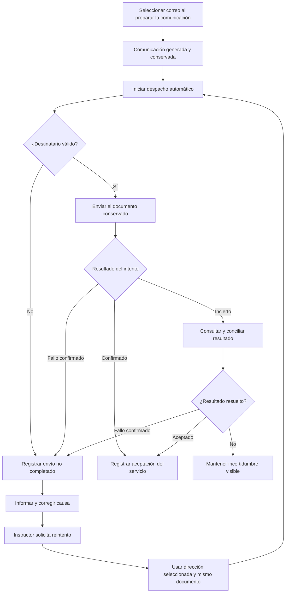
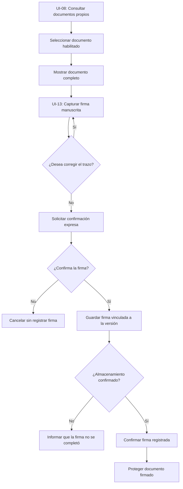
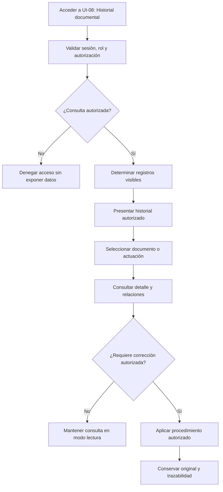

# TRAZA

## USER FLOW — Flujo de navegación e interacción

**Producto:** Sistema Integral de Gestión de Llamados de Atención y Seguimiento Académico 
**Nombre corto:** TRAZA
**Versión:** 1.0 
**Estado:** Aprobado
**Fecha:** 22 de octubre de 2026  
**Actualización documental:** 04-11-2026 — versión unificada y ajustes de correo y trazabilidad.  
**Documento de referencia funcional:** `TRAZA_PRD.md`, versión 1.0, 21 de octubre de 2026  

> **Regla de interpretación:** este documento describe la navegación y el comportamiento visible de las funcionalidades del MVP. No aprueba por sí mismo decisiones tecnológicas pendientes, no reemplaza las reglas del PRD ni los contratos técnicos del TRD y no incorpora funcionalidades excluidas del MVP.

---

## 1. Propósito

Este documento define cómo los usuarios navegan por TRAZA, qué pantallas y acciones tienen disponibles según su rol y las fichas de formacion asociadas a su ambito de responsabilidad, cómo se desarrollan los flujos operativos del MVP y cómo responde la interfaz ante validaciones, errores, interrupciones y resultados inciertos.

El USER_FLOW conecta los requisitos funcionales del PRD con la experiencia de uso que deberá implementarse y probarse. Se utiliza como referencia para diseño de interfaz, navegación, pruebas funcionales y trazabilidad.

## 2. Alcance

### 2.1 Funcionalidades incluidas

El documento cubre las nueve funcionalidades del MVP de TRAZA, de acuerdo con el alcance funcional definido en el PRD y su matriz de trazabilidad entre funcionalidades y requisitos funcionales.

| Código | Funcionalidad | Requisito(s) funcional(es) relacionado(s) |
|---|---|---|
| MVP-01 | Autenticación, autorregistro y control de acceso | RF-01 |
| MVP-02 | Importación y consulta de aprendices | RF-02 |
| MVP-03 | Registro y consulta de llamados de atención | RF-03 y RF-09; RF-08 para la firma de llamados |
| MVP-04 | Gestión de planes de mejoramiento | RF-04, RF-08 y RF-09 |
| MVP-05 | Seguimiento de compromisos de los planes de mejoramiento | RF-05 y RF-09 |
| MVP-06 | Generación del Formato de comunicación al aprendiz | RF-06, RF-07 y RF-09 |
| MVP-07 | Configuración y envío automático del Formato de comunicación | RF-07 y RF-09 |
| MVP-08 | Firma manuscrita y registro de aceptación del aprendiz | RF-08 y RF-09 |
| MVP-09 | Consulta del historial y trazabilidad documental | RF-09 |

Los flujos de usuario deberán representar las interacciones de los roles **Instructor** y **Aprendiz**, respetando los permisos, las reglas de negocio, los criterios de aceptación y las restricciones establecidos en el PRD.

La definición de los flujos deberá contemplar, según corresponda:

- La secuencia de interacciones y las decisiones que debe tomar cada usuario.
- Las condiciones previas necesarias para ejecutar cada flujo.
- Las validaciones, restricciones de acceso y reglas de negocio aplicables.
- Los resultados esperados y las alternativas ante errores u operaciones no completadas.
- Las relaciones entre los llamados de atención, los planes de mejoramiento, los compromisos, las firmas, las observaciones, las comunicaciones y el historial documental.
- La trazabilidad entre cada flujo de usuario y los requisitos funcionales relacionados.

La generación del Plan de mejoramiento 1, del Plan de mejoramiento 2 y del Formato de comunicación al aprendiz será manual y potestativa del instructor. El sistema ofrecerá las opciones correspondientes al acumular dos, tres y cuatro llamados de atención, respectivamente, sin generar estos documentos automáticamente por alcanzar dichos umbrales.

### 2.2 Fuera del alcance del MVP

No se definirán como flujos implementables del MVP las siguientes funcionalidades, aunque puedan aparecer en la visión de evolución del producto:

- Firma biométrica mediante huella dactilar u otros mecanismos biométricos.
- Funcionalidades de inteligencia artificial para consultar el Reglamento del SENA, analizar antecedentes o apoyar la elaboración de documentos.
- Aplicación móvil nativa independiente. El acceso desde dispositivos móviles se realizará mediante la aplicación web.
- Envío de comunicaciones por WhatsApp, SMS u otros canales diferentes del correo electrónico definido para el MVP.
- Integraciones con sistemas institucionales externos que no hayan sido aprobadas expresamente.
- Analítica predictiva y decisiones disciplinarias automatizadas.
- Determinación automática de la existencia de una falta, su calificación definitiva o la imposición de sanciones.
- Funcionalidades para que el aprendiz registre, modifique o elimine llamados de atención, gestione planes de mejoramiento o administre otros usuarios.
- Interfaz para administrar cuentas de instructores, roles, permisos o asociaciones entre instructores y fichas de formación.
- Comportamientos automáticos u opciones documentales adicionales para llamados de atención posteriores al cuarto, mientras las reglas correspondientes permanezcan pendientes de definición y aprobación.

Las exclusiones anteriores no deberán interpretarse como restricciones a las funcionalidades expresamente incluidas en el MVP. En particular, la firma manuscrita capturada en pantalla táctil sí forma parte del alcance, al igual que el envío automático por correo electrónico del Formato de comunicación una vez generado por el instructor.

Cualquier funcionalidad adicional deberá evaluarse y aprobarse formalmente antes de incorporarse al alcance implementable del MVP.

## 3. Principios de navegación

La navegación y la interacción de TRAZA deberán seguir los siguientes principios para mantener una experiencia de uso coherente con los roles, las reglas de negocio y las restricciones funcionales del MVP.

### PN-01. Navegación según el rol y el ámbito de responsabilidad

La interfaz presentará las funcionalidades y los registros autorizados para el usuario autenticado. El Instructor solo podrá consultar y gestionar información de aprendices cuyas fichas estén asociadas previamente a su ámbito de responsabilidad. El Aprendiz solo podrá consultar sus propios documentos y ejecutar las operaciones expresamente autorizadas para su rol.

### PN-02. Navegación orientada a las tareas

La organización de las pantallas facilitará el acceso a las tareas principales de cada rol, incluyendo el registro y la consulta de llamados de atención, la gestión de planes de mejoramiento, el seguimiento de compromisos y la consulta del historial documental. Las opciones de generación de documentos se presentarán al Instructor cuando se cumplan las condiciones de negocio correspondientes, sin generar documentos automáticamente.

### PN-03. Consistencia de la interacción

Los elementos de navegación, los controles, las acciones y los mensajes deberán mantener un comportamiento uniforme en las diferentes funcionalidades. Las acciones disponibles deberán ser comprensibles y distinguir claramente las operaciones de consulta, registro, corrección, generación documental, firma y envío de comunicaciones.

### PN-04. Visibilidad del contexto y de los resultados

La interfaz deberá permitir identificar el aprendiz y el documento sobre los que se está trabajando, según corresponda. También deberá presentar la información necesaria para comprender las relaciones entre los llamados de atención, los planes de mejoramiento, los compromisos, las comunicaciones y las actuaciones registradas. Los resultados de las operaciones deberán comunicarse de acuerdo con su estado real.

### PN-05. Control explícito de las operaciones relevantes

Las operaciones que requieran una decisión expresa del usuario deberán ejecutarse únicamente después de la acción correspondiente. La generación de planes de mejoramiento y del Formato de comunicación requerirá la decisión del Instructor. La firma de un documento requerirá que el Aprendiz visualice su contenido completo y confirme expresamente la operación antes de registrar la firma.

### PN-06. Integridad de los documentos y sus evidencias

La interfaz deberá respetar las restricciones aplicables a los documentos firmados. Una vez registrada la firma, no se permitirá modificar ni eliminar silenciosamente el documento firmado. Las correcciones autorizadas deberán conservar el documento original, la firma asociada y la trazabilidad correspondiente. La consulta de un documento no se interpretará como aceptación.

### PN-07. Retroalimentación y recuperación ante errores

La interfaz deberá informar de manera comprensible los resultados de las operaciones, las validaciones pendientes, los errores y las operaciones no completadas. Cuando una operación admita reintentos, deberá ofrecer las opciones correspondientes sin provocar registros o actuaciones duplicados. Los mensajes de éxito solo se mostrarán cuando el resultado esperado haya sido confirmado.

### PN-08. Coherencia entre navegación y alcance funcional

Las opciones de navegación y las acciones disponibles deberán corresponder exclusivamente a las funcionalidades aprobadas para el MVP. No se ofrecerán operaciones que permitan al Aprendiz gestionar actuaciones académicas, que habiliten capacidades excluidas del producto o que anticipen comportamientos pendientes de definición y aprobación. La navegación no deberá introducir reglas de negocio nuevas ni sustituir las decisiones del Instructor o de las instancias institucionales competentes.

## 4. Roles, ámbito de responsabilidad y navegación autorizada

TRAZA contempla los dos roles definidos en el PRD: **Instructor** y **Aprendiz**. La navegación y las acciones disponibles dependerán del rol asignado al usuario autenticado y, para el Instructor, de las fichas de caracterización asociadas previamente a su ámbito de responsabilidad.

### 4.1. Navegación por rol

| Rol | Destino inicial | Áreas y acciones del MVP |
|---|---|---|
| Instructor | Vista inicial con acceso a los aprendices de las fichas bajo su responsabilidad. | Consultar aprendices autorizados; registrar y consultar llamados de atención; consultar el historial documental; generar, cuando corresponda y por decisión propia, planes de mejoramiento y el Formato de comunicación al aprendiz; registrar y consultar compromisos de seguimiento; registrar observaciones por ausencia de firma; consultar el estado del envío de comunicaciones a Coordinación Académica y reintentar los envíos fallidos. |
| Aprendiz | Vista inicial con acceso a sus propios documentos y actuaciones disponibles para consulta o firma. | Consultar sus propios llamados de atención y planes de mejoramiento; visualizar el documento completo y registrar su firma manuscrita mediante una pantalla táctil cuando la firma esté habilitada. |

**Reglas de aplicación:**

- Los roles, permisos y restricciones definidos en el PRD son la referencia para determinar las acciones autorizadas. Esta sección resume su traducción a la navegación y no amplía los permisos aprobados.
- El Instructor solo podrá consultar y gestionar información de aprendices cuyas fichas estén asociadas previamente a su ámbito de responsabilidad. La administración de usuarios, roles y asociaciones no forma parte de la navegación del MVP.
- El Aprendiz solo podrá consultar sus propios documentos y ejecutar las operaciones expresamente autorizadas para su rol. No podrá acceder a información de otros aprendices ni a las notas o evidencias internas del seguimiento realizado por el Instructor.
- La generación de planes de mejoramiento y del Formato de comunicación al aprendiz estará disponible para el Instructor cuando se cumplan las condiciones de negocio correspondientes. Alcanzar el número de llamados requerido no generará documentos automáticamente.
- El registro de la firma estará condicionado a la visualización completa del documento y a la confirmación expresa del Aprendiz. La consulta de un documento no se interpretará como aceptación ni como firma.
- La ausencia de firma solo podrá registrarla el Instructor mediante la observación correspondiente, de acuerdo con las reglas definidas en el PRD. El Aprendiz no dispondrá de una acción para registrar por sí mismo la negativa a firmar.
- La importación de aprendices permitirá incorporar sus datos de referencia, pero no creará cuentas ni concederá acceso al sistema. El registro de la cuenta del Aprendiz deberá validar su identidad frente a un registro previamente importado.
- El envío del Formato de comunicación al aprendiz a Coordinación Académica se realizará mediante el mecanismo definido para el MVP. La interfaz deberá distinguir el estado del envío del estado del documento y no presentar un envío como exitoso sin confirmación del servicio correspondiente.
- Las acciones, los documentos y los resultados visibles deberán respetar las restricciones de acceso y las reglas de integridad documental. Las operaciones no autorizadas no deberán estar disponibles en la interfaz ni poder ejecutarse mediante solicitudes directas al sistema.

## 5. Inventario de pantallas

Los identificadores siguientes se proponen para facilitar el diseño, las pruebas y la trazabilidad entre el USER_FLOW, el PRD y los requisitos funcionales. Son identificadores del USER_FLOW, no nombres obligatorios de rutas ni decisiones sobre componentes de Flutter.

| ID | Pantalla o vista | Propósito | Acceso principal | Estados relevantes |
|---|---|---|---|---|
| UI-01 | Inicio de sesión | Autenticar a los usuarios mediante sus credenciales individuales. | Usuarios no autenticados | Inicial, validando, error de autenticación, acceso exitoso. |
| UI-02 | Autorregistro del aprendiz | Permitir que el aprendiz cree su cuenta mediante correo electrónico, contraseña y número de identificación, validando la coincidencia con un registro importado. | Aprendiz no registrado | Inicial, validando datos, registro exitoso, datos inválidos, identificación no encontrada, error. |
| UI-03 | Recuperación de contraseña | Permitir que el usuario inicie el procedimiento de recuperación de su contraseña. | Usuarios no autenticados | Inicial, procesando solicitud, solicitud procesada, error. |
| UI-04 | Inicio del usuario | Presentar las opciones de navegación correspondientes al rol y los permisos efectivos del usuario autenticado. | Instructor y Aprendiz | Cargando, disponible, sin información, error, acceso no autorizado. |
| UI-05 | Consulta de aprendices | Permitir al Instructor consultar y seleccionar aprendices pertenecientes a fichas asociadas a su ámbito de responsabilidad. | Instructor | Cargando, con resultados, sin resultados, error, acceso no autorizado. |
| UI-06 | Importación de aprendices | Permitir cargar archivos CSV o JSON, validar su estructura y revisar los registros antes de confirmar la importación. | Instructor | Inicial, archivo seleccionado, validando, errores de validación, listo para confirmar, error. |
| UI-07 | Resultado de importación | Presentar el resumen de registros procesados, insertados y rechazados, con las razones de rechazo correspondientes. | Instructor | Procesando, completada, completada con rechazos, fallida, error. |
| UI-08 | Historial documental del aprendiz | Consultar los llamados de atención, planes de mejoramiento y demás documentos y actuaciones relacionados, según los permisos del usuario. | Instructor autorizado y Aprendiz propietario | Cargando, con registros, sin registros, error, acceso no autorizado. |
| UI-09 | Registro y edición del llamado de atención | Diligenciar y registrar un llamado de atención con la información requerida por el formato institucional. Antes de guardar, permitir editar o cancelar; después de guardar, tramitar correcciones mediante una nueva versión o documento correctivo vinculado. | Instructor autorizado | Inicial, diligenciando, validación pendiente, guardando, guardado, error, solo lectura. |
| UI-10 | Detalle del llamado de atención | Consultar el documento completo, sus datos asociados, su estado de firma, las correcciones o anulaciones vinculadas y las observaciones autorizadas. | Instructor autorizado y Aprendiz propietario | Cargando, disponible, firmado, sin firma, corregido, anulado, error, acceso no autorizado. |
| UI-11 | Generación del plan de mejoramiento | Diligenciar y generar manualmente el Plan de mejoramiento 1 o 2, con la información y los compromisos requeridos por el formato institucional. | Instructor autorizado | Disponible para generar, diligenciando, validación pendiente, generando, generado, error. |
| UI-12 | Detalle y seguimiento del plan | Consultar el plan generado y permitir al Instructor registrar actuaciones de seguimiento, observaciones, evidencias y resultados, sin estados formales automáticos del compromiso. | Instructor autorizado; Aprendiz propietario para consulta documental autorizada | Cargando, disponible, sin compromisos, seguimiento registrado, solo lectura, error. |
| UI-13 | Firma del documento | Mostrar el documento completo y permitir al Aprendiz capturar, revisar y confirmar su firma manuscrita, vinculándola con la versión exacta del documento. | Aprendiz propietario | Documento disponible, capturando firma, confirmación pendiente, guardando firma, firma registrada, error. |
| UI-14 | Registro de observación por ausencia de firma | Permitir al Instructor registrar una observación cuando haya verificado que el aprendiz fue informado y no encuentre la firma del documento. | Instructor autorizado | Inicial, diligenciando, validación pendiente, guardando, registrada, error. |
| UI-15 | Generación del Formato de comunicación | Permitir al Instructor diligenciar y generar manualmente el Formato de comunicación al aprendiz cuando corresponda. | Instructor autorizado | Disponible para generar, diligenciando, validación pendiente, generando, generado, error. |
| UI-16 | Configuración del correo institucional | Permitir al Instructor registrar o actualizar las direcciones institucionales disponibles, sin asociación a fichas. La selección para cada comunicación se realiza en UI-15 y para el reintento en UI-17. | Instructor | Inicial, diligenciando, validando dirección, guardado, error. |
| UI-17 | Historial y estado de envíos | Consultar los intentos y resultados de envío del Formato de comunicación, identificar fallos y reintentar un envío fallido sin generar otro documento. | Instructor autorizado | Cargando, enviado según respuesta del servicio, envío fallido, pendiente de reintento, reintentando, error. |

**Reglas de aplicación:**

- El inventario representa las vistas funcionales previstas para el MVP. El diseño podrá agrupar varias vistas en una misma pantalla o dividirlas cuando sea necesario, sin alterar los permisos ni las reglas de negocio.
- Los estados indicados son una propuesta inicial para orientar el diseño de interfaz y deberán precisarse en los flujos detallados y los criterios de aceptación.
- La navegación y los datos presentados deberán respetar el rol del usuario, la propiedad de los registros y el ámbito de responsabilidad del Instructor.
- Las opciones de generación de los planes de mejoramiento y del Formato de comunicación solo estarán disponibles cuando se cumplan las condiciones de negocio correspondientes. La generación siempre requerirá la decisión del Instructor.
- La firma deberá quedar asociada a la versión exacta del documento y su registro solo se confirmará después de verificar que fue almacenada correctamente.
- El envío del Formato de comunicación se iniciará automáticamente después de su generación. El historial de envíos deberá distinguir el resultado informado por el servicio de correo de la recepción o lectura efectiva por parte del destinatario.
- No se incluyen pantallas para administrar usuarios, roles o asociaciones entre instructores y fichas, dado que estas configuraciones se realizan fuera de la interfaz funcional del MVP.
- Las acciones de corrección y anulación deberán estar disponibles únicamente para usuarios autorizados. El detalle de la interfaz podrá definirse en diseño, pero deberá permitir vincular la corrección o anulación con el original y conservar su trazabilidad. Los permisos de anulación y su efecto sobre el conteo acumulado siguen pendientes de decisión.

## 6. Mapa general de navegación

El siguiente mapa representa los recorridos principales de TRAZA desde el acceso hasta las áreas funcionales autorizadas para cada rol. Resume la navegación del MVP sin definir rutas técnicas ni componentes específicos de la interfaz.

### 6.1. Rutas protegidas

- Las pantallas operativas y los datos de TRAZA requieren una sesión válida y la autorización correspondiente al rol, la propiedad del registro y las reglas de negocio aplicables.
- Si un usuario intenta acceder directamente a una vista protegida, el sistema deberá validar la sesión y los permisos antes de presentar información o ejecutar operaciones.
- Después de autenticarse, el usuario podrá continuar hacia el destino solicitado únicamente si está autorizado para acceder a él.
- El Instructor solo podrá consultar y gestionar los aprendices cuyas fichas estén asociadas previamente a su ámbito de responsabilidad. Si no existe una asociación válida para una ficha, el sistema deberá impedir el acceso a los aprendices de esa ficha sin bloquear innecesariamente otras operaciones autorizadas.
- El Aprendiz solo podrá consultar sus propios documentos y realizar las operaciones habilitadas para su rol. No podrá acceder a los documentos, compromisos ni evidencias internas de seguimiento de otros aprendices.
- Si el usuario no tiene autorización para una operación, el sistema deberá denegarla y presentar un mensaje comprensible, sin revelar información protegida. Cuando corresponda, ofrecerá regresar a una vista autorizada.
- Las restricciones de acceso deberán aplicarse tanto en la navegación como en las operaciones solicitadas al sistema. Ocultar una opción de la interfaz no sustituye la validación de permisos.
- Las operaciones que no se completen deberán informar su resultado real. En particular, el sistema no confirmará una firma hasta verificar su almacenamiento ni presentará como exitoso un envío que el servicio de correo no haya confirmado.
- Los errores y los reintentos no deberán producir llamados, documentos, firmas o actuaciones duplicadas. Los reintentos de envío utilizarán el mismo Formato de comunicación generado.
- El cierre de sesión deberá finalizar el acceso autenticado. Las vistas protegidas no deberán permitir recuperar información mediante una navegación posterior sin volver a validar la sesión y los permisos.

## 7. Flujos funcionales del MVP

Este apartado describe los recorridos principales de los usuarios en TRAZA, las respuestas esperadas del sistema y las alternativas ante errores o condiciones que impidan completar una operación.

Cada flujo se relaciona con las funcionalidades del MVP, los requisitos funcionales del PRD y los identificadores de pantalla definidos en el apartado 5. Los diagramas representan el comportamiento funcional, sin establecer rutas técnicas ni decisiones específicas de implementación.

### 7.1. Flujo de autenticación, autorregistro y control de acceso — MVP-01 / RF-01

#### Camino exitoso

1. El usuario abre TRAZA.
2. Si no tiene una sesión válida, el sistema presenta UI-01.
3. El usuario ingresa sus credenciales y solicita el acceso.
4. El sistema valida las credenciales, el estado de la cuenta y los permisos aplicables.
5. Si la autenticación es válida, el sistema identifica el rol y presenta UI-04 con las opciones autorizadas.
6. Si el usuario es un Aprendiz que aún no tiene cuenta, podrá acceder a UI-02 para realizar el autorregistro mediante la validación de su número de identificación contra un registro previamente importado.
7. El usuario podrá cerrar la sesión mediante la opción correspondiente.

#### Errores y alternativas

- **Credenciales incorrectas:** mostrar un mensaje que no revele información innecesaria sobre la existencia de una cuenta y permitir reintentar.
- **Identificación no encontrada:** impedir completar el autorregistro e informar que los datos no coinciden con un registro habilitado.
- **Cuenta o permisos no válidos:** denegar el acceso a las operaciones protegidas.
- **Recuperación de contraseña:** permitir iniciar el procedimiento desde UI-03.
- **Fallo del servicio de autenticación:** informar que no fue posible completar el acceso, sin presentar la operación como exitosa.

**Decisiones funcionales confirmadas el 04-11-2026.** La importación admite únicamente aprendices de fichas previamente asociadas al instructor; se verifica el permiso por fila tanto al validar como al confirmar. Las filas no autorizadas se rechazan sin exponer datos de ámbitos ajenos y se conserva el procesamiento de filas válidas autorizadas.

Los correos destinatarios pertenecen a un conjunto limitado de direcciones institucionales disponibles, sin asociación a fichas. El instructor selecciona una dirección para la comunicación al preparar su envío. Para conservar el envío automático aprobado, la selección se presenta antes de confirmar la generación; tras generar y conservar el documento, el sistema inicia el envío sin una segunda confirmación. Si falta una selección válida, conserva el documento, registra envío no completado y permite seleccionar un destinatario y reintentar. Cada intento conserva una copia de la dirección efectivamente utilizada; no se deduce un destinatario a partir de la ficha ni de cambios posteriores del catálogo.

Las opciones documentales no generadas permanecen disponibles después de superar su umbral: Plan 1 desde dos llamados, Plan 2 desde tres y comunicación desde cuatro. La generación sigue siendo manual y potestativa. Con tres llamados pueden coexistir Plan 1 y Plan 2 pendientes; con cuatro o más se conservan las opciones pendientes de los tres tipos. Esto no crea tipos documentales nuevos para el quinto llamado. La cantidad de documentos independientes permitidos del mismo tipo sigue pendiente; no se aprueba una restricción de uno por aprendiz. Las correcciones mantienen versiones y trazabilidad.

### 7.2. Flujo de importación y consulta de aprendices — MVP-02 / RF-02

#### Camino exitoso

1. El Instructor autenticado accede a UI-06.
2. Selecciona un archivo CSV o JSON.
3. El sistema valida la estructura y los campos obligatorios: `id`, `nombre_completo` y `numero_ficha`.
4. El sistema presenta los registros válidos y los errores detectados antes de confirmar la importación.
5. El Instructor confirma la operación.
6. El sistema revalida que cada ficha esté asociada al Instructor, incorpora únicamente los registros válidos nuevos autorizados y evita duplicados. Las filas de fichas no asociadas se rechazan sin exponer datos ajenos.
7. El sistema presenta UI-07 con el resumen de registros procesados, insertados y rechazados.
8. El Instructor puede consultar los aprendices importados mediante UI-05.

#### Errores y alternativas

- **Formato no admitido o archivo ilegible:** impedir la importación e informar el problema.
- **Campos obligatorios ausentes o inválidos:** identificar los registros afectados y explicar los errores detectados.
- **Identificación duplicada:** evitar la creación de otro registro para la misma identificación y reportar el resultado conforme a las reglas de importación.
- **Importación parcialmente exitosa:** mostrar por separado los registros insertados y rechazados, con sus motivos.
- **Fallo durante el procesamiento:** informar el resultado real de la operación. No deberá presentarse como exitosa una importación que no haya sido confirmada.
- **Importación completada:** no crear cuentas de usuario ni conceder acceso automáticamente a los aprendices importados.

### 7.3. Flujo de registro y consulta de llamados de atención — MVP-03 / RF-03

#### Camino exitoso

1. El Instructor accede a UI-05 y selecciona un aprendiz autorizado.
2. Consulta su historial documental en UI-08.
3. Selecciona la opción para registrar un llamado de atención mediante UI-09.
4. Diligencia la información requerida por el formato institucional.
5. El sistema valida los campos obligatorios y las condiciones de autorización.
6. El Instructor confirma el registro.
7. El sistema conserva el llamado, lo asocia al aprendiz y al Instructor responsable y actualiza el historial.
8. El Instructor puede consultar el documento mediante UI-10.
9. El sistema actualiza el conteo acumulado de llamados y presenta las opciones de generación documental que correspondan, sin generar documentos automáticamente.

#### Errores y alternativas

- **Aprendiz fuera del ámbito autorizado:** impedir la consulta y el registro.
- **Información obligatoria incompleta:** señalar los campos pendientes y conservar los datos ingresados cuando sea posible.
- **Fallo al guardar:** informar que la operación no se completó si se confirma el fallo. Si el resultado es incierto, verificar si el registro existe antes de permitir repetir la operación.
- **Cambios antes de guardar:** permitir editar el formulario o cancelarlo; si se cancela antes de guardar, no crear un registro ni un documento definitivo.
- **Corrección después de guardar:** no sobrescribir ni eliminar físicamente el original. Crear una nueva versión o un documento correctivo vinculado, preservando el contenido y el historial original.
- **Anulación:** tramitarla mediante una actuación explícita con motivo obligatorio, responsable, fecha y referencia al documento afectado; conservar el original disponible para consulta y auditoría. Los permisos de anulación y su efecto sobre el conteo acumulado están pendientes de decisión.
- **Llamado firmado:** no invalidar ni reemplazar silenciosamente la firma; mantenerla vinculada a la versión exacta firmada.
- **Consulta del documento:** no deberá interpretarse como aceptación ni como firma del Aprendiz.

### 7.4. Flujo de generación y gestión de planes de mejoramiento — MVP-04 / RF-04

#### Camino exitoso

1. El Instructor consulta el historial documental de un aprendiz autorizado.
2. El sistema presenta el conteo acumulado de llamados y las opciones de generación disponibles.
3. Desde dos llamados puede generar Plan 1 pendiente; desde tres, Plan 2 pendiente. Las opciones no generadas permanecen disponibles al superar el umbral y pueden coexistir.
4. El Instructor decide expresamente si desea generar el documento.
5. Si decide continuar, diligencia los campos requeridos por el formato institucional, incluidos los compromisos y demás datos aplicables.
6. El sistema valida la información y genera el documento tras la confirmación del Instructor.
7. El documento queda asociado al aprendiz y a las actuaciones que lo originaron.
8. El Instructor puede consultar el plan en UI-12 y gestionar sus compromisos.
9. El Aprendiz podrá consultar y firmar el plan cuando la operación esté habilitada para su cuenta.

#### Errores y alternativas

- **Umbral no alcanzado:** no presentar la opción de generación que aún no corresponda.
- **Instructor decide no generar:** conservar el historial sin crear el documento.
- **Datos incompletos:** impedir la generación hasta corregir los campos obligatorios.
- **Fallo al generar o guardar:** informar que la operación no se completó y evitar documentos o actuaciones duplicados.
- **Plan firmado:** proteger el documento contra modificaciones o eliminaciones silenciosas.
- **Llamados posteriores al cuarto:** no habilitar comportamientos adicionales que no hayan sido definidos y aprobados.

### 7.5. Flujo de seguimiento de compromisos — MVP-05 / RF-05

#### Camino exitoso

1. El Instructor accede a UI-12 desde el historial del aprendiz autorizado.
2. Consulta el plan y sus compromisos registrados.
3. Selecciona el compromiso que desea verificar.
4. Registra una actuación de seguimiento con las observaciones, evidencias y resultados de la verificación que correspondan. No asigna al compromiso un estado formal como «pendiente», «cumplido» o «incumplido».
5. El sistema valida los datos requeridos.
6. El Instructor confirma el registro.
7. El sistema conserva el seguimiento y lo asocia con el plan, el compromiso y el Instructor responsable.
8. El Instructor consulta el historial de seguimiento para reconstruir las actuaciones realizadas.

#### Errores y alternativas

- **Plan o compromiso no autorizado:** denegar el acceso a la información.
- **Información incompleta:** indicar qué datos deben completarse antes de guardar.
- **Fallo de almacenamiento:** informar que el seguimiento no se registró y permitir un reintento seguro.
- **Seguimiento previamente registrado:** evitar duplicaciones causadas por el reenvío de una misma operación.
- **Estados del compromiso:** no crear ni actualizar estados formales automáticos; cada verificación se registra como una actuación nueva y conserva las actuaciones anteriores.
- **Consulta por parte del Aprendiz:** no exponer las notas ni las evidencias internas del seguimiento del Instructor.

### 7.6. Flujo de generación del Formato de comunicación — MVP-06 / RF-06

#### Camino exitoso

1. El Instructor consulta el historial documental del aprendiz.
2. Desde cuatro llamados de atención, el sistema ofrece la opción de generar el Formato de comunicación.
3. El Instructor decide expresamente si desea generarlo.
4. Si continúa, accede a UI-15 y diligencia la información requerida por el formato institucional.
5. El sistema valida los datos.
6. El Instructor selecciona el correo destinatario entre los disponibles, sin asociación a ficha, y confirma la generación. Si no existe una selección válida, se conserva el documento y se registra envío no completado.
7. El sistema genera y conserva el documento, asociado al aprendiz y a las actuaciones correspondientes.
8. Tras generar el documento, se inicia el flujo de envío automático descrito en el apartado 7.7.

#### Errores y alternativas

- **Umbral no alcanzado:** no ofrecer la generación del Formato de comunicación.
- **Instructor decide no generar:** no crear el documento ni iniciar el envío.
- **Información incompleta o inválida:** permitir corregir los datos antes de confirmar.
- **Fallo de generación:** informar que el documento no se generó correctamente y evitar duplicaciones al reintentar.
- **Generación exitosa:** conservar el documento aunque el envío de correo falle posteriormente; el fallo de envío no deberá ocasionar la pérdida ni la regeneración del documento.

### 7.7. Flujo de configuración, envío y reintento de comunicaciones — MVP-07 / RF-07

#### Camino exitoso

1. El Instructor dispone de un conjunto limitado de correos institucionales, gestionado mediante UI-16 sin relación con fichas. Al preparar la comunicación en UI-15, selecciona el destinatario antes de confirmar la generación.
2. El sistema valida el formato de la dirección ingresada.
3. Una vez generado el Formato de comunicación, TRAZA inicia inmediatamente su envío automático como archivo adjunto a la dirección configurada, sin solicitar una confirmación adicional para enviarlo.
4. El sistema registra el documento, el destinatario, la fecha y hora del intento y el resultado informado por el servicio de correo.
5. El Instructor consulta UI-17 para revisar el estado conocido del envío.
6. Si el envío falla, el sistema conserva el documento, informa el problema y permite reintentar el mismo envío después de resolver la causa.

#### Errores y alternativas

- **Dirección inválida:** no aceptar una dirección que no supere la validación correspondiente.
- **Destinatario no configurado:** conservar el documento generado, registrar el envío como no completado e informar al Instructor.
- **Servicio de correo no disponible:** conservar el documento y el resultado del intento; permitir reintentar cuando se restablezca el servicio.
- **Envío fallido:** registrar el fallo y permitir reintentar sin generar nuevamente el Formato de comunicación ni duplicar la actuación documental.
- **Resultado del servicio:** distinguir el resultado informado por el servicio de correo de la recepción, apertura o lectura efectiva del mensaje.
- **Reintento:** conservar el historial de los intentos realizados, sin sobrescribir los resultados anteriores.

**Resultado incierto y destinatario vigente:** si no puede determinarse si el servicio aceptó el mensaje, consultar o conciliar el intento antes de reenviar. Mantener la incertidumbre visible mientras no se resuelva; la falta de confirmación no prueba un fallo. Un reintento autorizado empleará la dirección seleccionada por el Instructor para ese intento y conservará el destinatario y resultado de cada intento anterior. La configuración en UI-16 puede realizarse antes de generar el documento o corregirse después de un envío no completado.

### 7.8. Flujo de firma manuscrita y registro de aceptación — MVP-08 / RF-08

#### Camino exitoso

1. El Aprendiz autenticado accede a sus documentos mediante UI-08.
2. Selecciona un llamado de atención o un plan de mejoramiento habilitado para firma.
3. El sistema presenta el documento completo y la indicación correspondiente al significado de la firma.
4. El Aprendiz captura su firma manuscrita en UI-13.
5. Antes de confirmar, puede borrar el trazo y repetirlo.
6. El Aprendiz confirma expresamente la operación.
7. El sistema registra la firma asociada al Aprendiz, al documento y a la versión exacta presentada.
8. El sistema verifica que la firma se almacenó correctamente.
9. Solo después de confirmar el almacenamiento, informa que la firma quedó registrada.
10. El documento firmado queda protegido contra modificaciones o eliminaciones silenciosas.

#### Errores y alternativas

- **Documento ajeno al Aprendiz:** denegar el acceso a su consulta o firma.
- **Documento no habilitado para firma:** permitir únicamente las operaciones autorizadas, como su consulta en modo lectura.
- **Cancelación antes de confirmar:** no registrar la firma.
- **Fallo al almacenar la firma:** informar que la operación no se completó; no mostrar el documento como firmado.
- **Reintento después de un fallo:** evitar duplicar firmas o registros de aceptación.
- **Documento firmado:** impedir su modificación o eliminación silenciosa. Las correcciones autorizadas deberán conservar el original, la firma y la trazabilidad.
- **Ausencia de firma:** no interpretarla como aceptación. Cuando corresponda, el Instructor podrá registrar la observación prevista en UI-14.

### 7.9. Flujo de consulta del historial y trazabilidad documental — MVP-09 / RF-09

#### Camino exitoso

1. El usuario autenticado accede al historial documental mediante UI-08, desde la navegación autorizada para su rol.
2. El sistema valida los permisos del usuario y el alcance de los registros solicitados.
3. El Instructor consulta el historial de los aprendices bajo su responsabilidad; el Aprendiz consulta exclusivamente sus propios documentos y actuaciones visibles para su rol.
4. El sistema presenta los documentos y registros relacionados disponibles, incluidos llamados, planes, compromisos, seguimientos, firmas, observaciones y comunicaciones, según los permisos aplicables.
5. El usuario selecciona un registro para consultar su detalle.
6. El sistema presenta la información disponible y conserva las relaciones entre documentos y actuaciones.
7. Las correcciones posteriores al guardado deberán crear una nueva versión o un documento correctivo vinculado al original, sin sobrescribirlo ni eliminarlo físicamente.
8. Las anulaciones deberán registrarse como actuaciones explícitas con motivo obligatorio, responsable, fecha y referencia al documento afectado; el original seguirá disponible para consulta y auditoría.
9. Si el documento original tiene firma, esta permanecerá vinculada a la versión exacta firmada. Una corrección posterior requerirá un tratamiento explícito de la aceptación correspondiente y no invalidará silenciosamente la firma.

#### Errores y alternativas

- **Sesión inválida:** solicitar autenticación antes de permitir el acceso.
- **Registro fuera del ámbito autorizado:** denegar la consulta sin revelar información protegida.
- **Documento inexistente o no disponible:** informar que no fue posible encontrar o consultar el registro.
- **Historial sin registros:** mostrar un estado vacío comprensible, sin tratarlo como un error técnico.
- **Fallo al cargar información:** informar el problema y permitir reintentar la consulta.
- **Corrección de documento firmado:** conservar el original, la firma asociada a la versión exacta y la relación con la nueva versión o documento correctivo.
- **Anulación:** exigir motivo obligatorio y registrar responsable, fecha y referencia; conservar el original para consulta y auditoría. No permitir que una anulación elimine el historial.
- **Resultado incierto al guardar una corrección o anulación:** verificar si la actuación se registró antes de permitir repetirla.
- **Trazabilidad incompleta:** no presentar como disponible una evidencia que el sistema no haya podido recuperar o verificar.

## 8. Estados y transiciones del seguimiento académico

TRAZA deberá representar de manera diferenciada el avance del seguimiento académico, la disponibilidad de generación documental, el estado de firma de los documentos y los resultados del seguimiento de compromisos. Esta distinción permitirá consultar el historial sin introducir transiciones automáticas que no estén definidas en las reglas de negocio.

### 8.1. Estados y condiciones del llamado de atención

Los llamados de atención **no tendrán estados de ciclo de vida**. Cada llamado se registra, se asocia al aprendiz y al Instructor responsable y se incorpora al conteo acumulado del aprendiz.

| Condición o evento | Comportamiento esperado |
|---|---|
| Registro confirmado de un llamado | Conservar el llamado y actualizar el conteo acumulado del aprendiz. |
| Corrección antes de guardar | El Instructor puede editar el formulario o cancelarlo; si lo cancela, no se crea registro ni documento definitivo. |
| Corrección después de guardar | Crear una nueva versión o un documento correctivo vinculado al original; no sobrescribir ni eliminar físicamente el original. La corrección del mismo llamado no se contabiliza como un nuevo llamado. |
| Anulación | Registrar una actuación explícita con motivo obligatorio, responsable, fecha y referencia al documento; conservar el original. Los permisos y el efecto sobre el conteo acumulado están pendientes de decisión. |
| Firma registrada | Bloquear la modificación y eliminación ordinarias de la versión firmada y conservar la firma vinculada a esa versión exacta. |
| Corrección posterior a la firma | Crear una nueva versión o documento relacionado, preservando el original y su firma; no invalidar ni reemplazar silenciosamente la firma. |
| Consulta del llamado | Presentar la información autorizada sin modificar su registro ni interpretar la consulta como aceptación. |

El conteo será continuo, sin límite temporal. Los llamados posteriores al cuarto continuarán incorporándose al historial, pero no habilitarán nuevas opciones documentales mientras no se definan y aprueben las reglas correspondientes.

### 8.2. Disponibilidad y generación de documentos

La disponibilidad documental se determinará a partir del número acumulado de llamados de atención por aprendiz.

| Condición | Opción disponible para el Instructor | Transición al ejecutar la acción |
|---|---|---|
| Un llamado acumulado | No se habilita una nueva opción documental por umbral. | El historial continúa disponible para consulta. |
| Dos llamados acumulados | Generar Plan de mejoramiento 1. | Si el Instructor decide generarlo y la operación se completa, el plan queda registrado y asociado a sus antecedentes. |
| Tres llamados acumulados | Generar Plan 2 y conservar Plan 1 si sigue pendiente. | Si el Instructor decide generarlo y la operación se completa, el plan queda registrado y asociado a sus antecedentes. |
| Cuatro llamados acumulados | Generar comunicación y conservar planes pendientes. | Si el Instructor decide generarlo y la operación se completa, el formato queda registrado y se inicia el envío automático por correo. |
| Más de cuatro llamados acumulados | Conservar opciones pendientes de Plan 1, Plan 2 y comunicación; sin tipos nuevos. | Los nuevos llamados se conservan en el historial. |

**Reglas de transición:**

- Alcanzar un umbral habilita una opción; no genera automáticamente el documento.
- El Instructor conserva la decisión de generar cada documento.
- Cancelar el diligenciamiento antes de confirmar la generación no deberá crear un documento.
- Una generación fallida no deberá presentarse como exitosa ni producir documentos o actuaciones duplicados al reintentar.
- La existencia de un plan o de un Formato de comunicación deberá reflejar una generación efectivamente completada, no únicamente la disponibilidad de la opción.
- La generación de un documento no implica que haya sido firmado, enviado, recibido o leído.

### 8.3. Estado de firma y ausencia de firma

El sistema deberá distinguir la situación de firma de cada documento que requiera formalización. Esta clasificación describe la situación documental; no constituye un ciclo de vida del llamado de atención.

| Situación | Condición | Comportamiento esperado |
|---|---|---|
| Sin firma registrada | El documento no tiene una firma almacenada. | Permitir la consulta y, cuando corresponda, ofrecer la firma al Aprendiz autorizado. |
| Firma registrada | La firma fue almacenada y asociada a la versión exacta presentada. | Confirmar la operación y proteger la versión firmada contra modificaciones o eliminaciones silenciosas. |
| Observación por ausencia de firma | El Instructor verificó que informó al Aprendiz y no encuentra una firma registrada. | Conservar la observación con su texto, el Instructor responsable, la fecha y hora y la referencia al documento. |

**Reglas de transición:**

- La firma solo se registrará después de que el Aprendiz visualice el documento completo y confirme expresamente la operación.
- El sistema solo informará que la firma fue registrada cuando su almacenamiento se haya confirmado.
- La ausencia de firma no equivale a aceptación.
- El Aprendiz no podrá registrar por sí mismo una observación de ausencia de firma ni firmar en nombre de otra persona.
- Una observación por ausencia de firma no sustituye la firma ni modifica el documento original.
- Una vez firmada una versión, cualquier corrección posterior deberá preservar el documento original, su firma y la trazabilidad correspondiente.

### 8.4. Seguimiento de compromisos de los planes de mejoramiento

El seguimiento de los compromisos se registrará exclusivamente mediante actuaciones asociadas al plan, al compromiso y al Instructor responsable. El sistema conservará las observaciones, las evidencias y los resultados registrados durante las verificaciones. En el MVP no se manejarán estados formales del compromiso, como «pendiente», «en proceso», «cumplido» o «incumplido».

| Evento | Comportamiento esperado |
|---|---|
| Registro de un compromiso en un plan | Asociar el compromiso al plan correspondiente y conservar la información definida en el formato institucional. |
| Registro de una actuación de seguimiento | Conservar la observación, la evidencia y el resultado informado por el Instructor, según corresponda. |
| Nueva verificación del compromiso | Incorporar la nueva actuación al historial sin sobrescribir las actuaciones anteriores. |
| Corrección o anulación autorizada | Aplicar el procedimiento aprobado y preservar la trazabilidad de la actuación original. |
| Consulta del historial de seguimiento | Presentar las actuaciones autorizadas en su secuencia correspondiente. |

La decisión funcional para el MVP es no implementar una máquina de estados formal para los compromisos. El instructor registra cada actuación, observación, evidencia y resultado de verificación; el sistema conserva el historial sin asignar ni inferir estados del compromiso.

El sistema tampoco determinará automáticamente el incumplimiento de un compromiso. La verificación y el registro del resultado corresponden al Instructor.

### 8.5. Estado del envío del Formato de comunicación

El envío del Formato de comunicación se gestionará de forma independiente de la generación y la firma documental.

| Situación del envío | Condición | Comportamiento esperado |
|---|---|---|
| Pendiente de intento | El formato se generó, pero el intento todavía no se ha completado o registrado. | Conservar el documento e iniciar el envío conforme al flujo definido. |
| Envío confirmado por el servicio | El servicio de correo informa que el envío se completó satisfactoriamente. | Registrar el resultado del intento y presentarlo al Instructor. |
| Envío fallido o no completado | El destinatario no es válido, el servicio no está disponible o el intento falla. | Conservar el documento, registrar el resultado e informar al Instructor. |
| Reintento solicitado | Se ha resuelto la causa del fallo y el Instructor inicia un nuevo intento autorizado. | Reutilizar el mismo documento y registrar el nuevo intento sin duplicar la actuación documental. |

**Reglas de transición:**

- La generación del Formato de comunicación inicia automáticamente el flujo de envío.
- Si no existe una dirección válida o el servicio no está disponible, el documento deberá conservarse y el fallo deberá quedar registrado.
- Cada intento deberá conservar su fecha, hora, destinatario y resultado informado por el servicio.
- El reintento no deberá generar otro Formato de comunicación ni duplicar la actuación que lo originó.
- La confirmación del servicio de correo no constituye evidencia de que el destinatario recibió, abrió o leyó el mensaje.

### 8.6. Reglas generales de transición y trazabilidad

- Las transiciones deberán producirse como consecuencia de eventos verificables, acciones autorizadas o resultados confirmados por el sistema.
- Las opciones documentales se determinarán por el conteo acumulado de llamados y no por un estado artificial del llamado.
- La generación, la firma, el seguimiento y el envío deberán conservar sus relaciones con el aprendiz y las actuaciones que les dieron origen.
- Los errores no deberán producir estados de éxito falsos ni permitir que una operación incompleta se interprete como una actuación formalizada.
- Los reintentos deberán prevenir duplicaciones y preservar el historial de los intentos previos.
- Las correcciones y anulaciones autorizadas deberán conservar la evidencia original y la trazabilidad correspondiente.
- El acceso a los estados, documentos y actuaciones deberá respetar el rol, la propiedad del registro y el ámbito de responsabilidad del Instructor.

## 9. Gestión de firmas y aceptación de documentos

TRAZA permitirá al Aprendiz consultar sus propios llamados de atención y planes de mejoramiento, visualizar el documento completo y registrar su aceptación mediante una firma manuscrita capturada en pantalla táctil. La firma deberá quedar asociada al documento y a la versión exacta presentada al Aprendiz.

### 9.1. Consulta previa a la firma

- El Aprendiz deberá autenticarse y acceder exclusivamente a sus propios documentos.
- Antes de habilitar la firma, el sistema presentará el contenido completo del documento y una indicación explícita sobre el significado de la acción.
- La interfaz deberá distinguir los documentos disponibles para consulta de aquellos habilitados para firma.
- La consulta, apertura o visualización de un documento no constituirá evidencia de aceptación.
- Si el documento no está habilitado para firma, el Aprendiz podrá consultarlo en modo de solo lectura cuando tenga autorización.

### 9.2. Registro de la firma

El flujo de firma deberá seguir esta secuencia:

1. El Aprendiz selecciona un documento propio habilitado para firma.
2. El sistema presenta el documento completo y las indicaciones correspondientes.
3. El Aprendiz captura su firma manuscrita en la pantalla táctil.
4. Antes de confirmar, podrá borrar el trazo y repetirlo.
5. El sistema solicita una confirmación expresa de la firma.
6. Si el Aprendiz confirma, el sistema registra la firma vinculada al documento y a la versión exacta presentada.
7. El sistema verifica que el almacenamiento se haya completado correctamente.
8. Solo después de confirmar el almacenamiento, la interfaz informa que la firma quedó registrada.
9. El documento firmado queda protegido contra modificaciones o eliminaciones silenciosas.

La evidencia deberá permitir identificar, como mínimo, el documento y su versión, el Aprendiz que firmó y la fecha y hora de la operación. Los detalles técnicos adicionales de auditoría se definirán en el TRD.

### 9.3. Negativa a firmar y ausencia de firma

El PRD establece que el Instructor podrá registrar una observación cuando haya verificado que informó al Aprendiz del documento y no encuentre la firma correspondiente.

- El Instructor registrará la observación desde la interfaz autorizada.
- La observación deberá conservar el texto registrado, la identificación del Instructor, la fecha y hora y la referencia al documento.
- El Aprendiz no dispondrá de una opción de autoservicio para registrar una negativa a firmar.
- La ausencia de firma no se interpretará como aceptación del documento.
- La observación por ausencia de firma no sustituirá la firma ni modificará el contenido del documento.
- La interfaz deberá distinguir un documento firmado de uno que no tiene firma y cuenta con una observación registrada.

**Decisión pendiente:** el PRD contempla el registro de una observación por ausencia de firma, pero no define un flujo independiente para que el Aprendiz registre o formalice una negativa expresa. Por tanto, no se incorporará esa capacidad al MVP sin una decisión funcional aprobada.

### 9.4. Conservación e integridad de la evidencia

- La firma deberá conservarse asociada a la versión exacta del documento presentada al Aprendiz.
- Una vez firmada una versión, no se permitirá modificarla ni eliminarla silenciosamente.
- Las correcciones posteriores a la firma deberán generar una nueva versión o un documento relacionado, conservando el original, la firma y la trazabilidad.
- Antes de guardar, el Instructor podrá editar el formulario o cancelarlo; cancelar no creará registro ni documento definitivo.
- Después de guardar, el original no se sobrescribirá ni eliminará físicamente. La corrección se realizará mediante una nueva versión o un documento correctivo vinculado, conservando el contenido y el historial original. La corrección del mismo llamado no se contabilizará como un nuevo llamado.
- Si el documento ya fue firmado, la firma permanecerá vinculada a la versión exacta firmada. La nueva versión requerirá un tratamiento explícito de aceptación; no se invalidará ni reemplazará silenciosamente la firma.
- Las anulaciones deberán registrarse como actuaciones explícitas con motivo obligatorio, responsable, fecha y referencia al documento afectado, manteniendo el original disponible para consulta y auditoría. Los permisos de anulación y su efecto sobre el conteo acumulado permanecen pendientes de decisión.
- Si el almacenamiento de la firma falla, el sistema no deberá mostrar el documento como firmado.
- Los reintentos de una operación de firma no deberán generar registros duplicados ni alterar una firma previamente almacenada.

## 10. Estados de interfaz transversales

TRAZA deberá presentar estados de interfaz consistentes en las diferentes funcionalidades del MVP. Los mensajes y controles disponibles deberán corresponder al resultado real de la operación y a los permisos del usuario.

| Estado | Comportamiento esperado | Aplicación |
|---|---|---|
| Carga | Informar que la información está siendo consultada o procesada y evitar acciones incompatibles con la operación en curso. | Consultas, historial documental, autenticación y carga de registros. |
| Vacío | Informar que no existen registros para mostrar y orientar al usuario hacia la siguiente acción permitida, cuando corresponda. | Historial sin documentos, consultas sin resultados y compromisos aún no registrados. |
| Validación | Identificar los campos obligatorios pendientes y los datos inválidos, indicando cómo corregirlos. | Formularios, importación, configuración del correo y generación documental. |
| Error | Informar que una operación no pudo completarse, describir el problema de forma comprensible y ofrecer recuperación cuando sea posible. | Autenticación, almacenamiento, importación, firma y generación documental. |
| Éxito | Confirmar la operación únicamente cuando el sistema haya verificado el resultado esperado. | Registro de llamados, importación, generación documental y almacenamiento de firmas. |
| Resultado incierto | Indicar que no fue posible confirmar el resultado de la operación y verificar su estado antes de permitir repetirla. | Interrupciones de conexión durante registros, firmas, importaciones, correcciones o anulaciones que puedan generar duplicados. |
| Acceso denegado | Informar que la operación no está autorizada, sin exponer datos protegidos. | Intentos de acceso a registros de otros aprendices o fuera del ámbito de responsabilidad. |
| Solo lectura | Presentar el documento o registro sin controles que permitan modificarlo cuando no se autorice su edición. | Documentos firmados y registros disponibles únicamente para consulta. |

### 10.1. Reglas de aplicación

- Los estados deberán ser comprensibles y mantener un comportamiento coherente en todas las pantallas.
- Los mensajes de validación deberán identificar el problema y, cuando sea posible, la acción requerida para corregirlo.
- El estado de carga no deberá confundirse con un resultado exitoso.
- El sistema no deberá presentar una operación como completada si el resultado no ha sido confirmado.
- Cuando el resultado sea incierto, el sistema deberá comprobar si la operación anterior se completó antes de permitir repetirla. Si no puede verificarlo, deberá mantener visible la incertidumbre y no inducir a repetir a ciegas.
- Las acciones de reintento deberán respetar las reglas de integridad e idempotencia definidas para cada operación.
- Los mensajes no deberán revelar credenciales, información personal innecesaria ni datos de registros para los cuales el usuario carezca de autorización.
- Los fallos recuperables deberán ofrecer una alternativa cuando exista una acción segura para continuar.

## 11. Cancelación, navegación atrás y recuperación

TRAZA deberá gestionar la navegación entre pantallas y la interrupción de operaciones de forma que no se produzcan pérdidas de información inadvertidas, registros duplicados ni modificaciones indebidas de documentos.

### 11.1. Abandono de formularios

- El guardado de llamados, planes, actuaciones de seguimiento, correcciones y anulaciones requiere una acción explícita del usuario mediante la opción «Guardar» o la acción de confirmación definida para esa operación.
- La interfaz solo confirmará el éxito después de verificar que la operación se completó.
- Si el usuario intenta abandonar un formulario con cambios no guardados, la interfaz deberá advertirle de que puede perder la información ingresada y permitir regresar al formulario o descartar los cambios.
- La cancelación antes de guardar no deberá crear un registro, una actuación ni un documento definitivo.
- Los formularios sin cambios pendientes podrán abandonarse sin una confirmación adicional, salvo que exista una regla específica que lo requiera.
- Los formularios de registro y generación documental deberán distinguir entre información en edición y operaciones ya confirmadas.
- No se presupone autoguardado ni borradores persistentes. Los datos no guardados no se garantizarán recuperables después de un cierre inesperado o una interrupción.

### 11.2. Navegación atrás

- La navegación atrás deberá respetar las reglas de autorización y el estado de la sesión.
- Al regresar a una pantalla anterior, el sistema no deberá ejecutar nuevamente operaciones de registro, generación, firma o envío.
- Si existen cambios sin guardar, se aplicará la advertencia de abandono correspondiente.
- Los documentos firmados y los registros protegidos no deberán volver a un estado editable como consecuencia de la navegación.
- La navegación atrás no deberá permitir acceder a información protegida después del cierre de sesión o de la pérdida de autorización.

### 11.3. Interrupción de operaciones

- Si una operación falla y el fallo está confirmado, el sistema deberá informar que no fue posible completarla.
- Si se pierde la conexión y el resultado no puede confirmarse, la interfaz deberá indicar que el resultado es incierto y verificar el estado de la operación anterior antes de permitir un reintento.
- Los reintentos no deberán generar llamados, documentos, firmas, correcciones, anulaciones o actuaciones duplicados.
- Si la generación del Formato de comunicación se completó, un fallo posterior del envío no deberá eliminar el documento ni provocar que se genere nuevamente para reintentar el correo.
- Si la firma se almacenó correctamente, la interfaz deberá recuperar o consultar su estado confirmado antes de permitir una nueva operación de firma.
- Si una operación no llegó a completarse, el sistema no deberá presentar su resultado como exitoso.
- Si una operación se completó pero se perdió la respuesta de confirmación, el sistema deberá recuperar el resultado existente en lugar de ejecutar nuevamente la operación.

### 11.4. Recuperación de sesión y datos ingresados

- Si la sesión deja de ser válida durante una operación, el sistema deberá impedir nuevas operaciones protegidas hasta que el usuario se autentique nuevamente.
- Después de autenticarse, el usuario solo podrá regresar al destino solicitado si continúa autorizado.
- El sistema no deberá exponer información protegida en pantallas de autenticación ni permitir recuperar datos mediante una navegación posterior sin validar la sesión y los permisos.
- No se implementará autoguardado ni persistencia de borradores en el MVP. No se garantizará la recuperación de datos que no se hayan guardado explícitamente.
- Los documentos y actuaciones que sí se hayan guardado deberán poder consultarse desde el historial, con las restricciones de acceso correspondientes.

## 12. Accesibilidad y adaptabilidad

TRAZA será una aplicación web adaptable a los tamaños de pantalla previstos para el MVP. La interfaz deberá facilitar las tareas de los Instructores y permitir que los Aprendices consulten y firmen sus documentos desde dispositivos con pantalla táctil compatible.

### 12.1. Adaptabilidad a dispositivos

- Las pantallas deberán adaptar su distribución al tamaño disponible, evitando que los controles esenciales queden fuera del área visible.
- Los formularios, tablas y documentos deberán permitir la consulta y operación sin exigir el uso de una aplicación móvil nativa.
- La firma manuscrita deberá poder capturarse mediante una pantalla táctil compatible.
- Los controles de navegación y las acciones principales deberán mantenerse identificables en los tamaños de pantalla previstos.
- Los documentos deberán poder visualizarse completos antes de firmarlos, con mecanismos de desplazamiento y ampliación cuando sean necesarios.
- Los dispositivos y navegadores mínimos compatibles deberán definirse en el TRD y verificarse mediante pruebas.

### 12.2. Criterios de accesibilidad y usabilidad

- Los controles deberán tener etiquetas comprensibles y una finalidad identificable.
- Los mensajes de error y validación deberán expresarse en lenguaje claro e indicar, cuando sea posible, cómo corregir el problema.
- La información relevante no deberá comunicarse exclusivamente mediante colores; los estados deberán incluir texto, iconos u otras señales comprensibles.
- Los controles interactivos deberán contar con tamaños y separaciones que faciliten su utilización en pantallas táctiles.
- Los formularios deberán identificar los campos obligatorios y asociar los mensajes de validación con los campos correspondientes.
- La navegación deberá mantener una estructura coherente y permitir identificar la ubicación del usuario dentro del flujo.
- Las operaciones sensibles, como la confirmación de una firma, deberán incluir indicaciones explícitas sobre la acción que se realizará.
- Las pruebas de usabilidad deberán contemplar las tareas principales de ambos roles y las condiciones de uso desde dispositivos móviles.

### 12.3. Alcance pendiente

El nivel de conformidad con estándares específicos de accesibilidad, los navegadores admitidos, las resoluciones de referencia y los requisitos detallados de compatibilidad deberán definirse y aprobarse antes de cerrar los criterios de aceptación técnicos. Estos parámetros se documentarán en el TRD sin ampliar por sí mismos el alcance funcional del MVP.

## 13. Cierre de sesión

TRAZA deberá permitir que los usuarios finalicen su sesión de forma explícita y evitar que, después de salir, puedan continuar accediendo a información protegida mediante la interfaz.

### 13.1. Flujo de cierre de sesión

1. El usuario autenticado selecciona la opción de cerrar sesión.
2. El sistema finaliza la sesión de acuerdo con el mecanismo de autenticación implementado.
3. La interfaz abandona las vistas protegidas y presenta la pantalla de inicio de sesión.
4. Si el usuario intenta acceder nuevamente a una vista protegida, el sistema valida la sesión antes de presentar información o permitir operaciones.
5. Si no existe una sesión válida, solicita autenticación.

### 13.2. Reglas de aplicación

- El cierre de sesión deberá impedir nuevas operaciones protegidas con la sesión finalizada.
- La navegación atrás no deberá permitir consultar datos protegidos sin una sesión válida.
- El cierre de sesión no deberá eliminar ni alterar los documentos, las firmas o las actuaciones previamente confirmadas.
- Si el usuario tiene cambios sin guardar, el comportamiento deberá ajustarse a las reglas de abandono de formularios y a las capacidades de recuperación que se aprueben.
- El sistema no deberá mostrar mensajes que revelen información personal o académica después de finalizar la sesión.
- La gestión de sesiones, su expiración, la invalidación de credenciales de sesión y los mecanismos técnicos de protección se especificarán en el TRD.

## 14. Pruebas de navegación y escenarios funcionales

Las pruebas de navegación deberán verificar que los recorridos definidos en el USER_FLOW se ejecutan correctamente, que los permisos se aplican en todas las operaciones y que los errores no producen pérdida de información, duplicaciones ni confirmaciones incorrectas.

Los siguientes escenarios constituyen una base inicial para derivar los casos de prueba detallados.

| ID de prueba | Escenario | Resultado esperado |
|---|---|---|
| PF-01 | Inicio de sesión con credenciales válidas. | El usuario accede a la navegación correspondiente a su rol. |
| PF-02 | Inicio de sesión con credenciales incorrectas. | Se informa el error sin revelar información innecesaria sobre la cuenta. |
| PF-03 | Autorregistro con identificación coincidente con un registro importado. | Se permite completar el registro de la cuenta del Aprendiz. |
| PF-04 | Autorregistro con identificación no encontrada. | Se impide completar el registro y se informa la causa de manera comprensible. |
| PF-05 | Acceso del Instructor a una ficha asociada a su responsabilidad. | Puede consultar y gestionar los aprendices autorizados. |
| PF-06 | Acceso del Instructor a una ficha no asociada a su responsabilidad. | Se deniega el acceso a los registros de esa ficha. |
| PF-07 | Importación de archivo válido con registros nuevos. | Se incorporan los registros válidos y se presenta el resultado. |
| PF-08 | Importación con registros inválidos o duplicados. | Se identifican los rechazos y se evita duplicar aprendices. |
| PF-09 | Registro de un llamado de atención. | El llamado queda guardado y asociado al aprendiz y al Instructor responsable. |
| PF-10 | Corrección de un llamado después de guardarlo y antes de la firma. | Se crea una nueva versión o documento correctivo vinculado al original, sin sobrescribirlo ni eliminarlo; la corrección del mismo llamado no se contabiliza como un nuevo llamado. |
| PF-11 | Consulta del conteo acumulado de llamados. | El conteo considera los llamados registrados sin límite temporal. |
| PF-12 | Alcanzar dos, tres o cuatro llamados acumulados. | Se habilita la opción documental correspondiente, sin generación automática. |
| PF-13 | Cancelar la generación de un documento antes de confirmarla. | No se crea el documento ni se registra una actuación de generación completada. |
| PF-14 | Generación exitosa de un plan de mejoramiento. | El documento queda asociado al aprendiz y a sus antecedentes. |
| PF-15 | Registro de un compromiso y una actuación de seguimiento. | El sistema conserva la información y sus relaciones documentales. |
| PF-16 | Consulta de notas y evidencias internas por parte del Aprendiz. | El sistema impide su acceso a información interna no autorizada. |
| PF-17 | Firma de un documento propio habilitado. | La firma queda asociada a la versión exacta y se confirma después del almacenamiento. |
| PF-18 | Fallo al almacenar una firma. | No se presenta el documento como firmado y se informa que la operación no se completó. |
| PF-19 | Intento de modificar un documento firmado. | Se impide la modificación o eliminación silenciosa del original. |
| PF-20 | Registro de una observación por ausencia de firma. | Se conservan el texto, el Instructor responsable, la fecha, la hora y la referencia al documento. |
| PF-21 | Generación del Formato de comunicación. | El documento queda conservado y se inicia el flujo de envío automático. |
| PF-22 | Envío de correo exitoso según el servicio. | Se registra el intento y se muestra el resultado informado por el servicio. |
| PF-23 | Fallo del envío del Formato de comunicación. | Se conserva el documento y se registra el fallo para su consulta y eventual reintento. |
| PF-24 | Reintento de un envío fallido. | Se reutiliza el mismo documento y se conserva el historial de intentos. |
| PF-25 | Pérdida de conexión durante una operación. | Se informa el error o resultado incierto y se evita duplicar la operación al recuperar la conexión. |
| PF-26 | Abandono de un formulario con cambios no guardados. | Se advierte al usuario antes de descartar la información ingresada. |
| PF-27 | Cierre de sesión y navegación atrás. | No se permite recuperar información protegida sin una sesión válida. |
| PF-28 | Consulta de un historial sin registros. | Se muestra un estado vacío comprensible, sin confundirlo con un fallo. |
| PF-29 | Acceso directo a una vista protegida sin autorización. | Se deniega el acceso sin exponer información protegida. |
| PF-30 | Consulta de llamados posteriores al cuarto. | Los llamados se conservan en el historial sin habilitar comportamientos documentales no aprobados. |
| PF-31 | Cancelar el formulario de un llamado antes de guardarlo. | No se crea un registro ni un documento definitivo. |
| PF-32 | Corregir un documento después de guardarlo. | Se crea una nueva versión o documento correctivo vinculado; el original no se sobrescribe ni elimina físicamente. |
| PF-33 | Anular un documento mediante el procedimiento habilitado. | Se exige motivo y se registra responsable, fecha y referencia; el original sigue disponible para consulta y auditoría. La prueba queda condicionada a que se aprueben los permisos de anulación. |
| PF-34 | Corregir un documento que ya fue firmado. | La firma permanece asociada a la versión exacta firmada y no se invalida silenciosamente; la nueva versión requiere tratamiento explícito de aceptación. |
| PF-35 | Intentar guardar una corrección o anulación y perder la conexión antes de recibir confirmación. | El sistema verifica el resultado de la operación previa antes de permitir repetirla y evita duplicaciones. |
| PF-36 | Abandonar un formulario con cambios no guardados. | Se advierte al usuario y se le permite regresar al formulario o descartar los cambios. |
| PF-37 | Consultar un documento o actuación ya guardados. | Se recuperan desde el historial autorizado; no se depende de un formulario persistente. |
| PF-38 | Registrar varias actuaciones de seguimiento para un compromiso. | Cada actuación se conserva en el historial; el sistema no asigna estados formales ni determina automáticamente incumplimientos. |
| PF-39 | Reintentar una operación de guardado cuyo resultado anterior es incierto. | Se comprueba primero si la operación se completó y no se crean registros duplicados. |

### 14.1. Criterios generales de ejecución

- Cada prueba deberá identificar las condiciones iniciales, el rol utilizado, los datos de prueba, los pasos ejecutados y el resultado esperado.
- Los casos de autorización deberán probar tanto la navegación como el intento de ejecutar directamente operaciones no permitidas.
- Los escenarios de firma, generación documental y envío de correo deberán comprobar la persistencia de los registros y la ausencia de duplicaciones.
- Los fallos recuperables deberán probarse antes, durante y después de las operaciones críticas cuando corresponda.
- Los resultados de las pruebas deberán registrar si el escenario fue satisfactorio, fallido o bloqueado por una decisión funcional pendiente.
- Los casos relacionados con comportamientos no aprobados no deberán considerarse requisitos implementables hasta que exista una decisión funcional formal.

## 15. Trazabilidad entre PRD, USER_FLOW y pruebas

La siguiente matriz relaciona los requisitos funcionales del PRD con las pantallas, los flujos y los escenarios de prueba propuestos. Su finalidad es verificar que cada requisito tenga una representación funcional y un medio de comprobación.

| Requisito del PRD | Flujo del USER_FLOW | Pantallas relacionadas | Pruebas principales |
|---|---|---|---|
| RF-01. Autenticación, autorregistro y control de acceso | 7.1, 11 y 13 | UI-01, UI-02, UI-03 y UI-04 | PF-01 a PF-06, PF-25, PF-27 y PF-29 |
| RF-02. Importación y consulta de aprendices | 7.2 | UI-05, UI-06 y UI-07 | PF-07 y PF-08 |
| RF-03. Registro y consulta de llamados de atención | 7.3, 7.9, 8.1, 9, 10 y 11 | UI-08, UI-09 y UI-10 | PF-09 a PF-13, PF-19, PF-26, PF-30 a PF-36 y PF-39 |
| RF-04. Generación y gestión de planes de mejoramiento | 7.4 y 8.2 | UI-08, UI-11 y UI-12 | PF-12 a PF-15 |
| RF-05. Seguimiento de compromisos de los planes de mejoramiento | 7.5 y 8.4 | UI-12 | PF-15, PF-16 y PF-38 |
| RF-06. Generación del Formato de comunicación al aprendiz | 7.6 y 8.2 | UI-08 y UI-15 | PF-12, PF-13 y PF-21 |
| RF-07. Configuración y envío automático del Formato de comunicación | 7.7 y 8.5 | UI-16 y UI-17 | PF-21 a PF-24 |
| RF-08. Firma manuscrita y registro de aceptación del Aprendiz | 7.8, 8.3 y 9 | UI-10, UI-12, UI-13 y UI-14 | PF-17 a PF-20 |
| RF-09. Consulta del historial y trazabilidad documental | 7.9, 8.1 a 8.6, 9, 10 y 11 | UI-08, UI-10, UI-12, UI-14 y UI-17 | PF-09, PF-10, PF-14 a PF-24, PF-28 y PF-30 a PF-39 |

### 15.1. Reglas de mantenimiento de la trazabilidad

- Cada requisito funcional deberá tener al menos un flujo o una referencia explícita al comportamiento que lo implementa.
- Cada flujo deberá identificar las pantallas relacionadas y los escenarios de prueba que permiten verificarlo.
- Las reglas de negocio que condicionan una operación deberán quedar reflejadas tanto en el flujo correspondiente como en las pruebas pertinentes.
- Los cambios de numeración o alcance en el PRD deberán actualizar esta matriz y las referencias del USER_FLOW.
- Los estados transversales, el cierre de sesión, la navegación y la recuperación deberán verificarse mediante los escenarios que correspondan, aunque no constituyan requisitos funcionales independientes.
- La matriz es una propuesta inicial de trazabilidad. Deberá contrastarse con la numeración definitiva del PRD antes de aprobar la versión final del USER_FLOW.

## 16. Criterios de aceptación del USER_FLOW

El USER_FLOW de TRAZA se considerará completo y listo para aprobación cuando cumpla las siguientes condiciones:

1. **Coherencia con el PRD:** los flujos respetan el alcance aprobado del MVP, las reglas de negocio, los roles y los requisitos funcionales.
2. **Cobertura de funcionalidades:** las nueve funcionalidades del MVP cuentan con flujos que describen los recorridos principales y las alternativas relevantes.
3. **Navegación definida:** los roles, las pantallas, los destinos iniciales y las rutas protegidas son coherentes entre sí.
4. **Control de acceso:** se especifican las restricciones por rol, propiedad del registro y ámbito de responsabilidad del Instructor.
5. **Reglas de seguimiento:** el conteo de llamados y la disponibilidad de generación documental corresponden a las condiciones aprobadas, sin introducir generación automática.
6. **Integridad documental:** se define la consulta, la firma, la ausencia de firma, las correcciones mediante nueva versión o documento correctivo y las anulaciones trazables, conservando el original.
7. **Seguimiento de compromisos:** se describen el registro y la consulta de las actuaciones, sin estados formales de compromiso ni determinación automática de incumplimientos.
8. **Comunicaciones:** se especifican la generación del Formato de comunicación, el envío automático, el registro de resultados y los reintentos.
9. **Estados de interfaz:** se contemplan los estados de carga, vacío, validación, error, éxito, resultado incierto y acceso denegado.
10. **Recuperación:** se define el guardado explícito, la advertencia por cambios sin guardar, la cancelación previa al guardado, la verificación de resultados inciertos antes de reintentar y el comportamiento ante navegación atrás y cierre de sesión.
11. **Accesibilidad y adaptabilidad:** se establecen criterios funcionales de uso desde dispositivos móviles y pantallas táctiles, así como las definiciones que corresponden al TRD.
12. **Trazabilidad:** los requisitos funcionales se relacionan con los flujos, las pantallas, las reglas de negocio y las pruebas correspondientes.
13. **Verificabilidad:** los escenarios de prueba describen resultados esperados observables y permiten detectar fallos de autorización, integridad o duplicación.
14. **Decisiones pendientes:** las definiciones no aprobadas se identifican explícitamente y no se presentan como requisitos confirmados.
15. **Consistencia documental:** los identificadores de requisitos, funcionalidades, pantallas y pruebas son estables y coinciden con los documentos relacionados.
16. **Control de cambios:** se define cómo evaluar y aprobar modificaciones que afecten el alcance, los flujos o sus relaciones de trazabilidad.

La aprobación del USER_FLOW confirma que la navegación y el comportamiento funcional están suficientemente especificados para orientar el diseño y la planificación. No sustituye la definición técnica del TRD ni la verificación de los criterios de aceptación del PRD.

## 17. Supuestos y decisiones funcionales pendientes

Este apartado distingue las decisiones aún pendientes de aquellas ya resueltas para el MVP. Las decisiones resueltas deben aplicarse de forma consistente; las pendientes no autorizan implementar un comportamiento definitivo.

| ID | Tema | Definición pendiente | Impacto potencial | Acción requerida |
|---|---|---|---|---|
| DP-01 | Estados de compromisos | **Resuelto para el MVP:** no se implementan estados formales. Se registran actuaciones, observaciones, evidencias y resultados sin determinar automáticamente incumplimientos. | Pantallas, modelo de datos, reportes y pruebas. | Mantener esta decisión consistente en PRD, USER_FLOW, TRD y PLAN. |
| DP-02 | Negativa expresa a firmar | Definir si se necesita un flujo formal para registrar una negativa expresa, distinto de la observación por ausencia de firma ya contemplada. | Firma, aceptación, evidencia y permisos. | Confirmar el comportamiento institucional y actualizar el PRD si se aprueba. |
| DP-03 | Borradores y recuperación | **Resuelto para el MVP:** no hay autoguardado ni borradores persistentes; no se garantiza recuperar datos no guardados tras un cierre inesperado. Los registros guardados se consultan desde el historial. | Persistencia, experiencia de usuario y recuperación de sesión. | Reflejar la decisión en diseño, pruebas y TRD cuando corresponda. |
| DP-04 | Abandono de formularios | **Resuelto para el MVP:** si hay cambios sin guardar, advertir y permitir regresar al formulario o descartar los cambios. Cancelar antes de guardar no crea registro ni documento. | Navegación y prevención de pérdida de datos. | Aplicar la regla de manera coherente en los formularios editables. |
| DP-05 | Correcciones y anulaciones | **Parcialmente resuelto:** después de guardar, corregir mediante nueva versión o documento correctivo vinculado; anular mediante actuación con motivo, responsable, fecha y referencia, conservando el original. Sigue pendiente quién puede autorizar anulaciones y cómo afectan al conteo acumulado y a la disponibilidad de documentos. | Integridad documental, permisos, conteo y generación documental. | Aprobar los permisos de anulación y su efecto en las reglas de conteo antes de implementar el comportamiento completo. |
| DP-06 | Compatibilidad y accesibilidad | Determinar navegadores, tamaños de pantalla, criterios específicos de accesibilidad y dispositivos de referencia. | Diseño de interfaz y pruebas de compatibilidad. | Definir criterios funcionales y técnicos en coordinación con el TRD. |
| DP-07 | Sesiones | Precisar duración, expiración, recuperación y comportamiento de la sesión ante inactividad o interrupciones. | Autenticación, seguridad y navegación. | Establecer las condiciones funcionales y documentar los mecanismos técnicos en el TRD. |
| DP-08 | Conservación de evidencias | Definir periodos de conservación y políticas aplicables a documentos, firmas, observaciones, seguimientos y registros de envío. | Almacenamiento, auditoría y cumplimiento institucional. | Validar las políticas institucionales y los requisitos aplicables. |
| DP-09 | Llamados posteriores al cuarto | Definir si en una versión futura se habilitarán documentos u otras actuaciones adicionales después del cuarto llamado. | Reglas de negocio, navegación y documentos disponibles. | Mantener fuera del MVP hasta contar con una decisión formal. |
| DP-10 | Confirmación de operaciones | El guardado requiere acción explícita. Si el resultado de una operación es incierto, verificar el resultado anterior antes de permitir repetirla. La confirmación específica de otras operaciones se aplica según el flujo descrito. | Usabilidad, persistencia y prevención de duplicaciones. | Mantener coherencia entre los formularios, estados de interfaz y pruebas. |

### 17.1. Tratamiento de las decisiones pendientes

- Las decisiones pendientes deberán tener un responsable de validación y un resultado documentado antes de incorporarse como requisitos aprobados.
- Mientras una decisión no esté aprobada, los flujos no deberán asumir un comportamiento definitivo para ella.
- Si una decisión modifica el alcance o el comportamiento descrito en el PRD, deberá actualizarse primero el documento correspondiente y después los artefactos afectados.
- Las decisiones técnicas se documentarán en el TRD, manteniendo la separación entre comportamiento funcional e implementación.
- Las decisiones que afecten las pruebas deberán actualizar la matriz de trazabilidad y los casos de prueba asociados.

## 18. Control de cambios

Los cambios que afecten el USER_FLOW deberán gestionarse de forma controlada para preservar la coherencia entre el PRD, el USER_FLOW, el TRD, el PLAN y los casos de prueba.

### 18.1. Registro de cambios

Cada propuesta de modificación deberá registrar, como mínimo:

- Identificador del cambio.
- Fecha de solicitud.
- Descripción del comportamiento actual y del cambio propuesto.
- Justificación y necesidad que motiva la modificación.
- Requisitos funcionales, reglas de negocio, pantallas y flujos afectados.
- Impacto potencial en permisos, datos, documentos, firmas, integraciones y pruebas.
- Responsable de evaluar y aprobar la propuesta.
- Estado de la solicitud y decisión final.

### 18.2. Evaluación del impacto

Antes de aprobar un cambio, deberá evaluarse:

- Si modifica el alcance del MVP o incorpora una funcionalidad excluida.
- Si altera los permisos o la navegación de alguno de los roles.
- Si cambia una regla de negocio, una condición de generación documental o una transición.
- Si afecta la integridad de documentos, firmas, observaciones o actuaciones previas.
- Si requiere modificar pantallas, estados de interfaz, criterios de aceptación o pruebas.
- Si genera cambios en el modelo de datos, las integraciones o la arquitectura descrita en el TRD.
- Si requiere ajustar la secuencia de trabajo y las dependencias del PLAN.

### 18.3. Aprobación e incorporación

- Los cambios no deberán incorporarse como requisitos aprobados antes de que la persona o instancia responsable los autorice.
- Los cambios que alteren el comportamiento funcional deberán reflejarse primero en el PRD y después en el USER_FLOW y en los demás documentos afectados.
- Los cambios exclusivamente técnicos deberán documentarse en el TRD, siempre que no modifiquen el comportamiento funcional aprobado.
- Los identificadores de requisitos, pantallas, flujos y pruebas deberán conservar su estabilidad o actualizarse de manera consistente cuando sea necesario.
- Después de incorporar un cambio, deberá revisarse la matriz de trazabilidad y actualizarse los casos de prueba afectados.
- Las decisiones rechazadas o aplazadas deberán conservar su registro para evitar que se incorporen posteriormente por error.

### 18.4. Historial de versiones

Cada versión aprobada del USER_FLOW deberá registrar:

| Campo | Descripción |
|---|---|
| Versión | Identificador de la versión del documento. |
| Fecha | Fecha de emisión o aprobación. |
| Descripción del cambio | Resumen de las modificaciones incorporadas. |
| Apartados afectados | Secciones modificadas o añadidas. |
| Documentos relacionados | PRD, TRD, PLAN y pruebas afectadas. |
| Responsable de elaboración | Persona que preparó la actualización. |
| Estado de aprobación | En elaboración, en revisión o aprobado, según el proceso definido. |

El historial de versiones deberá permitir identificar qué cambios se realizaron, por qué se realizaron y qué documentos o pruebas se vieron afectados.

**Registro de esta actualización:** versión 1.0, 22 de octubre de 2026. Se incorporan las decisiones funcionales sobre actuaciones de seguimiento sin estados formales, correcciones y anulaciones con conservación del original, guardado explícito, cancelación previa al guardado, advertencias por cambios sin guardar y verificación de resultados inciertos antes de reintentar. Se actualizan los flujos, estados de interfaz, escenarios de prueba, trazabilidad y decisiones pendientes.

### 18.5. Criterio de cierre del cambio

Una solicitud de cambio podrá considerarse incorporada cuando haya sido aprobada, reflejada en los documentos correspondientes, evaluada frente a sus dependencias y acompañada de la actualización de la trazabilidad y de las pruebas afectadas. La incorporación documental no sustituye la validación posterior del comportamiento implementado.

**Fin del USER FLOW — TRAZA, versión 1.0**

**Decisiones de producto 04-11-2026:** importación solo por ficha asociada; destinatario seleccionado sin relación con ficha; conservación de opciones documentales omitidas al superar el umbral. Generaciones independientes repetidas siguen pendientes.

## Registro complementario confirmado — 04-11-2026 (DC-07/DC-08)

**Fuente:** instrucción expresa de Luis Fernando Corredor Mora en la revisión de E0. Se conserva la versión documental existente; este registro actualiza únicamente las decisiones indicadas y no aprueba las propuestas físicas del nuevo anexo.

- **DC-07, confirmada:** identificación del aprendiz como texto, con ceros iniciales; retirar espacios exteriores antes de validar; exigir uno o más dígitos ASCII 0–9. Rechazar vacío, espacios internos, letras, puntos, guiones y otros caracteres; no convertir a número ni limpiar caracteres inválidos silenciosamente. Error localizado por fila. ` 00123456 ` se acepta como `00123456`; `0012 3456`, `1.234.567` y solo espacios se rechazan. Aplicar la misma regla al dato de identificación utilizado en autorregistro. El conjunto exacto de espacios exteriores se precisa como propuesta P-06 del anexo, sin ampliarlo silenciosamente.
- **DC-08, confirmada:** Luis Fernando Corredor Mora asume inicialmente la habilitación de instructores y asignación de fichas. No se crea rol administrador ni interfaz administrativa del MVP. El mecanismo técnico y sus controles son propuestas para revisión.
- **Ficha pendiente:** no se han aprobado caracteres ni normalización de numero_ficha. P-01 del anexo propone una política explícita; no se aplica automáticamente DC-07 a ese campo ni se bloquean relaciones independientes.
- **Alcance autorizado:** especificación física inicial de identidad, fichas e importación, autorización, auditoría, idempotencia, procedimiento operativo y casos de prueba. Entregar para revisión antes de convertir en migración; sin ejecutar cambios ni crear recursos Supabase.
- **Pendientes conservados:** generaciones independientes repetidas, acceso histórico ante traslados/cambios de responsabilidad, autoridad y efectos de anulaciones y continuidad del seguimiento de compromisos corregidos. No se resuelven mediante restricciones implícitas.
- **Formatos:** se identificaron ejemplos diligenciados GOR-F-084 V02 y GD-F-011; no está confirmada su incorporación a Docs ni su vigencia institucional. Se requieren copias/instrucciones validadas para fidelidad documental, sin bloquear el núcleo independiente. No se inventan campos definitivos.

**Entregable vigente:** [TRAZA_E0_ESPECIFICACION_FISICA_INICIAL.md](TRAZA_E0_ESPECIFICACION_FISICA_INICIAL.md), v0.4 para revisión técnica, 06-11-2026; decisiones funcionales actualizadas en el registro final de esta fecha. FI-01–39 previstos, no ejecutados. Primera migración: [propuesta v0.1](TRAZA_E0_PRIMERA_MIGRACION_PROPUESTA.md), sin SQL.

En §7.1/7.2 se aplica DC-07 antes de comparar identificaciones; la importación muestra errores por fila y conserva éxito parcial. No se agrega navegación administrativa.

## Decisiones confirmadas y secuencia E0 — 06-11-2026

**Fuente:** aprobación expresa de Luis Fernando Corredor Mora. Este registro actualiza los pendientes históricos de 04/05-11-2026 solo en lo resuelto aquí; no cambia generaciones repetidas, traslados/acceso histórico, anulaciones ni continuidad de seguimiento de compromisos corregidos. DC-07/DC-08 permanecen confirmadas.

- **P-08 aprobada:** impedir duplicación y conservar causa exacta interna restringida. Ficha inexistente/no autorizada: número de fila y «No se pudo validar la ficha para esta fila», sin distinguir ambas ni buscar duplicados globales. Ficha autorizada y permiso vigente verificable sobre aprendiz existente: número y «Identificación ya registrada». Otros casos de duplicidad: número y «No fue posible incorporar esta fila», sin datos ajenos ni motivo de duplicidad. Aplicar en validación, confirmación, nuevas consultas, descarga, contadores y caché con permisos actuales. La ficha de entrada no acredita acceso al existente. Mensaje genérico reduce exposición, no elimina toda inferencia. Sin canal de revisión inventado; DC-08 no autoriza consultar otras fichas. PRD CA-02.5/6 ajustados; CA-02.7 conservado.
- **P-01/P-06 confirmadas:** identificación y ficha textuales de uno o más dígitos ASCII 0–9, con ceros preservados; retirar exclusivamente U+0020 exterior, rechazar vacío, espacios internos, tabs y otros caracteres. Misma normalización en catálogo y búsqueda de ficha en importación; también en identificación de autorregistro.
- **P-04 aprobada con ajuste:** agrupar filas válidas autorizadas por id normalizado; coincidencia de nombre y ficha según contrato: primera candidata y siguientes duplicadas internas. Diferencia de nombre o ficha: rechazar todas las filas del grupo conflictivo e indicar números de fila para corregir. Filas inválidas/ajenas se tratan aparte, no bloquean válidas ni exponen datos a través de agrupación. Otras identificaciones continúan. Distinto de P-08 frente a datos ya persistidos. La comparación concreta de nombre sigue como precisión técnica propuesta en §6.1 del anexo, no se deduce su aprobación.
- **P-05:** depuración productiva condicionada a política institucional; plazo pendiente. Desarrollo con datos sintéticos y plazos de ensayo explícitos, sin convertirlos en política productiva.
- **Primera migración:** alcance/secuencia confirmados, base técnica privada PostgreSQL; identidad, fichas, asociaciones e importación en incremento posterior. Diseño de objetos y permisos todavía para revisión; no se autoriza generar/ejecutar SQL ni crear recursos.

Referencias vigentes: [especificación física v0.4](TRAZA_E0_ESPECIFICACION_FISICA_INICIAL.md), para revisión técnica, FI-01–39 previstos; [primera migración propuesta v0.1](TRAZA_E0_PRIMERA_MIGRACION_PROPUESTA.md), M1-01–12 previstos. P-02/03/07, precisión de comparación de nombre, plazo productivo de P-05 y validaciones técnicas permanecen pendientes. No hay pruebas funcionales ejecutadas ni H0 cerrado.
